# Project Showcase

Generated on: 2026-10-27

[")](showcase-rank-history.svg)  

This page showcases my side projects, providing an overview of what each project does, its technical implementation, and key metrics. Each project summary includes information about the programming languages used, development activity, releases, and licensing. The projects are ranked by score, which combines recent activity, project size, tag history, and whether the project has shipped a release.

## Table of Contents

* [⇢ Project Showcase](#project-showcase)
* [⇢ ⇢ Overall Statistics](#overall-statistics)
* [⇢ ⇢ Projects](#projects)
* [⇢ ⇢ ⇢ 1. conf](#1-conf)
* [⇢ ⇢ ⇢ 2. homelabfs](#2-homelabfs)
* [⇢ ⇢ ⇢ 3. comicredr](#3-comicredr)
* [⇢ ⇢ ⇢ 4. snonux.foo](#4-snonuxfoo)
* [⇢ ⇢ ⇢ 5. gunrunners](#5-gunrunners)
* [⇢ ⇢ ⇢ 6. dotfiles](#6-dotfiles)
* [⇢ ⇢ ⇢ 7. player](#7-player)
* [⇢ ⇢ ⇢ 8. turbolaunch](#8-turbolaunch)
* [⇢ ⇢ ⇢ 9. turbomon](#9-turbomon)
* [⇢ ⇢ ⇢ 10. turbonotes](#10-turbonotes)
* [⇢ ⇢ ⇢ 11. quicklog](#11-quicklog)
* [⇢ ⇢ ⇢ 12. s3tools](#12-s3tools)
* [⇢ ⇢ ⇢ 13. gonf](#13-gonf)
* [⇢ ⇢ ⇢ 14. ior](#14-ior)
* [⇢ ⇢ ⇢ 15. bgtutor-mcp](#15-bgtutor-mcp)
* [⇢ ⇢ ⇢ 16. hexai](#16-hexai)
* [⇢ ⇢ ⇢ 17. f3sctl](#17-f3sctl)
* [⇢ ⇢ ⇢ 18. ggaze](#18-ggaze)
* [⇢ ⇢ ⇢ 19. comicredr-training-assets](#19-comicredr-training-assets)
* [⇢ ⇢ ⇢ 20. foo.zone](#20-foozone)
* [⇢ ⇢ ⇢ 21. bgtutor-assets](#21-bgtutor-assets)
* [⇢ ⇢ ⇢ 22. fdroid](#22-fdroid)
* [⇢ ⇢ ⇢ 23. timesamurai](#23-timesamurai)
* [⇢ ⇢ ⇢ 24. tasksamurai](#24-tasksamurai)
* [⇢ ⇢ ⇢ 25. restforge](#25-restforge)
* [⇢ ⇢ ⇢ 26. gitsyncer](#26-gitsyncer)
* [⇢ ⇢ ⇢ 27. ebpf-for-sres](#27-ebpf-for-sres)
* [⇢ ⇢ ⇢ 28. syncmaster](#28-syncmaster)
* [⇢ ⇢ ⇢ 29. comicforge](#29-comicforge)
* [⇢ ⇢ ⇢ 30. foostore](#30-foostore)
* [⇢ ⇢ ⇢ 31. shuriken.sh](#31-shurikensh)
* [⇢ ⇢ ⇢ 32. ychat](#32-ychat)
* [⇢ ⇢ ⇢ 33. totalrecall](#33-totalrecall)
* [⇢ ⇢ ⇢ 34. fastforge](#34-fastforge)
* [⇢ ⇢ ⇢ 35. goprecords](#35-goprecords)
* [⇢ ⇢ ⇢ 36. hypr](#36-hypr)
* [⇢ ⇢ ⇢ 37. gt](#37-gt)
* [⇢ ⇢ ⇢ 38. gogios](#38-gogios)
* [⇢ ⇢ ⇢ 39. ds-sim](#39-ds-sim)
* [⇢ ⇢ ⇢ 40. irregular.ninja](#40-irregularninja)
* [⇢ ⇢ ⇢ 41. gemtexter](#41-gemtexter)
* [⇢ ⇢ ⇢ 42. gos](#42-gos)
* [⇢ ⇢ ⇢ 43. yoga](#43-yoga)
* [⇢ ⇢ ⇢ 44. rcm](#44-rcm)
* [⇢ ⇢ ⇢ 45. scifi](#45-scifi)
* [⇢ ⇢ ⇢ 46. log4jbench](#46-log4jbench)
* [⇢ ⇢ ⇢ 47. timr](#47-timr)
* [⇢ ⇢ ⇢ 48. foostats](#48-foostats)
* [⇢ ⇢ ⇢ 49. wireguardmeshgenerator](#49-wireguardmeshgenerator)
* [⇢ ⇢ ⇢ 50. ioriot](#50-ioriot)
* [⇢ ⇢ ⇢ 51. sillybench](#51-sillybench)
* [⇢ ⇢ ⇢ 52. terraform](#52-terraform)
* [⇢ ⇢ ⇢ 53. photoalbum](#53-photoalbum)
* [⇢ ⇢ ⇢ 54. guprecords](#54-guprecords)
* [⇢ ⇢ ⇢ 55. geheim](#55-geheim)
* [⇢ ⇢ ⇢ 56. gorum](#56-gorum)
* [⇢ ⇢ ⇢ 57. docker-radicale-server](#57-docker-radicale-server)
* [⇢ ⇢ ⇢ 58. randomjournalpage](#58-randomjournalpage)
* [⇢ ⇢ ⇢ 59. algorithms](#59-algorithms)
* [⇢ ⇢ ⇢ 60. staticfarm-apache-handlers](#60-staticfarm-apache-handlers)
* [⇢ ⇢ ⇢ 61. ipv6test](#61-ipv6test)
* [⇢ ⇢ ⇢ 62. sway-autorotate](#62-sway-autorotate)
* [⇢ ⇢ ⇢ 63. mon](#63-mon)
* [⇢ ⇢ ⇢ 64. fapi](#64-fapi)
* [⇢ ⇢ ⇢ 65. pingdomfetch](#65-pingdomfetch)
* [⇢ ⇢ ⇢ 66. fype](#66-fype)
* [⇢ ⇢ ⇢ 67. loadbars](#67-loadbars)
* [⇢ ⇢ ⇢ 68. pwgrep](#68-pwgrep)
* [⇢ ⇢ ⇢ 69. xerl](#69-xerl)
* [⇢ ⇢ ⇢ 70. playground](#70-playground)
* [⇢ ⇢ ⇢ 71. japi](#71-japi)
* [⇢ ⇢ ⇢ 72. gotop](#72-gotop)
* [⇢ ⇢ ⇢ 73. awksite](#73-awksite)
* [⇢ ⇢ ⇢ 74. perldaemon](#74-perldaemon)
* [⇢ ⇢ ⇢ 75. rubyfy](#75-rubyfy)
* [⇢ ⇢ ⇢ 76. netdiff](#76-netdiff)
* [⇢ ⇢ ⇢ 77. perl-c-fibonacci](#77-perl-c-fibonacci)
* [⇢ ⇢ ⇢ 78. muttdelay](#78-muttdelay)
* [⇢ ⇢ ⇢ 79. cpuinfo](#79-cpuinfo)
* [⇢ ⇢ ⇢ 80. dyndns](#80-dyndns)
* [⇢ ⇢ ⇢ 81. debroid](#81-debroid)
* [⇢ ⇢ ⇢ 82. netcalendar](#82-netcalendar)
* [⇢ ⇢ ⇢ 83. jsmstrade](#83-jsmstrade)
* [⇢ ⇢ ⇢ 84. template](#84-template)
* [⇢ ⇢ ⇢ 85. vs-sim](#85-vs-sim)
* [⇢ ⇢ ⇢ 86. perl-poetry](#86-perl-poetry)
* [⇢ ⇢ ⇢ 87. hsbot](#87-hsbot)
* [⇢ ⇢ ⇢ 88. jailman](#88-jailman)

## Overall Statistics

* 📦 Total Projects: 88
* 📊 Total Commits: 18,799
* 📈 Total Lines of Code: 1,873,412
* 📄 Total Lines of Documentation: 158,038
* 💻 Languages: Go (42.5%), C++ (15.5%), Dart (11.5%), C (6.8%), Shell (4.6%), JavaScript (3.7%), Java (3.2%), JSON (1.9%), Python (1.8%), YAML (1.7%), XML (1.2%), C/C++ (1.2%), Perl (0.9%), TypeScript (0.7%), CSS (0.5%), HTML (0.5%), Kotlin (0.4%), Ruby (0.4%), Config (0.3%), TOML (0.2%), HCL (0.1%), Make (0.1%)
* 📚 Documentation: Markdown (80.7%), Text (17.2%), LaTeX (2.2%)
* 🚀 Release Status: 56 released, 32 experimental (63.6% with releases, 36.4% experimental)

## Projects

### 1. conf

* 💻 Languages: YAML (51.3%), Shell (17.3%), Go (15.0%), Python (10.8%), Perl (3.3%), Make (0.7%), JSON (0.6%), Config (0.6%), Docker (0.2%)
* 📚 Documentation: Markdown (98.7%), Text (1.3%)
* 📊 Commits: 1636
* 📈 Lines of Code: 57051
* 📄 Lines of Documentation: 17459
* 🏷️ Tags: 2
* 📅 Development Period: 2021-12-28 to 2026-10-26
* 🏆 Score: 149.1 (combines recent activity, code size, tags, and release status)
* ⚖️ License: No license found
* 🧪 Status: Experimental (no releases yet)

`conf` is snonux's personal homelab and server configuration repository — a single source of truth that replaces ad-hoc server administration with declarative, repeatable automation across a deliberately heterogeneous fleet: two OpenBSD frontends, NetBSD and Rocky Linux Raspberry Pis, Rocky Linux k3s nodes, FreeBSD hosts, and Garage object-storage nodes. Its value is that everything from unattended upgrades on each OS, ACME certificate renewal, authoritative NSD DNS zones, OpenSMTPD/relayd/httpd, the PF firewall, WireGuard host entries, Gogios/DTail/foostats monitoring, Pi-hole, NFS mount repair, and Garage config is expressed as 61 idempotent tasks pushed over SSH with per-cluster parallelism, a `-n` dry-run preview mode, and recorded plans (plan.jsonl) you can review before anything touches a host.

It's implemented on top of gonf, a Go configuration-management library (pinned in `go.mod`), with this repo holding only the recipes: a typed central inventory (`gonf/cluster/cluster.go`) maps each host to a cluster with per-host data like SSH target, privilege method, and schedules; tasks are registered per host group with prefixes and dependencies (`Needs`), so an aggregate like `./gonf.sh cluster frontends frontends` runs the whole group in dependency order. DRY helpers (`RegisterGroup`, `WithShellVars`, `EachHost`) keep recipes small, services restart via `OnChange` hooks when configs converge, and secrets resolve from a KeePass/foostore vault with local-file fallback. Beyond OS config, `f3s/` covers the Kubernetes side — k3s apps managed GitOps-style through ArgoCD with Helm charts for the Prometheus/Loki/Tempo monitoring stack, Forgejo, cert-manager, a private registry, Pi-hole, and media workloads like Immich and Navidrome — while `packages/` builds and uploads custom signed packages (gogios, f3sctl, DTail) to a private package repo, and most app directories share a common Justfile for ops shortcuts (status, logs, port-forward, ArgoCD sync/restart).

[View on GitHub](https://github.com/snonux/conf)  

---

### 2. homelabfs

* 💻 Languages: JSON (93.1%), Shell (4.2%), Python (1.8%), Go (0.9%)
* 📚 Documentation: Text (51.3%), Markdown (48.7%)
* 📊 Commits: 14
* 📈 Lines of Code: 11258
* 📄 Lines of Documentation: 4257
* 🏷️ Tags: 0
* 📅 Development Period: 2026-10-24 to 2026-10-25
* 🏆 Score: 111.2 (combines recent activity, code size, tags, and release status)
* ⚖️ License: BSD-3-Clause
* 🧪 Status: Experimental (no releases yet)

[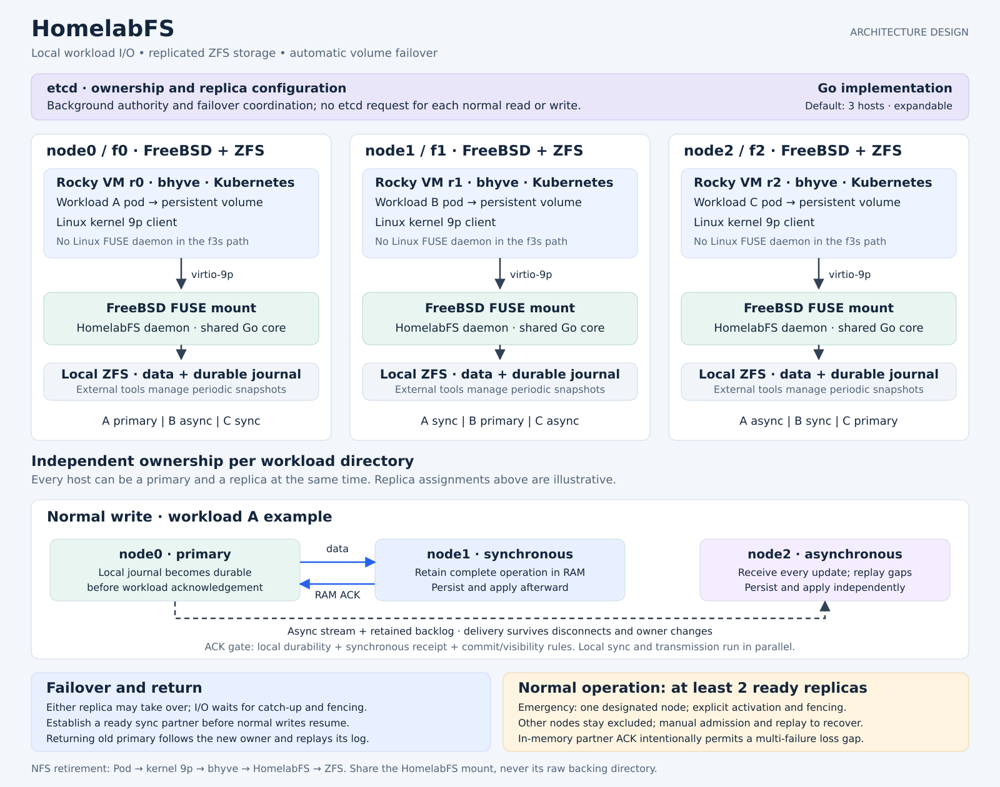](showcase/homelabfs/image-1.svg)  

HomelabFS is a planned distributed filesystem for a personal homelab ("f3s"), designed to replace NFS with highly available, POSIX-style file storage that Kubernetes workloads require. It is currently in the concept phase—containing architecture notes, design documents, and experimental compatibility probes rather than a working distributed implementation—but the core design is well developed: each workload owns an independent persistent volume, with reads and writes served by a primary node while other nodes hold replicas (different nodes can be primary for different workloads simultaneously). Writes are acknowledged after local journal durability plus an in-memory receipt from a synchronous partner, with a third asynchronous replica receiving operations via replayable backlog—a deliberate durability tradeoff the design documents openly acknowledge.

  

Implementation is built around a Go core running on FreeBSD hosts with local ZFS storage, coordinating ownership via etcd (kept outside the per-operation I/O path) and replicating over an existing WireGuard mesh. Kubernetes pods running in Rocky Linux bhyve VMs access volumes through a 9p path: guest kernel 9p client → virtio-9p → a HomelabFS FUSE mount on the FreeBSD host → local ZFS plus peer replication. Failover promotes a replica when a pod moves, but blocks I/O until fencing, authoritative recovery, and synchronous-partner readiness complete, with an explicit emergency mode for single-node operation. The access-path components (native FUSE/ZFS on FreeBSD guests and the Rocky 9p/FUSE stack) have passed proof-of-concept validation, but the distributed protocol, failover, and fault-injection testing remain to be built.

[View on GitHub](https://github.com/snonux/homelabfs)  

---

### 3. comicredr

* 💻 Languages: Dart (74.8%), Shell (14.2%), Python (4.8%), TOML (2.4%), JSON (1.6%), YAML (0.5%), C++ (0.4%), Make (0.4%), Kotlin (0.3%), CMake (0.3%), XML (0.1%), C (0.1%)
* 📚 Documentation: Markdown (96.6%), Text (3.4%)
* 📊 Commits: 574
* 📈 Lines of Code: 94034
* 📄 Lines of Documentation: 7718
* 🏷️ Tags: 29
* 📅 Development Period: 2026-09-24 to 2026-10-26
* 🏆 Score: 108.7 (combines recent activity, code size, tags, and release status)
* ⚖️ License: Apache-2.0
* 🏷️ Latest Release: v0.9.10 (2026-10-26)

  

ComicRedr is a free, open-source comic reader for Linux laptops and Android phones/tablets, designed for reading comics panel by panel on small screens—reviving the "guided view" experience once offered by Comixology. Unlike cloud-backed readers, it runs entirely on your own machine with no account required, reading the comics you already own in CBZ, CBT, comic EPUB, PDF, and plain image formats. Its two standout modes are guided view, which steps through a page one panel at a time, and balloon mode, which zooms through speech balloons individually. Beyond that, it offers a full library experience (covers, series, collections, search, bookmarks with notes, and reading history), single-page and spread viewing, a night filter, margin trimming, and cleanup for yellowed old scans.

  

The implementation centers on a small built-in detector model that runs locally on your CPU to identify panels and balloons—no cloud AI involved. For comics where automated detection struggles (slanted or borderless frames), it can alternatively delegate to your coding agent: Claude Code or Codex follow an `AGENTS.md` file to pre-compute panel data saved alongside each comic. Your exact reading position (page, panel, and zoom) syncs across devices either bundled with the file or through your own S3-compatible server such as a self-hosted Garage instance. The app is keyboard-first with an optional vi layer, fully remappable keys and touch zones, and is distributed as a build-from-source Linux app plus an Android APK via a custom F-Droid repository.

[View on GitHub](https://github.com/snonux/comicredr)  

---

### 4. snonux.foo

* 💻 Languages: JavaScript (67.7%), JSON (15.6%), Go (8.4%), CSS (6.5%), Python (1.8%)
* 📚 Documentation: Markdown (51.2%), Text (48.8%)
* 📊 Commits: 350
* 📈 Lines of Code: 73445
* 📄 Lines of Documentation: 2862
* 🏷️ Tags: 42
* 📅 Development Period: 2026-04-06 to 2026-10-21
* 🏆 Score: 95.1 (combines recent activity, code size, tags, and release status)
* ⚖️ License: MIT
* 🏷️ Latest Release: v0.21.0 (2026-10-21)

snonux is a Go-based static microblog engine that powers snonux.foo, built around a simple "drop-box" publishing workflow: you place files into an input directory and the tool consumes them into a fully static site. It supports multiple post formats out of the box — plain text, GitHub Flavored Markdown (with local images automatically copied and their paths rewritten), standalone images (downscaled beyond 1024px and re-encoded as JPEG at 80% quality), and MP3 audio rendered with an embedded HTML5 player. Each run produces paginated HTML pages, an Atom feed of the latest 42 entries, per-post directories containing metadata JSON and assets, and processed source files are removed from the inbox afterward.

The implementation is a single Go binary with all templates, themes, fonts, and games embedded at build time via Go's embed mechanism. It ships with 20+ visual themes featuring WebGL backgrounds, each bundling self-hosted fonts (making zero runtime requests to font CDNs) and its own three-level arcade game built on a shared JavaScript engine with sound, touch controls, and cookie-based progress saving. Deployment is a single flag away via rsync (LAN with WireGuard fallback), and quality is enforced through mage-driven testing: headless Chrome E2E smoke tests for desktop and emulated phones, bot-driven campaign playthroughs, and CPU/frame-rate profiling for the games.

[View on GitHub](https://github.com/snonux/snonux.foo)  

---

### 5. gunrunners

* 💻 Languages: C++ (92.3%), Python (4.3%), C (1.9%), Shell (0.4%), HTML (0.3%), CMake (0.2%), CSS (0.2%), JavaScript (0.2%)
* 📚 Documentation: Text (84.9%), Markdown (15.1%)
* 📊 Commits: 355
* 📈 Lines of Code: 290244
* 📄 Lines of Documentation: 13954
* 🏷️ Tags: 26
* 📅 Development Period: 2026-10-08 to 2026-10-23
* 🏆 Score: 84.6 (combines recent activity, code size, tags, and release status)
* ⚖️ License: GPL-2.0
* 🏷️ Latest Release: v0.11.7 (2026-10-23)

  

**Gunrunners** is a free, open-source (GPLv2+) jump-and-shoot platformer that plays like Duke Nukem II, playable in the browser, on Linux, and on Android. It offers a substantial campaign of 49 levels across seven episodes (plus two vehicle-focused EXTRAS levels), where every level has its own unique mechanic twist, a collectible prototype weapon, its own synthesized soundtrack, a bonus level hidden behind TV static, and a briefing cutscene. Players choose from six distinct runners (or build their own with a full in-game runner editor), can swap runners mid-level, drive six vehicles (tank, helicopter, hoverbike, submarine, spaceship, mech), and hunt secrets on top of the core G-U-N letters and gem-collecting goals. Accessibility is well covered with configurable controls, touch schemes, gamepad support, difficulty modes, and optional assists.

  

Architecturally, the game is a single C++ codebase (built with CMake) that compiles to three targets from one source tree: a native Linux build using SDL2, Cairo, and libcurl; an Android APK distributed via F-Droid; and a WebAssembly browser build via Emscripten, which is always kept in sync with the latest release. Rendering uses HD vector graphics drawn with Cairo — smooth neon art with parallax rather than pixel sprites — while the movement physics are a frame-accurate port of Duke Nukem II's engine (via RigelEngine), preserving the original jump arcs, ladders, and hang bars. Notably, all audio is generated at runtime by the game itself: every sound effect and every note of music is synthesized, with no sample files. Features like exploration maps, save slots, cloud saves (S3-compatible), cheats with consequences, and a secret playable author character round out a self-contained, dependency-light package.

[View on GitHub](https://github.com/snonux/gunrunners)  

---

### 6. dotfiles

* 💻 Languages: Shell (80.4%), Python (6.5%), Go (6.0%), Config (2.0%), TOML (1.6%), CSS (1.4%), Ruby (0.8%), JSON (0.7%), YAML (0.5%)
* 📚 Documentation: Markdown (100.0%)
* 📊 Commits: 1552
* 📈 Lines of Code: 22883
* 📄 Lines of Documentation: 13741
* 🏷️ Tags: 2
* 📅 Development Period: 2023-07-30 to 2026-10-26
* 🏆 Score: 80.9 (combines recent activity, code size, tags, and release status)
* ⚖️ License: No license found
* 🧪 Status: Experimental (no releases yet)

This is a personal dotfiles repository for a multi-machine Linux/macOS/FreeBSD fleet, covering shell configurations (bash, fish, zsh), editor and terminal tooling (helix, tmux, ghostty), a Wayland desktop (sway, waybar), git and task management configs, plus a collection of ~30 utility scripts (AI editor integration, backups, video stabilization, Immich sync, etc.). It also holds reusable agent prompts and skills that get symlinked into various AI coding tools (Cursor, Claude Code, Codex, OpenCode). Deployment is handled by gonf, a companion tool invoked via `./gonf.sh`, which can apply tasks locally or stream a plan over SSH to remote hosts, with dry-run and profile-override support.

The architecture is task-based: each `home_*`, `pkg_*`, and `system_*` task is a gonf recipe guarded by OS profile and hostname checks (e.g., `pkg_fedora` runs only on Fedora, `system_wireguard` only on specific hosts). Guards are serializable and evaluated on the destination, so pushed plans adapt to the target machine automatically. Unprivileged tasks mostly symlink or copy files into `$HOME`, while privileged tasks handle system-level state like package installation, WireGuard units, `/etc/hosts` blocks, and login shells — all idempotently and without touching unrelated host configuration. Layout is one directory per tool, with dated notes and runbooks kept alongside the configs.

[View on GitHub](https://github.com/snonux/dotfiles)  

---

### 7. player

* 💻 Languages: Dart (44.1%), Go (39.5%), JavaScript (7.5%), TypeScript (5.4%), CSS (1.3%), Python (0.5%), HTML (0.5%), Kotlin (0.4%), YAML (0.2%), Shell (0.2%), JSON (0.2%)
* 📚 Documentation: Markdown (99.9%), Text (0.1%)
* 📊 Commits: 506
* 📈 Lines of Code: 156193
* 📄 Lines of Documentation: 9659
* 🏷️ Tags: 24
* 📅 Development Period: 2026-04-28 to 2026-10-21
* 🏆 Score: 64.4 (combines recent activity, code size, tags, and release status)
* ⚖️ License: MIT
* 🏷️ Latest Release: v0.10.1 (2026-10-21)

[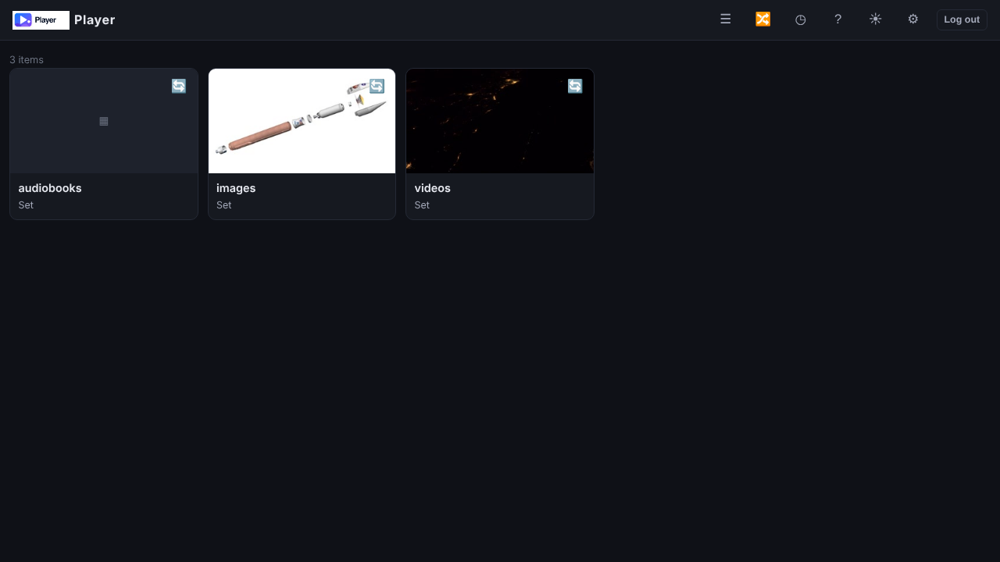](showcase/player/image-1.png)  

Player is a self-hosted media server for organizing and enjoying personal media collections—such as image sets and audiobooks—through either a browser-based web UI or a companion Android app. Because it's self-hosted, users keep full control over their media files, accounts, and playback on their own infrastructure instead of depending on a third-party cloud service. The server exposes a REST API for library browsing and playback, supports user accounts, and uses ffmpeg/ffprobe on the host for media processing, with deployment options including Docker and Kubernetes.

  

The project is structured as a monorepo with two components: a Go server (`player-server/`) that owns the web UI, media library, playback APIs, accounts, and storage, and a Flutter Android client (`player-android/`) that consumes the same REST API documented in the server's docs. Builds use Mage on the server side and standard Flutter tooling for Android. Releases are tightly coupled across platforms—server and Android share a single version tag, with a GitHub Actions workflow that verifies version parity and publishes signed APKs (targeting F-Droid) alongside a Linux server bundle containing the binary and web UI.

[View on GitHub](https://github.com/snonux/player)  

---

### 8. turbolaunch

* 💻 Languages: Dart (74.6%), Shell (12.7%), Kotlin (9.6%), YAML (1.7%), XML (1.5%)
* 📚 Documentation: Markdown (93.0%), Text (7.0%)
* 📊 Commits: 128
* 📈 Lines of Code: 12430
* 📄 Lines of Documentation: 1005
* 🏷️ Tags: 15
* 📅 Development Period: 2026-10-08 to 2026-10-21
* 🏆 Score: 43.6 (combines recent activity, code size, tags, and release status)
* ⚖️ License: MIT
* 🏷️ Latest Release: v0.3.12 (2026-10-20)

  

TurboLaunch is a small, privacy-focused home screen launcher for Android, built with GrapheneOS users in mind. Its core interaction is search-first: press Home, type two or three letters, hit Enter, and the app opens. Search uses fzf-style fuzzy matching—letters in order with gaps allowed, so "orgm" finds Organic Maps—with matched letters highlighted, and app shortcuts like "New note" appear as results too. Beyond search, the grid adapts to behavior: launch counts are tracked over a configurable window (30 days by default), and the most-used apps are sorted toward the bottom near the thumb, though icons can optionally be pinned in place. It also includes a quick launch bar for essentials like the camera, app pairs for split-screen use, and a stats screen that surfaces rarely launched apps as uninstall candidates.

  

Privacy and multi-device consistency drive the design: there's no tracking and no Google Play Services, and the only network use is optional sync of launch data to the user's own S3-compatible bucket (AWS, MinIO, or Garage), so the same grid follows you across phones—with apps missing from a device shown as faded "ghost" cells. Additional features include customizable swipes and drawn gestures for actions like locking the phone, toggling the flashlight, or opening apps, plus work profile support, wallpaper/grid/font settings, and full JSON export/import for migrating to a new device. Architecturally, it's a native Android launcher that replaces the home screen, handling launch-count tracking, fuzzy search, and client-side S3 sync entirely on-device so all data stays under the user's control. It's MIT-licensed and distributed via a personal F-Droid repository or direct APKs.

[View on GitHub](https://github.com/snonux/turbolaunch)  

---

### 9. turbomon

* 💻 Languages: Dart (82.8%), Kotlin (13.1%), XML (2.9%), YAML (0.7%), Python (0.4%), JavaScript (0.1%)
* 📚 Documentation: Markdown (87.6%), Text (12.4%)
* 📊 Commits: 27
* 📈 Lines of Code: 13184
* 📄 Lines of Documentation: 1376
* 🏷️ Tags: 3
* 📅 Development Period: 2026-10-10 to 2026-10-21
* 🏆 Score: 36.8 (combines recent activity, code size, tags, and release status)
* ⚖️ License: MIT
* 🏷️ Latest Release: v0.2.1 (2026-10-15)

  

**TurboMon** is a privacy-first system monitor for Android that provides a `top`-style view of CPU, RAM, and GPU alongside live, colour-coded graphs of battery status, temperatures, storage, disk I/O, and network speeds. It also includes a Wi-Fi channel analyser and a Bluetooth scanner for diagnosing radio-related issues. Its standout feature is the **snapshot**: a Markdown-formatted report capturing the phone's current state, designed to be handed directly to an LLM to identify what's draining the battery or causing slowdowns and to suggest fixes. Notably, the app has no internet permission at all—all data stays on the device, with the user explicitly choosing when to share a snapshot.

  

The project follows a layered architecture. Core functionality works out of the box using standard Android APIs, while optional Shizuku or root integration unlocks deeper instrumentation such as accurate per-process CPU percentages, the full process list, and every thermal sensor. The UI is organised into tabs (System, Power, I/O, Wi-Fi channels) with graphs that shift colour as load increases, supplemented by a home-screen widget and a floating overlay for glanceable monitoring. A configurable background scanning system handles periodic data collection with documented behaviour around frequency and lifecycle. Well-organised documentation covers features, permission rationale, the snapshot schema, and build/testing workflows, and the app is distributed through F-Droid under an MIT license.

[View on GitHub](https://github.com/snonux/turbomon)  

---

### 10. turbonotes

* 💻 Languages: Dart (84.4%), Kotlin (10.0%), XML (1.9%), CMake (1.3%), C++ (1.2%), Python (0.5%), YAML (0.4%), C/C++ (0.3%)
* 📚 Documentation: Markdown (95.8%), Text (4.2%)
* 📊 Commits: 23
* 📈 Lines of Code: 18367
* 📄 Lines of Documentation: 1061
* 🏷️ Tags: 8
* 📅 Development Period: 2026-10-07 to 2026-10-21
* 🏆 Score: 35.0 (combines recent activity, code size, tags, and release status)
* ⚖️ License: MIT
* 🏷️ Latest Release: v0.4.0 (2026-10-21)

[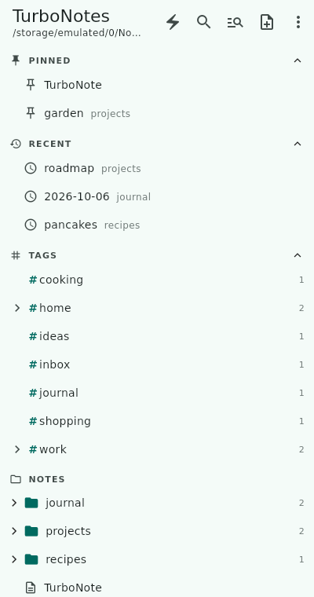](showcase/turbonotes/image-1.png)  

TurboNotes is a lightweight app for browsing and editing a folder of Markdown notes on Android, with an additional Linux desktop build. Each `.md` file in a pointed-at directory—say, one kept in sync with your laptop via Syncthing—is a note one tap away. As the sibling of Quicklog (which captures new notes), TurboNotes focuses on the notes you already have. Because it works on plain files rather than a proprietary store, it avoids lock-in, slots naturally into file-sync workflows, and keeps a privacy-first posture with no telemetry.

  

The app is built around fast navigation and non-destructive editing. A sidebar file tree provides pinned and recent notes plus a tag tree for filtering, backed by a fuzzy finder and typo-tolerant full-text search. The same Markdown text can be edited in a raw editor or a WYSIWYG view that never rewrites the note and renders inline images added from the gallery, camera, or clipboard. Implementation-wise, it leans heavily on platform integration: files opened from other apps (such as a File Browser server) save back to where they came from, notes can be shared out as text, PDF, or image, and quick capture works from the home-screen widget or share sheet without opening the app. Autosave never silently overwrites changes made on disk while you edit, and an optional, off-by-default S3 sync merges independent edits while keeping conflict copies.

[View on GitHub](https://github.com/snonux/turbonotes)  

---

### 11. quicklog

* 💻 Languages: Dart (89.7%), Kotlin (7.3%), CMake (0.9%), YAML (0.8%), C++ (0.6%), XML (0.6%), C/C++ (0.1%)
* 📚 Documentation: Markdown (81.0%), Text (19.0%)
* 📊 Commits: 178
* 📈 Lines of Code: 26865
* 📄 Lines of Documentation: 1381
* 🏷️ Tags: 26
* 📅 Development Period: 2024-01-20 to 2026-10-21
* 🏆 Score: 30.4 (combines recent activity, code size, tags, and release status)
* ⚖️ License: MIT
* 🏷️ Latest Release: v0.5.4 (2026-10-16)

  

Quicklog is a lightweight Flutter app for capturing thoughts as timestamped Markdown notes, primarily on Android with Linux desktop support for development. It's a rewrite of an earlier Go/Fyne app called Quicklogger, with the same core workflow: type a quick note, hit **Log text**, and it's saved as `ql-YYMMDD-HHMMSS.md` in a configured directory — typically one synced to your computer via Syncthing. The app emphasizes privacy and reliability: it collects no telemetry, defaults to local-only storage, keeps S3 credentials on-device, and guarantees notes are never lost (if an S3 write fails, the note is immediately saved locally and S3 is skipped for an hour with a manual retry option). Beyond the single-screen editor, it includes an entry browser with edit and delete support, Android share-intent integration ("Share to Quicklog"), and JSON-based settings backup/restore for surviving uninstalls or migrating devices.

[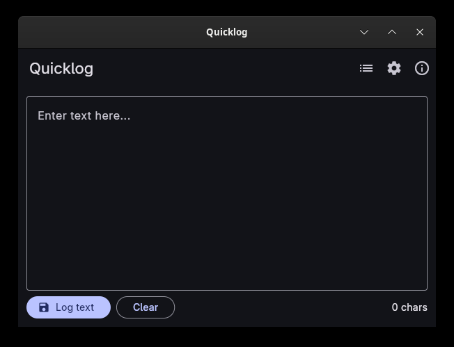](showcase/quicklog/image-2.png)  

Architecturally, Quicklog supports three storage modes — **Local only** (default), **S3 only**, and **Local + S3** dual write — targeting path-style S3-compatible endpoints like Garage. The S3-only mode includes elaborate recovery logic: automatic outage recovery that moves local notes into the bucket, on-device upload receipts to avoid redundant transfers, conflict handling that preserves both versions when texts differ, and optional scheduled background retries on Android. A companion Dart CLI (`bin/quicklog_drain.dart`) runs laptop-side, streaming notes from the bucket into taskwarrior via a JSON-lines protocol with ack-based deletion, so failed imports are retried rather than lost. The project is built with Flutter's standard toolchain (no NDK or containerized cross-compilation needed, since Dart AOT emits ARM code directly from x86_64), versions everything through `pubspec.yaml`, and is distributed via F-Droid, which builds reproducibly from source using a pinned Flutter SDK version.

[View on GitHub](https://github.com/snonux/quicklog)  

---

### 12. s3tools

* 💻 Languages: Go (99.5%), Docker (0.5%)
* 📚 Documentation: Markdown (100.0%)
* 📊 Commits: 26
* 📈 Lines of Code: 6074
* 📄 Lines of Documentation: 232
* 🏷️ Tags: 5
* 📅 Development Period: 2026-10-07 to 2026-10-21
* 🏆 Score: 28.8 (combines recent activity, code size, tags, and release status)
* ⚖️ License: No license found
* 🏷️ Latest Release: v0.1.4 (2026-10-17)

`s3rm` is a command-line tool, written in Go, for safely deleting selected top-level prefixes (i.e., "folders") from S3-compatible object storage, supporting AWS S3, Ceph RADOS Gateway, and Garage. Its core value is making bulk deletion safe: rather than exposing a bare destructive command, it layers multiple safeguards, including protected prefixes that can't be deleted, exact bucket-name confirmation, a `--dry-run` mode that previews eligible object counts and total bytes without touching data, progress reporting, and post-deletion verification. Because these checks can run non-interactively (e.g., `s3rm --prefix=old-exports/ --confirm-bucket=photos`), the tool works equally well in a terminal or embedded in containers and automated pipelines.

Architecturally, the project follows a conventional Go CLI layout with configuration resolved from a TOML file (`~/.config/s3rm/config.toml`) or environment variables (`S3RM_BUCKET`, `S3RM_REGION`, and standard credentials). Development is driven by Mage task targets—`mage build`, `mage test`, and `mage check`—where the check target enforces code quality via `go vet`, race-detector-enabled tests, `gofmt` formatting compliance, and static error-handling analysis with `errcheck`. The documentation also references Docker support for containerized usage, consistent with its dual interactive/automation design.

[View on GitHub](https://github.com/snonux/s3tools)  

---

### 13. gonf

* 💻 Languages: Go (99.6%), Config (0.3%)
* 📚 Documentation: Markdown (99.9%)
* 📊 Commits: 673
* 📈 Lines of Code: 153774
* 📄 Lines of Documentation: 17209
* 🏷️ Tags: 64
* 📅 Development Period: 2026-07-04 to 2026-10-21
* 🏆 Score: 28.6 (combines recent activity, code size, tags, and release status)
* ⚖️ License: No license found
* 🏷️ Latest Release: v0.25.2 (2026-10-12)

  

gonf is a lightweight, "keep it simple" configuration management tool for personal use, targeting Linux, OpenBSD, FreeBSD, and NetBSD hosts. Rather than YAML or a custom DSL, recipes are written in plain Go: your own program embeds the gonf API, registers named tasks, and each task declaratively states its desired resources—files (with content, mode), packages, services, users, cron jobs, and so on. When run, gonf "converges" hosts toward that declared state, changing only what has drifted since the last run—echoing its beaver mascot Gonfy rebuilding a lodge to plan. This makes it useful for managing a homelab or small fleet with idempotent, compile-time-checked, reviewable configuration, without heavyweight orchestration tools.

Architecturally, execution is plan-based: registered tasks are recorded into a versioned plan (JSONL, optionally sealed with age encryption for secure transport), which can be previewed with a dry run (`-n`) and applied later on any host that has gonf installed. Remote deployment works over SSH—gonf cross-compiles itself for the target OS/architecture and installs it there—supporting strict cluster previews and parallel fleet pushes. Privilege escalation (sudo/doas) is configured via flags or explicit per-host policies. Notably, the project was built with AI assistance but designed, reviewed, and tested by a human, which the docs emphasize as a trust signal.

[View on GitHub](https://github.com/snonux/gonf)  

---

### 14. ior

* 💻 Languages: Go (90.0%), C (9.3%), C/C++ (0.4%), Shell (0.2%)
* 📚 Documentation: Markdown (63.4%), Text (36.6%)
* 📊 Commits: 2043
* 📈 Lines of Code: 293308
* 📄 Lines of Documentation: 10100
* 🏷️ Tags: 11
* 📅 Development Period: 2024-01-18 to 2026-10-05
* 🏆 Score: 28.4 (combines recent activity, code size, tags, and release status)
* ⚖️ License: No license found
* 🏷️ Latest Release: v1.2.0 (2026-10-05)

  

`ior` (I/O Riot NG) is a Linux syscall tracing and observability tool that uses eBPF to capture what processes are actually doing — syscall timings, invocation counts, and file paths — and presents the results in an interactive terminal dashboard with a live flamegraph. It's the Go/C/eBPF successor to the original SystemTap-based I/O Riot, and it's useful both for diagnosing filesystem and syscall behavior in real time and for recording activity for later analysis. After launching, you pick a process (or trace all of them) from a PID picker and explore the data across tabbed views, adjusting what's traced on the fly.

[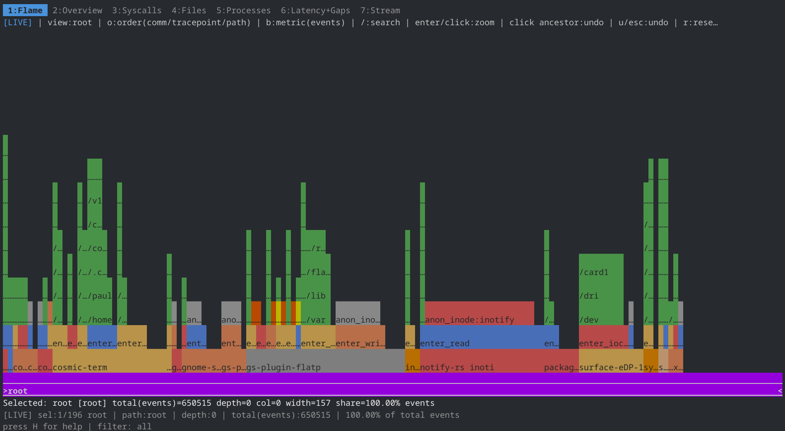](showcase/ior/image-2.png)  

Implementation-wise, it targets Linux/amd64 on kernels with BTF and follows an eBPF tracing architecture: a CO-RE (compile-once, run-everywhere) BPF object is embedded into a statically linked binary, so it can be built once (via Docker or Mage) and copied to other BTF-capable hosts, where missing tracepoints are simply skipped. Tracing is organized into "families" — filesystem syscalls by default, with optional groups like Time and Polling — plus per-syscall allow/block lists, sampling, and runtime attach/detach through a probes dialog. Beyond the TUI, it records snapshots and sessions to CSV or Parquet, or to a compressed `.ior.zst` flamegraph format that interoperates with standard FlameGraph tooling (`ior collapsed` pipes into `flamegraph.pl`). Headless modes support non-interactive collection and stop automatically when the traced process exits.

[View on GitHub](https://github.com/snonux/ior)  

---

### 15. bgtutor-mcp

* 💻 Languages: Go (89.6%), JSON (9.0%), Docker (0.7%), YAML (0.7%)
* 📚 Documentation: Markdown (98.5%), Text (1.5%)
* 📊 Commits: 5
* 📈 Lines of Code: 3655
* 📄 Lines of Documentation: 616
* 🏷️ Tags: 1
* 📅 Development Period: 2026-09-30 to 2026-10-21
* 🏆 Score: 27.2 (combines recent activity, code size, tags, and release status)
* ⚖️ License: MIT
* 🏷️ Latest Release: v0.30.0 (2026-10-03)

bgtutor-mcp is a standalone MCP server, written in Go, that turns English podcasts into voice-guided Bulgarian listening lessons. Instead of building a custom voice app, it lets an off-the-shelf voice AI (Claude or ChatGPT voice mode) act as the tutor: the AI pulls prepared episode content paragraph by paragraph over MCP, translates it into Bulgarian live, reads it aloud, and teaches grammar and vocabulary along the way. Learners benefit from a persistent vocabulary notebook (saving words, phrases, and grammar rules across sessions) and an alternative citizenship mode that repurposes the same infrastructure for Bulgarian citizenship exam prep, with 36 grammar chapters, interview rehearsal, and mock exams with grading.

The architecture separates offline preparation from runtime serving. During preparation, a coding agent (Claude Code, Codex, etc.) follows PREPARE.md to split a transcript into paragraphs, translate them, and write teaching notes into per-episode folders, which the CLI then validates and publishes. At runtime, `bgtutor serve` exposes a stateless Streamable HTTP MCP endpoint with tools like `list_episodes`, `get_paragraph` (English text, reference Bulgarian, grammar/vocab notes), and vocabulary management; errors return human-readable messages the AI can speak, and session instructions are sent on initialize. Bearer-token auth secures non-localhost deployments, learner data persists as JSON files, and the static binary ships as a distroless Docker container, with an HTTPS tunnel planned for connecting public voice-AI clients.

[View on GitHub](https://github.com/snonux/bgtutor-mcp)  

---

### 16. hexai

* 💻 Languages: Go (99.3%), Python (0.7%)
* 📚 Documentation: Markdown (100.0%)
* 📊 Commits: 613
* 📈 Lines of Code: 53278
* 📄 Lines of Documentation: 2790
* 🏷️ Tags: 125
* 📅 Development Period: 2025-08-01 to 2026-10-24
* 🏆 Score: 23.7 (combines recent activity, code size, tags, and release status)
* ⚖️ License: No license found
* 🏷️ Latest Release: v0.44.4 (2026-10-24)

  

**Hexai** brings AI-assisted coding to the Helix editor, which lacks built-in AI features. Through an LSP integration, it provides AI code completions, code actions (rewriting, documenting, fixing diagnostics, generating Go tests), and inline chat directly in the editor—letting you complete code with one model or compare suggestions from several, ask questions about the current file, and apply code changes from natural-language instructions. The project also ships companion tools: `hexai`, a command-line LLM client with response caching, `hexai-tmux-action`, a tmux popup for running custom AI actions outside the editor, and `ask`, a Taskwarrior-based CLI for managing project tasks with stable task aliases.

  

The project is written in Go and distributed as multiple binaries—most notably `hexai-lsp-server`, which implements the Language Server Protocol so that any LSP-capable editor can theoretically integrate with it, though Helix is the tested and documented integration. AI provider access is abstracted behind a common interface supporting Ollama (local or cloud, the default), OpenAI, OpenRouter, and Anthropic, so users can mix local and hosted models or compare outputs across providers. The guide in `docs/` walks through Helix setup, provider configuration, and each feature with animated terminal demos.

[View on GitHub](https://github.com/snonux/hexai)  

---

### 17. f3sctl

* 💻 Languages: Go (98.9%), JavaScript (1.0%), YAML (0.2%)
* 📚 Documentation: Markdown (100.0%)
* 📊 Commits: 224
* 📈 Lines of Code: 37770
* 📄 Lines of Documentation: 1662
* 🏷️ Tags: 29
* 📅 Development Period: 2026-08-08 to 2026-10-23
* 🏆 Score: 22.0 (combines recent activity, code size, tags, and release status)
* ⚖️ License: No license found
* 🏷️ Latest Release: v0.11.3 (2026-09-29)

f3sctl replaces a bare Wake-on-LAN script with a coordinated power manager for a rack of FreeBSD bhyve hosts (f0–f3): it powers hosts on and off, reports status, drives the rack-fan plug and f-host mains AC independently, cold-cycles the whole rack (all hosts off, AC cut and restored to drain supplies), and mutes the Gogios monitor around deliberate downtime. Its value lies in the ordering and guards: a shutdown unmounts NFS and cleanly exports the removable zusb backup pool before anything irreversible happens, stops CARP failover daemons so a host can't be wedged seconds before power-off, stops guests in parallel with a bounded timeout, confirms each host actually went dark via ICMP (a host left powered-on-but-off-network can't be woken again remotely), and only then turns the fans off — while fan/AC switches refuse to act while any power job is running locally or on a peer node, magic packets are re-sent to hosts that ignore them, and monitoring un-mutes even when a wake fails, so real outages page instead of hiding behind the mute.

It's a single Go binary with three runtime modes: a CLI, a CGI handler under bozohttpd on two Raspberry Pi nodes behind relayd load balancing, and an SSH-invoked agent on the hosts themselves, gated by a ForceCommand-pinned key, a five-verb allowlist, and exact-argv doas rules. All rack-wide jobs route through the API because only the Pis hold SSH credentials that can reach the hosts — that's what makes the identical command work from a laptop — and the Pis themselves are never powered off, since they're the way back on. The API is self-describing hypermedia (Siren) with constant-time, multi-key authentication re-read per request, and it advertises actions only when they're currently possible, so clients encode no rules of their own. A peer job-state check keeps the load-balanced pair from starting conflicting jobs (responses carry an `X-F3sctl-Node` header naming the serving node), and configuration is compiled-in defaults overlaid by a JSON file covering path lists, the overridable host inventory, and peer addresses, making re-topology an edit rather than a rebuild. Because CLI verbs and HTTP routes come from one shared registry, any new subsystem gains both at once and the API can never disagree with the CLI about what an action means.

[View on GitHub](https://github.com/snonux/f3sctl)  

---

### 18. ggaze

* 💻 Languages: C (89.9%), C/C++ (8.7%), Python (0.9%), Shell (0.3%), XML (0.2%)
* 📚 Documentation: Markdown (97.3%), Text (2.7%)
* 📊 Commits: 376
* 📈 Lines of Code: 81191
* 📄 Lines of Documentation: 5096
* 🏷️ Tags: 5
* 📅 Development Period: 2026-07-12 to 2026-10-15
* 🏆 Score: 20.9 (combines recent activity, code size, tags, and release status)
* ⚖️ License: GPL-3.0
* 🏷️ Latest Release: v0.2.1 (2026-10-15)

[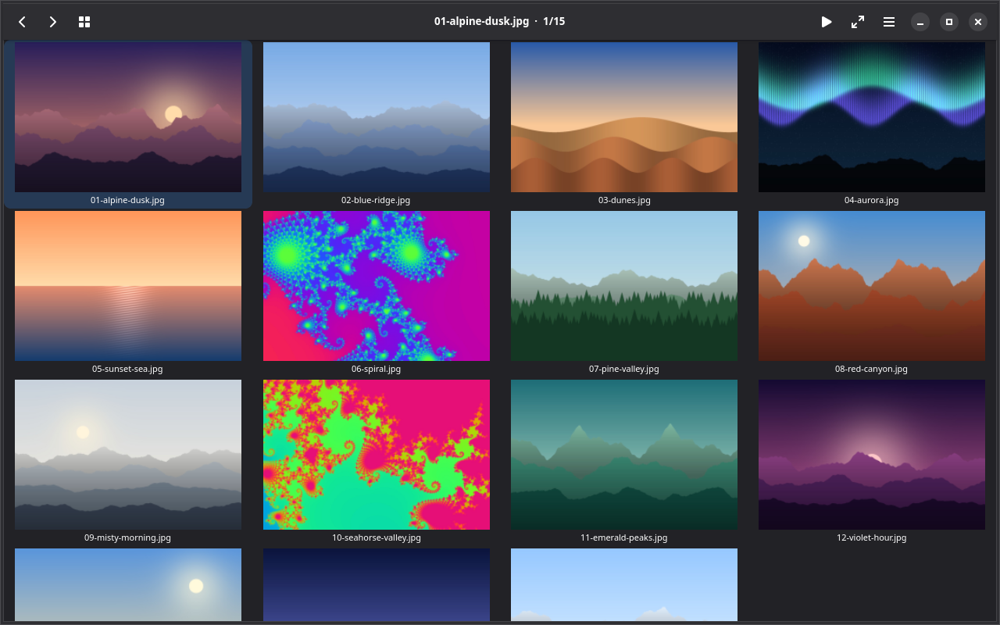](showcase/ggaze/image-1.png)  

ggaze is a small, fast, keyboard-first image viewer for Fedora Linux aimed at one specific job: quickly previewing a folder of photos downloaded from a camera, culling the rejects, and moving on. It follows the KISS philosophy of tools like feh, nsxiv, and qiv — no photo library, database, or sidecar files — while offering a GNOME-native interface (header bar, thumbnail grid, full-window viewer) reminiscent of gthumb. A folder opens as a thumbnail grid; Enter drops into the large view for flipping through the shoot. Culling is the centerpiece: multi-select and mark/range-mark, trash-to-`.Trash` with batch undo, permanent delete, move-to-destination popups, handoff to external programs, shell script execution, and clipboard copy. Everyday viewing is also covered — zoom, pan, fullscreen, slideshow, an EXIF + RGB histogram info overlay, animated GIF/WebP playback, and touchscreen gestures (pinch to zoom, swipe to navigate). Every action has both a vi-style key and a traditional one, with `?` showing a live shortcut table.

[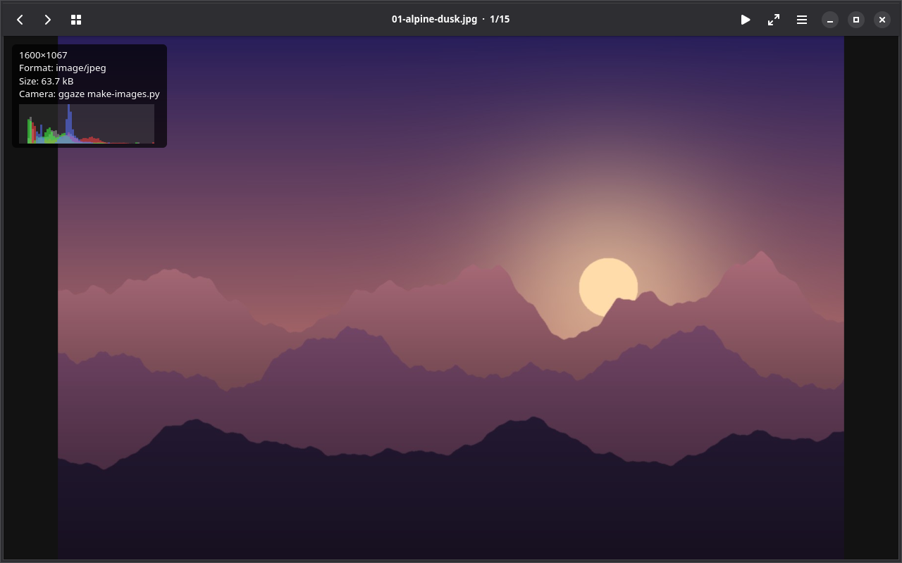](showcase/ggaze/image-2.png)  

It's written in plain C on GTK4 and libadwaita, built with Meson/ninja, and organized into documented modules. Decoding is GdkPixbuf-based, with optional backends compiled in when their development libraries are present: GEGL powers a non-destructive edit panel (layered strength-adjustable presets, crop, straighten, 90° rotations — the original file is never modified; edits compose into a saved copy), while JPEG XL, AVIF, HEIF, and libjpeg extend format support. A minimal pixbuf-only build is explicitly supported and has its own CI lane. Engineering rigor is evident in the unit/integration test suites with an ≥80% coverage target on plain-C modules, clang-format enforcement, automated Xvfb-based screenshots, GSettings-backed preferences, and an install script that places the binary, desktop entry, and icon under `~/.local`.

[View on GitHub](https://github.com/snonux/ggaze)  

---

### 19. comicredr-training-assets

* 💻 Languages: Python (52.1%), JSON (47.9%)
* 📚 Documentation: Markdown (100.0%)
* 📊 Commits: 5
* 📈 Lines of Code: 2345
* 📄 Lines of Documentation: 682
* 🏷️ Tags: 0
* 📅 Development Period: 2026-10-10 to 2026-10-10
* 🏆 Score: 19.5 (combines recent activity, code size, tags, and release status)
* ⚖️ License: No license found
* 🧪 Status: Experimental (no releases yet)

This repository provides supplementary training data and tooling for the panel detector of ComicRedr (a comic reader), complementing — not replacing — that project's own training recipe. Its centerpiece is `moredata/`: 1,123 synthetic comic pages (organized as 141 "books") derived from a private collection of 180 books and 13,239 pages. Each fake page preserves a real page's exact layout — the original gutter color and frame-border pixels are kept — while the art inside every frame is replaced with procedurally generated stand-ins: flat color regions derived by k-means from the original panel in the same proportions, plus ink lines, pen strokes, hatching, halftone dots and speed lines. No balloon-like shapes are drawn, deliberately, so the detector won't learn to treat balloons as background. Every page ships with exact axis-aligned frame labels (the box of the painted frame, not a detection) in ComicRedr's labelkit JSON format, and `index.tsv` records each page's layout, frame shapes, slant, gutter type and how the shipped model fared. The dataset is deliberately skewed toward the model's weak spots: the README's benchmark tables show the shipped model is strong on plain grids (~97% recall at IoU 0.5) but weak on polygons, touching panels, slanted frames and single-frame pages, so `moredata/` includes every readable page with a non-rectangular frame plus only a small per-book sample of plain ones.

Implementation-wise, `border_pages.py` scans PDFs, CBZ/ZIP files and image folders page by page (cross-checked against the shipped ONNX model), while `borders.py` extracts frames via gutter-color segmentation, morphological opening to drop lettering and bleed-out art, and rule-based splitting of touching panels; frames are classified as rect, slanted, polygon, rounded, round or notched, and ambiguous pages are skipped rather than guessed. Generation is seeded and reproducible, and the output plugs directly into ComicRedr's existing `spike/train.py` / `make train-model` pipeline with a tenth held out for validation. Notably, the README is candid about results: training on the fake-art pages actually hurt performance on modern pages (the model learned panel boundaries from the fake colors, joining real panels across thin gutters), so a companion script, `real_art.py`, re-renders the same layouts with real art from ComicRedr's clean training pages — that variant (`moredata-art/`) is the recommended one — though no run so far beat the shipped model, making the data as much a diagnostic asset as a training boost. A licensing caveat applies: because the layouts come from books outside ComicRedr's public-domain/CC-licensed list, models trained on this data are for private use only.

[View on GitHub](https://github.com/snonux/comicredr-training-assets)  

---

### 20. foo.zone

* 💻 Languages: XML (98.3%), Shell (1.4%), Go (0.3%)
* 📚 Documentation: Text (86.5%), Markdown (13.5%)
* 📊 Commits: 1955
* 📈 Lines of Code: 20579
* 📄 Lines of Documentation: 178
* 🏷️ Tags: 0
* 📅 Development Period: 2021-04-29 to 2026-10-20
* 🏆 Score: 15.7 (combines recent activity, code size, tags, and release status)
* ⚖️ License: No license found
* 🧪 Status: Experimental (no releases yet)

This repository hosts the static content for **foo.zone**, a personal site published in parallel on two protocols: the Gemini protocol (`gemini://foo.zone`) and the regular web (`https://foo.zone`). Gemini is a lightweight, privacy-focused alternative to HTTP/HTML, so maintaining both formats lets the author's writing reach readers across both ecosystems without duplicating effort. The key organizational feature is that each output format lives in its own dedicated Git branch — `content-gemtext` for Gemtext, `content-html` for HTML, `content-md` for Markdown, and so on — rather than being mixed into a single directory tree.

In terms of architecture, the site is built with [gemtexter](https://codeberg.org/snonux/gemtexter), a static content generator written by the same author (also hosted on Codeberg). Gemtexter treats Gemtext — the plain-text markup format used by Gemini capsules — as the canonical source, from which it derives the other formats like HTML and Markdown. This branch-per-format approach keeps the generated artifacts cleanly separated while making it easy to publish identical content as both a Gemini capsule and a conventional website.

[View on GitHub](https://github.com/snonux/foo.zone)  

---

### 21. bgtutor-assets

* 💻 Languages: JSON (80.3%), Python (19.7%)
* 📚 Documentation: Markdown (100.0%)
* 📊 Commits: 11
* 📈 Lines of Code: 10660
* 📄 Lines of Documentation: 4038
* 🏷️ Tags: 0
* 📅 Development Period: 2026-09-25 to 2026-10-03
* 🏆 Score: 14.3 (combines recent activity, code size, tags, and release status)
* ⚖️ License: No license found
* 🧪 Status: Experimental (no releases yet)

**bgtutor-assets** is a content repository for the Bulgarian Podcast Tutor, an MCP server (living in the separate `snonux/totalrecall` project) that helps learners study Bulgarian through real podcast material. The repo holds prepared learning episodes — each a folder containing `meta.json` and `paragraphs.json` following a documented format — sourced from English-language podcasts but annotated with Bulgarian notes pitched at specific CEFR levels (e.g., A2 for beginners, B1 for intermediate). Because the tutoring logic lives in the MCP server while the episodes live here, content and application are cleanly separated, making it easy to add new material without touching code. The repo also includes a `citizenship-test/` guide with study lists and practice tests for the Bulgarian language exam required for naturalisation, addressing a more specialized learning need.

Episodes follow a defined production workflow: they are prepared in a `totalrecall` checkout (per its `PREPARE.md` guide), validated and published using the Go CLI (`go run ./cmd/bgtutor validate/publish <id>`), then copied into this repo's `episodes/` directory and committed. Serving is handled separately — a `just upload-episode` recipe in an infrastructure config repo deploys episodes to a host. This pipeline ensures every episode conforms to the format the MCP server expects before it reaches learners, while the separation of assets from the server code keeps the tutoring engine and its curriculum independently versioned.

[View on GitHub](https://github.com/snonux/bgtutor-assets)  

---

### 22. fdroid

* 💻 Languages: YAML (70.2%), Python (28.8%), HTML (1.0%)
* 📚 Documentation: Markdown (100.0%)
* 📊 Commits: 30
* 📈 Lines of Code: 496
* 📄 Lines of Documentation: 815
* 🏷️ Tags: 0
* 📅 Development Period: 2026-09-26 to 2026-10-21
* 🏆 Score: 13.6 (combines recent activity, code size, tags, and release status)
* ⚖️ License: MIT
* 🧪 Status: Experimental (no releases yet)

  

This project is a personal F-Droid repository that distributes the author's Android apps—utilities like TurboNotes (markdown editing), TurboLaunch (search-first launcher), TurboMon (system monitor), RESTForge (hypermedia API browser), and a game—so they can be installed and updated through the F-Droid client instead of sideloading APKs manually. Users add the repo via a one-tap link, QR code, or by entering the GitHub Pages URL and signing fingerprint, after which apps appear and update like any other F-Droid package. Because APKs are served unchanged and keep their original developer signature, an app installed from this repo can also be updated from any other compatible source.

[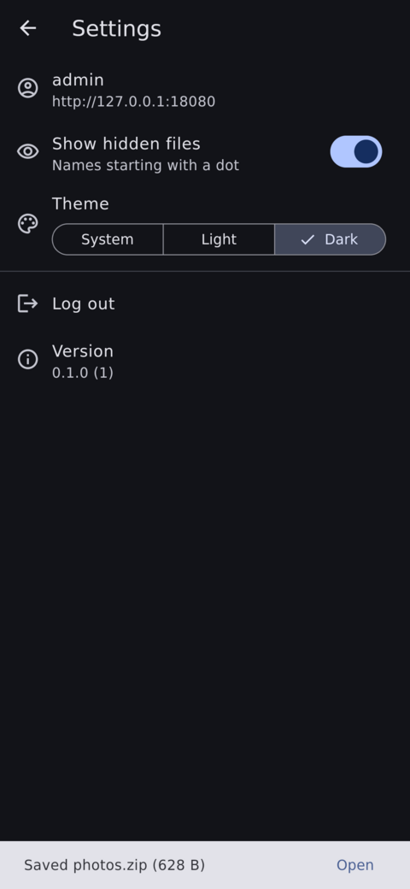](showcase/fdroid/image-2.png)  

The implementation is deliberately build-free: each app's own repository builds and signs its APKs and attaches them to GitHub releases on version tags. Here, a GitHub Actions publish workflow (triggered by pushes, a six-hour schedule, on-demand runs, or `repository_dispatch` events from app repos) uses `scripts/sync_apps.py` to fetch the two newest releases of every app listed in `apps.yml`, along with their fastlane metadata and screenshots. It then runs `fdroid update` to generate and sign the repository index with a signing key stored in Actions secrets, and deploys the result to GitHub Pages—so a new app release reaches phones within six hours with no manual work in this repo.

[View on GitHub](https://github.com/snonux/fdroid)  

---

### 23. timesamurai

* 💻 Languages: Go (98.5%), Shell (1.1%), JSON (0.3%)
* 📚 Documentation: Markdown (100.0%)
* 📊 Commits: 174
* 📈 Lines of Code: 22019
* 📄 Lines of Documentation: 210
* 🏷️ Tags: 17
* 📅 Development Period: 2025-06-25 to 2026-10-10
* 🏆 Score: 12.6 (combines recent activity, code size, tags, and release status)
* ⚖️ License: BSD-2-Clause
* 🏷️ Latest Release: v0.10.3 (2026-10-10)

  

**timesamurai** is a command-line worktime tracker written in Go that records work sessions, breaks, and time off as an append-only JSONL log, with a separate log file per host. It supports the full lifecycle of time accounting: opening and closing work sessions (`work start/stop`), crediting or debiting durations (`add/sub`), logging full days off, and converting accumulated "self-development" buffer hours into work time (`usebuffer`). Entries can be listed, searched, modified, deleted, undone, or bulk-edited in `$EDITOR`, and an accounting report summarizes balances over a date range. The tool also handles data portability with one-shot migration from legacy `db.<host>.json` files, export back to that format, and import of legacy `report.txt` lines, plus generated shell completions.

Architecturally, storage is a simple, durable append-only JSONL store, which keeps the data format transparent and easy to inspect or back up. Presentation is separated from data: all human-facing output is colorized on terminals (with themable roles via the `[colors]` section of `config.toml`), while machine-readable output (`--format json`, `--version`, completions) is never colored, and colors are disabled through `--no-color`, `NO_COLOR`, or non-TTY pipes. At v0.10.3, the project is feature-complete and in maintenance mode—all major subsystems (tracking, reporting, modifications, migration, completions) are implemented and tested, with ongoing work focused on small fixes rather than new features.

[View on GitHub](https://github.com/snonux/timesamurai)  

---

### 24. tasksamurai

* 💻 Languages: Go (99.9%)
* 📚 Documentation: Markdown (100.0%)
* 📊 Commits: 390
* 📈 Lines of Code: 22584
* 📄 Lines of Documentation: 743
* 🏷️ Tags: 43
* 📅 Development Period: 2025-06-19 to 2026-10-11
* 🏆 Score: 12.4 (combines recent activity, code size, tags, and release status)
* ⚖️ License: BSD-2-Clause
* 🏷️ Latest Release: v0.24.2 (2026-10-11)

[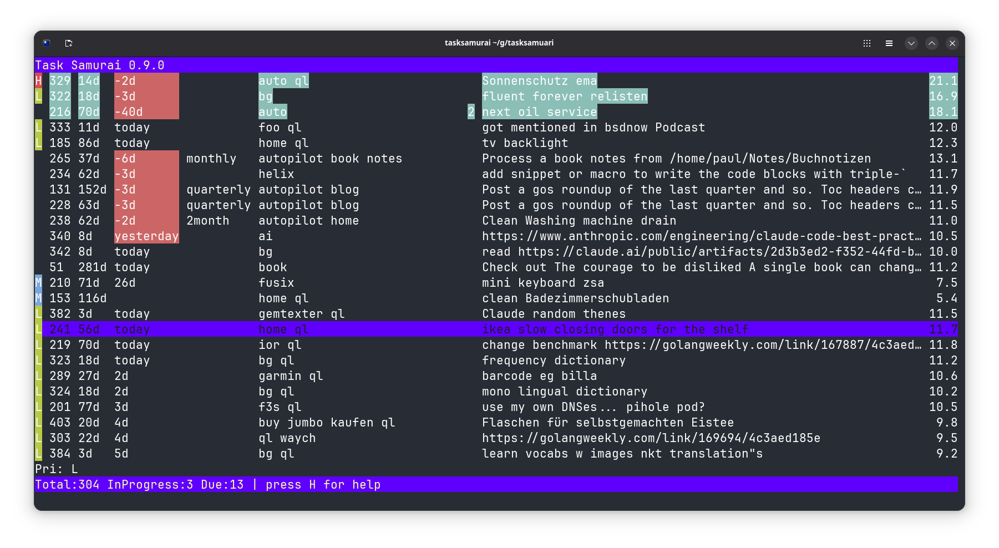](showcase/tasksamurai/image-1.png)  

Task Samurai is a fast, keyboard-driven terminal interface for Taskwarrior, written in Go using the Charmbracelet Bubble Tea framework. It exists to provide a snappier alternative to existing Taskwarrior UIs like the Python-based vit: tasks are displayed in a table, and every operation—adding tasks, completing, annotating, filtering, editing recurrence, browsing details—happens through hotkeys so you never leave the keyboard. For example, pressing `+` prompts for a description and creates a task instantly, while number keys toggle tag filters, and `H` shows the full hotkey reference.

  

Architecturally, it acts as a rich wrapper around the `task` CLI rather than reimplementing Taskwarrior's logic: hotkeys are translated into Taskwarrior commands, and the Bubble Tea table refreshes automatically after each action to stay current. Notable features include an inline command prompt (`:` and `;`) supporting tab completion and popping out into `$EDITOR`, fully configurable hotkey bindings via command-line flags, compact and "ultra" views, configurable auto-refresh intervals, a dimmed completed-tasks window, theming (including a "disco mode" that randomizes themes), smooth scrolling on every screen, and a debugging mode that captures goroutine stacks and profiles via Unix signals to diagnose hangs. It installs with a simple `go install` or via Mage.

[View on GitHub](https://github.com/snonux/tasksamurai)  

---

### 25. restforge

* 💻 Languages: Go (48.0%), Dart (31.5%), JavaScript (14.0%), C (3.1%), C/C++ (1.0%), Python (0.5%), Shell (0.5%), CMake (0.5%), C++ (0.3%), XML (0.3%), Kotlin (0.2%), YAML (0.2%)
* 📚 Documentation: Markdown (99.6%), Text (0.4%)
* 📊 Commits: 124
* 📈 Lines of Code: 52847
* 📄 Lines of Documentation: 3303
* 🏷️ Tags: 9
* 📅 Development Period: 2026-08-08 to 2026-10-21
* 🏆 Score: 11.6 (combines recent activity, code size, tags, and release status)
* ⚖️ License: MIT
* 🏷️ Latest Release: v0.7.0 (2026-09-26)

  

**RESTForge** is a generic client for [Siren](https://github.com/kevinswiber/siren) hypermedia APIs: you point it at a server and it renders whatever that API exposes — properties, sub-entities, links, and actions. From there you can follow links (it fetches them), trigger actions (after a confirmation prompt, then it re-reads the document to show what changed), and it will keep polling until the server reports that long-running work is finished. Its usefulness hinges on one strict rule: the client never constructs a URL and contains no server-specific code, so a single binary or app works unchanged against any Siren-conformant API. That generality is deliberately enforced — `just check` even greps the source for server vocabulary and leaked secrets, treating "a generic client that accidentally knows about one server" as a build-breaking bug.

The repository implements the same browser three times, as sibling projects that intentionally share **no code**: a Pebble watchapp in C plus ES5 JavaScript (architecturally split, with the watch rendering frames and reporting button presses while PebbleKit JS on the phone does networking and orchestration), a Flutter/Dart Android app (which also runs on Linux desktop for development), and a Go CLI (an interactive Bubble Tea TUI plus scriptable `restforge get` / `restforge act` subcommands in one binary). What unifies them is not implementation but contract: all behavioural requirements and invariants are written down once in `docs/DESIGN.md`, which governs all three apps. Each app has its own `Justfile` for development, while a root `Justfile` forwards to them and owns the cross-cutting checks — `just test` runs all three test suites without emulators, and `just check` must print nothing to pass.

[View on GitHub](https://github.com/snonux/restforge)  

---

### 26. gitsyncer

* 💻 Languages: Go (96.5%), Shell (3.4%), JSON (0.2%)
* 📚 Documentation: Markdown (100.0%)
* 📊 Commits: 280
* 📈 Lines of Code: 21476
* 📄 Lines of Documentation: 2500
* 🏷️ Tags: 59
* 📅 Development Period: 2025-06-23 to 2026-10-13
* 🏆 Score: 11.4 (combines recent activity, code size, tags, and release status)
* ⚖️ License: BSD-2-Clause
* 🏷️ Latest Release: v0.21.5 (2026-10-13)

GitSyncer is a command-line tool written in Go that keeps git repositories synchronized across multiple hosting organizations—primarily GitHub and Forgejo (via its Gitea-compatible API), plus optional one-way SSH backup targets such as a home NAS. It's useful for developers who want redundancy and vendor independence: it automatically creates missing repositories and branches, syncs a configurable set of branches (with global and per-repo overrides and regex-based exclusions), and never deletes branches or tags, making it safe to run unattended. It also detects merge conflicts with clear errors, rate-limits itself by default (once daily, with activity-based `--throttle` and `--force` overrides), and provides release management and repository cleanup.

Architecturally, GitSyncer clones a repository from the first configured organization, adds the others as git remotes, then fetches, merges, and pushes across all of them so every platform converges. Git data travels over SSH while Forgejo metadata (repo/releasing/descriptions) uses its REST API; backup locations are push-only, automatically initialize bare repos over SSH, and fail fast per-destination without aborting the run. Configuration lives in a single JSON file, and the CLI is organized into nested commands (`sync`, `manage`, `release`, `test`, `list`, `showcase`). Beyond syncing, it integrates local AI tools (ollama, claude, amp, hexai, with a fallback chain) to generate AI release notes and a Gemtext-format project showcase with cached summaries and weekly rank history, and a `manage batch-run` mode designed for cron-driven weekly automation, with state tracked in `.gitsyncer-state.json`.

[View on GitHub](https://github.com/snonux/gitsyncer)  

---

### 27. ebpf-for-sres

* 💻 Languages: HTML (65.0%), Shell (19.2%), C (11.1%), Make (2.5%), JSON (2.2%)
* 📚 Documentation: Markdown (100.0%)
* 📊 Commits: 1
* 📈 Lines of Code: 811
* 📄 Lines of Documentation: 160
* 🏷️ Tags: 0
* 📅 Development Period: 2026-09-26 to 2026-09-26
* 🏆 Score: 10.1 (combines recent activity, code size, tags, and release status)
* ⚖️ License: No license found
* 🧪 Status: Experimental (no releases yet)

**eBPF for SREs** is an educational project that introduces site reliability engineers to eBPF, covering what BPF is, why it's valuable during on-call incident response, and how it's applied in practice through [ior](https://github.com/snonux/ior) (I/O Riot NG), a tool that uses eBPF to trace I/O syscalls. The project pairs theory with hands-on learning: alongside the presentation, it ships every example from the slides as runnable scripts with a test harness, so learners can verify the concepts work on their own systems rather than just reading about them. This makes it useful both as conference/training material and as a self-serve lab for engineers wanting to build practical eBPF observability skills.

Architecturally, the project is split into two main components. The `presentation/` directory holds a 23-slide deck implemented as individual HTML files (1920×1080, in the Claude Slides artifact format), with a `deck.json` defining slide order, sections, and fonts, plus speaker notes in markdown. The `examples/` directory contains the executable scripts and a test runner (`run-all.sh`) that runs each example for a few seconds under a synthetic file I/O workload and reports PASS/FAIL, targeting Rocky Linux 9 via a setup script. In verification on a 6.18 kernel with bpftrace 0.20.2, 7 of 9 examples passed; the kprobe-based variant and bcc tools could not run there due to the kernel lacking kprobe support and headers, and remain unverified on Rocky 9.

[View on GitHub](https://github.com/snonux/ebpf-for-sres)  

---

### 28. syncmaster

* 💻 Languages: Go (100.0%)
* 📚 Documentation: Markdown (100.0%)
* 📊 Commits: 38
* 📈 Lines of Code: 8070
* 📄 Lines of Documentation: 675
* 🏷️ Tags: 9
* 📅 Development Period: 2026-08-24 to 2026-09-13
* 🏆 Score: 9.4 (combines recent activity, code size, tags, and release status)
* ⚖️ License: Custom License
* 🏷️ Latest Release: v0.6.1 (2026-09-13)

**syncmaster** is a Go CLI tool that automates importing files from USB devices mounted through GVFS on Linux — currently Fujifilm cameras, RICOH GR cameras, and the Supernote Nomad. It's a polished port of an original bash script. Camera sync copies photos flat into inbox-style destinations (separating JPEG/video from RAW files), geotags imported images by matching them against GPX tracks via `exiftool`, and safely skips duplicates. Supernote sync uses `rsync` to back up the device's `Note` and `Document` folders (never pushing changes back to the device) and converts `.note` files to PDF with `supernote-tool`. Safety is a first-class concern: the tool runs in **dry-run mode by default**, printing the plan without touching anything — you must explicitly pass `--run` or set `SYNCMASTER_RUN=1` to execute. It also supports auto-detection of connected devices, explicit driver selection, configurable destinations via environment variables, and clear exit codes for scripting.

The implementation centers on a **pluggable driver architecture**: the orchestrator knows only a `Driver` interface and a registry, with zero knowledge of any specific device. Each sync source is its own package that composes a generic recursive copier with reusable transforms (GPX geotagging, note→PDF conversion), so adding a new sync feature means writing one package and registering it with a single line — no orchestrator changes. Testability is baked in: all side effects (shell commands, filesystem, time, device mounts) go through small injected interfaces (`shell.Runner`, `fs.FS`, `clock.Clock`, `copier.Source`, etc.) with in-memory fakes, letting every package achieve 80–100% coverage with no hardware or external tools required. The project uses Mage for build, test (`-race -cover`), and lint workflows, and targets Go 1.26+ with `gio`/GVFS for mount discovery.

[View on GitHub](https://github.com/snonux/syncmaster)  

---

### 29. comicforge

* 💻 Languages: Go (99.4%), YAML (0.6%)
* 📚 Documentation: Markdown (96.7%), Text (3.3%)
* 📊 Commits: 84
* 📈 Lines of Code: 14705
* 📄 Lines of Documentation: 1239
* 🏷️ Tags: 3
* 📅 Development Period: 2026-04-19 to 2026-10-21
* 🏆 Score: 8.8 (combines recent activity, code size, tags, and release status)
* ⚖️ License: No license found
* 🏷️ Latest Release: v0.1.1 (2026-08-22)

  

ComicForge is a Go-based command-line tool that transforms a plain list of vocabulary words into a fully illustrated comic book using Google's Gemini AI. Aimed primarily at language learners, it generates original stories that weave the target vocabulary into context, produces matching artwork for each page, and packages the results as story text files, page PNGs, a browsable gallery, and print-ready PDF exports (A4 and book layouts via ImageMagick). It can also add MP3 narration to the comic using ffmpeg, and supports one-off image generation from a direct prompt.

The implementation follows a configurable, pipeline-based architecture: users supply a vocabulary file and a YAML config specifying the story language, script, page count, and artistic styles, then the tool orchestrates Gemini calls for story writing and page illustration, assembles PDFs when ImageMagick is available, and writes structured output to organized directories (assets, gallery, PDF). The codebase is modular, with pluggable providers and a documented generation pipeline, plus supporting tooling such as a `stylegrid` command for previewing all configured art styles and genres. Notably, it is designed for both humans and automated agents, with verification and rerun workflows documented to support reproducible generation.

[View on GitHub](https://github.com/snonux/comicforge)  

---

### 30. foostore

* 💻 Languages: Go (100.0%)
* 📚 Documentation: Markdown (100.0%)
* 📊 Commits: 155
* 📈 Lines of Code: 15637
* 📄 Lines of Documentation: 390
* 🏷️ Tags: 16
* 📅 Development Period: 2018-05-26 to 2026-10-21
* 🏆 Score: 6.3 (combines recent activity, code size, tags, and release status)
* ⚖️ License: No license found
* 🏷️ Latest Release: v0.9.2 (2026-09-24)

**foostore** is a Go-based tool for encrypting and storing text and binary documents— passwords, API tokens, PDFs, and other small files—in a KeePass database (`.kdbx`, secured by a password plus an optional key file). It's designed as a personal, cross-platform secret store (macOS, Linux, Android via Termux) built around Git: documents and their encrypted filename indices live in a Git repository that can synchronize with multiple remotes for geo-redundancy. The interactive experience emphasizes terminal workflows—fzf-based fuzzy search, an interactive shell with a customizable picker (with shortcuts for cat/paste/open/edit), editing via Helix or `$EDITOR`, clipboard support on macOS and GNOME, masked PIN entry, batch import/export with shredding, and fish shell tab completion with a `ge` shortcut wrapper.

Architecturally, the project has two backends: the original `geheim` backend (AES-256-CBC encrypted `.index`/`.data` pairs in Git, with a static IV and no authentication tag) is deprecated and read-only—existing stores can be converted with `migrate-kdbx`—while the KeePass backend handles all writes. For automation, a dedicated `foostore read` command offers exact, non-interactive, byte-for-byte retrieval with a strict contract: well-defined exit codes for every failure mode, a configurable timeout, no secret leakage into environment variables (credentials resolve via an inherited file descriptor or a permission-checked config-specified pass file), and refusal to guess at ambiguous references. Configuration lives in `~/.config/foostore.json`. Note that this is pre-alpha, single-maintainer software intended for personal use.

[View on GitHub](https://github.com/snonux/foostore)  

---

### 31. shuriken.sh

* 💻 Languages: Shell (99.0%), Config (0.4%), Perl (0.4%), Docker (0.1%), XML (0.1%)
* 📚 Documentation: Markdown (100.0%)
* 📊 Commits: 363
* 📈 Lines of Code: 24256
* 📄 Lines of Documentation: 951
* 🏷️ Tags: 36
* 📅 Development Period: 2011-11-19 to 2026-08-04
* 🏆 Score: 6.2 (combines recent activity, code size, tags, and release status)
* ⚖️ License: No license found
* 🏷️ Latest Release: v0.14.1 (2026-08-04)

  

shuriken is a Bash script for Unix-like systems that turns a directory of photos into a self-contained, static web photo album built entirely from HTML+CSS—no JavaScript. This makes the results fast, lightweight, and easy to host anywhere. Key features include a randomized splash page using a random album photo, per-photo EXIF details pages, an optional no-JavaScript EXIF stats site (camera leaderboard, shooting dates, and aspect-ration breakdowns as clickable filter mini-albums), thumbnail generation, chronological or shuffled ordering, and reproducible builds via a configurable random seed. Once generated, the album is published to remote hosts with rsync via a built-in sync command.

The project is implemented in Bash (5.1+) with ImageMagick handling image processing (previews, thumbnails, backgrounds) and GNU findutils/coreutils supplying filesystem and EXIF metadata operations. For portability, shuriken automatically resolves each required tool to its GNU variant—preferring `g`-prefixed binaries like `gfind` and `gstat`—so it runs on Linux, macOS, and FreeBSD, exiting with a clear error if genuine GNU tools aren't found. Generation is configurable through a `shuriken.conf` file plus extensive CLI overrides, with a dry-run mode for safe previews, parallel image jobs with timeouts, EXIF caching and artifact reuse for incremental builds (`--force` for full rebuilds), and customizable HTML templates. The script is built from `src/` using `just`, and a live example site (irregular.ninja) serves as ready-to-read sample configuration.

[View on GitHub](https://github.com/snonux/shuriken.sh)  

---

### 32. ychat

* 💻 Languages: C++ (49.9%), Shell (21.3%), C/C++ (19.6%), Perl (2.7%), Config (2.1%), HTML (2.1%), Make (1.0%), CSS (0.9%), Docker (0.4%)
* 📚 Documentation: Markdown (95.2%), Text (4.8%)
* 📊 Commits: 67
* 📈 Lines of Code: 42571
* 📄 Lines of Documentation: 568
* 🏷️ Tags: 11
* 📅 Development Period: 2008-05-15 to 2026-10-04
* 🏆 Score: 6.1 (combines recent activity, code size, tags, and release status)
* ⚖️ License: No license found
* 🏷️ Latest Release: v0.9.5 (2026-08-14)

This repository revives three legacy C++ projects by Paul C. Buetow (originally ~2003–2007) that share a common socket/event/template engine: **ychat**, a browser-based web chat server; **yhttpd**, a tiny standalone HTTP server derived from ychat's socket/threading code; and **ycurses**, a curses terminal front-end demo. The centerpiece is ychat, which serves a complete chat application over plain HTTP using only HTML/CSS/JS in the browser — users register persistent nick/password accounts or join as guests, then chat in rooms through a frameset UI with a streaming message view, an online-user list, and an input box. The revival modernized the aging codebase with legacy build fixes, a from-scratch streaming chat layer, and a security sweep that removed the `/exec` command module (a shell-injection RCE risk) and now restricts operator privileges to database-authenticated registered accounts.

Architecturally, ychat is a single C++ server built entirely inside a multi-stage Docker image (Rocky Linux 9 builder plus slim runtime), requiring no host toolchain, and listening on port 2000 by default. It mandatorily embeds SQLite, persisting registered accounts in a bind-mounted file (`/app/data/ychat.db`) across container restarts, while sessions, rooms, and online state remain in-memory (guests are wiped on restart). Behavior is governed by a config file baked into the image, with per-key runtime overrides via `-o key value`. The project's value is twofold: it's a lightweight, self-contained chat server deployable with a single `podman`/`docker` build-and-run, and it preserves working, buildable historical C++ code (GPL-2.0, with MIT-licensed Pico CSS vendored for styling).

[View on GitHub](https://github.com/snonux/ychat)  

---

### 33. totalrecall

* 💻 Languages: Go (98.8%), HTML (0.4%), CSS (0.3%), Shell (0.3%), YAML (0.2%)
* 📚 Documentation: Markdown (96.0%), Text (4.0%)
* 📊 Commits: 282
* 📈 Lines of Code: 22960
* 📄 Lines of Documentation: 400
* 🏷️ Tags: 45
* 📅 Development Period: 2025-07-14 to 2026-09-30
* 🏆 Score: 4.7 (combines recent activity, code size, tags, and release status)
* ⚖️ License: MIT
* 🏷️ Latest Release: v0.29.6 (2026-09-30)

  

**totalrecall** is a Go-based tool that automates the creation of Anki flashcard materials for Bulgarian vocabulary learners. Given a word (or a batch of words from a file), it generates everything needed for a rich flashcard: audio pronunciation (MP3 via Google Gemini TTS, with random or all-voice variants and configurable speech speed), IPA phonetic transcription, automatic Bulgarian-to-English translation, and AI-generated illustrative images. It offers both a CLI and a keyboard-driven GUI (the GUI is the default mode), supports batch processing from flexible text files, and exports directly to Anki-compatible formats—either a self-contained `.apkg` package with embedded media or a legacy CSV. Output files are organized under `~/.local/state/totalrecall/`, and a YAML config file allows customization of providers and directories.

[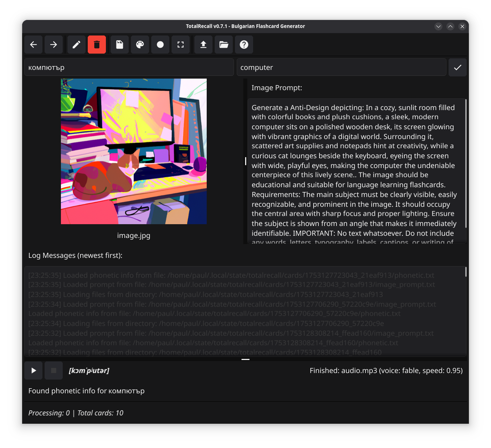](showcase/totalrecall/image-2.png)  

Architecturally, the tool is built around pluggable AI backends selected via configuration: Google Gemini is the default for all tasks (text-to-speech, translation, phonetic lookup, and image generation via the "Nano Banana" model), while OpenAI endpoints (including DALL-E) remain available as an explicitly selected alternative. Audio from Gemini is automatically converted to space-efficient MP3 using `ffmpeg`. The batch file format is notably flexible, supporting five card types that can be mixed freely: Bulgarian-only words (auto-translated), Bulgarian=English pairs, English-only entries (auto-translated to Bulgarian), and monolingual Bulgarian==Bulgarian definition cards. Provided translations are used directly without API calls, saving quota. Interestingly, the project is largely "vibe coded" using Claude Code, making it a notable example of AI-assisted application development.

[View on GitHub](https://github.com/snonux/totalrecall)  

---

### 34. fastforge

* 💻 Languages: C (93.2%), C/C++ (5.4%), JavaScript (0.7%), Make (0.7%)
* 📚 Documentation: Markdown (100.0%)
* 📊 Commits: 112
* 📈 Lines of Code: 4908
* 📄 Lines of Documentation: 278
* 🏷️ Tags: 9
* 📅 Development Period: 2026-04-06 to 2026-09-10
* 🏆 Score: 4.7 (combines recent activity, code size, tags, and release status)
* ⚖️ License: MIT
* 🏷️ Latest Release: v1.6.0 (2026-09-10)

[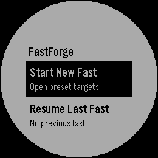](showcase/fastforge/image-1.png)  

**FastForge** is a Pebble smartwatch app for intermittent fasting tracking, published on the Rebble Appstore and built with the Rebble SDK. It lets users manage fasting sessions entirely from their wrist: a main menu for controlling fasts, a live countdown screen showing progress toward a fasting goal, and a history screen logging past sessions. This makes it easy to stay on target without pulling out a phone or tracking times mentally. The app is designed for both of Rebble's modern form factors — the round Pebble Round 2 ("gabbro") and the rectangular Pebble Time 2 ("emery") — with screens adapted to each display, as shown in its screenshots.

  

On the implementation side, the project targets Rebble SDK 4.9+ and uses the modern community Pebble toolchain: the `pebble` CLI installed via `uv`, SDL libraries for the emulator, and supporting tools like a device-tree compiler. Development is streamlined through a `just` command runner (justfile) that wraps the whole workflow — `just dev` builds and installs to the gabbro emulator, `just dev-emery` targets emery, while companion commands handle live log streaming, screenshots, emulator shutdown, and build cleanup. This gives contributors a reproducible, emulator-driven development loop on Fedora (and similar Linux systems) without requiring physical watch hardware.

[View on GitHub](https://github.com/snonux/fastforge)  

---

### 35. goprecords

* 💻 Languages: Go (97.9%), Shell (1.9%), Docker (0.2%)
* 📚 Documentation: Markdown (100.0%)
* 📊 Commits: 180
* 📈 Lines of Code: 8838
* 📄 Lines of Documentation: 1075
* 🏷️ Tags: 20
* 📅 Development Period: 2013-03-22 to 2026-10-24
* 🏆 Score: 4.2 (combines recent activity, code size, tags, and release status)
* ⚖️ License: No license found
* 🏷️ Latest Release: v0.6.2 (2026-10-24)

`goprecords` is a Go command-line tool that generates global uptime leaderboards — "uprecords"-style reports aggregated across many machines rather than a single host. It consumes the raw record files produced by `uptimed` on individual hosts, collected into a central stats directory or git repository, and ranks them by metrics such as Boots, Uptime, Downtime, Lifespan, and a combined Score across categories including Host, Kernel, KernelMajor, and KernelName. This makes it useful for tracking fleet-wide availability across heterogeneous systems (Linux, the BSDs, macOS), with hosts optionally classified as server, workstation, hybrid, or unknown (shown as a letter in report tables), stale hosts flagged with `*`/`+` markers, and output rendered as Plaintext, Markdown, Gemtext, or HTML.

The implementation is architected around three interchangeable modes: direct reporting from a stats directory with no database, an `import`/`query` pair backed by SQLite for repeatable aggregation, and an HTTP daemon mode (plain HTTP, with TLS terminated externally by a reverse proxy or ingress). The daemon exposes liveness/readiness probes, a `GET /report` endpoint mirroring the CLI's report options, and authenticated `PUT /upload/{HOSTNAME}/{kind}` endpoints so hosts can push their uptimed files directly — secured by per-client bearer tokens (hashed in a separate SQLite auth DB, scoped to one hostname each) with an optional anonymous mode for local testing. Operational conveniences round it out: a cross-platform upload client script for cron/systemd automation, CLI subcommands for classifying and listing hosts, and Prometheus `/metrics` integration where decommissioned hosts can be excluded from alerting and automatically re-included once they resume uploading.

[View on GitHub](https://github.com/snonux/goprecords)  

---

### 36. hypr

* 💻 Languages: TypeScript (49.4%), Ruby (32.3%), JSON (9.3%), Shell (4.2%), TOML (4.0%), Python (0.8%)
* 📚 Documentation: Markdown (100.0%)
* 📊 Commits: 165
* 📈 Lines of Code: 11368
* 📄 Lines of Documentation: 3142
* 🏷️ Tags: 0
* 📅 Development Period: 2026-03-21 to 2026-10-26
* 🏆 Score: 4.1 (combines recent activity, code size, tags, and release status)
* ⚖️ License: No license found
* 🧪 Status: Experimental (no releases yet)

[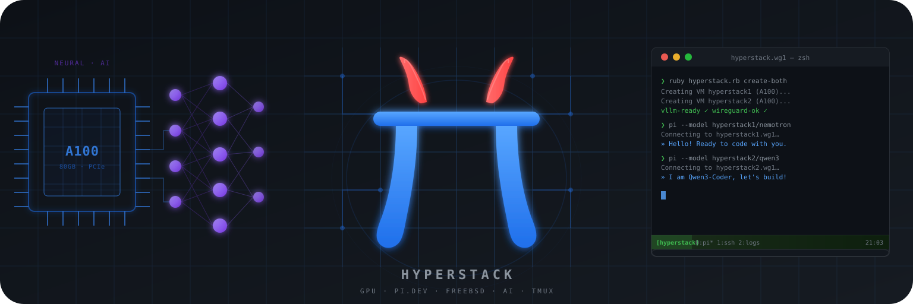](showcase/hypr/image-1.svg)  

**hypr** is a Ruby-based automation tool that manages the full lifecycle of GPU cloud VMs on Hyperstack—from creation and provisioning through teardown—so you can run your own self-hosted LLM inference for coding agents. It provisions two concurrent A100 80GB VMs, each serving a different model via vLLM (e.g., Qwen3.8 27B FP8 on one and Qwen3.8 Flash Next AWQ-INT4 on the other), and connects Pi coding agents (running inside a tmux session on a Linux bhyve VM on a FreeBSD host) to each endpoint. The setup is useful for anyone who wants the speed and capability of a local-feeling LLM for coding—full 262K context, no per-token API costs, and control over model choice—without exposing inference endpoints to the public internet: vLLM listens only on a WireGuard overlay network (192.168.3.0/24), firewalled so just your machine's tunnel interface can reach it.

Implementation-wise, a single CLI (`ruby hyperstack.rb --vm 1|2|both <command>`) drives everything via per-VM TOML configs: `create` boots the VM, runs `wg1-setup.sh` to wire up a single WireGuard interface with one peer block per VM, deploys vLLM as a Docker container on port 11434, and verifies with end-to-end inference tests. Named model presets in the TOML allow hot-switching models (including speculative decoding via Qwen's MTP head) without reprovisioning, and a `watch` command renders a live dashboard of GPU utilization, VRAM, throughput, and KV-cache stats. On the client side, Pi is configured through a symlinked `~/.pi` directory containing `models.json` (OpenAI-compatible providers pointing at each VM's tunnel IP), fish shell abbreviations for quick launches, and TypeScript extensions adding tools like web search, ask-mode, and loop scheduling. The project chooses vLLM over Ollama for its FlashAttention v2 prefill, block-level prefix caching, and better VRAM efficiency.

[View on GitHub](https://github.com/snonux/hypr)  

---

### 37. gt

* 💻 Languages: Go (98.0%), Shell (2.0%)
* 📚 Documentation: Markdown (100.0%)
* 📊 Commits: 415
* 📈 Lines of Code: 19850
* 📄 Lines of Documentation: 4351
* 🏷️ Tags: 8
* 📅 Development Period: 2025-11-25 to 2026-09-06
* 🏆 Score: 4.0 (combines recent activity, code size, tags, and release status)
* ⚖️ License: MIT
* 🏷️ Latest Release: v0.5.2 (2026-08-22)

  

`gt` is a command-line calculator written in Go that combines two calculation styles: natural-language percentage expressions (e.g., `gt '20% of 150'` → 30) and RPN (Reverse Polish Notation) stack arithmetic (e.g., `gt '3 4 +'` → 7). It's designed for quick math directly in the shell—expressions run as one-off commands, can be piped into workflows, or explored interactively in a REPL. Beyond basic arithmetic, it supports variables and assignment, symbols (`:x` syntax), built-in constants like `pi`, stack manipulation, comparisons and booleans, logarithm operators, hyper (n-ary) operators, fast integer exponentiation (`**`), and a rational-number mode. A standout capability is unit-aware computation, where expressions like `100Mbps 1hr *` multiply rates by time, backed by a metrics system with unit conversion, custom metrics, and metric commands.

Architecturally, `gt` is a single Go binary with its entry point in `cmd/gt`, installable via `go install` or `mage install`, with the Mage build tool handling build and test automation. Documentation is cleanly organized into per-topic guides under `docs/`, and Fish shell completions ship with the repo. The project also has a meta-purpose: it serves as an experiment in using local LLMs (Qwen, Gemma, Nemotron, GPT OSS) as pair programmers for developing the tool itself.

[View on GitHub](https://github.com/snonux/gt)  

---

### 38. gogios

* 💻 Languages: Go (99.7%), JSON (0.3%)
* 📚 Documentation: Markdown (96.9%), Text (3.1%)
* 📊 Commits: 132
* 📈 Lines of Code: 7264
* 📄 Lines of Documentation: 641
* 🏷️ Tags: 19
* 📅 Development Period: 2023-04-17 to 2026-09-26
* 🏆 Score: 3.6 (combines recent activity, code size, tags, and release status)
* ⚖️ License: Custom License
* 🏷️ Latest Release: v1.7.1 (2026-09-26)

  

Gogios is a lightweight, minimalistic server monitoring tool written in Go, designed for small-scale personal infrastructure (a handful of servers or VMs) rather than enterprise environments. It was created as a reaction to feature-heavy solutions like Nagios, Icinga, and Prometheus, which the author found bloated for personal use—requiring databases, web UIs, contact groups, and clustering that he didn't need. Instead, Gogios offers a no-frills approach: it periodically executes standard Nagios/Icinga check plugins and emails a single recipient a status report whenever a check's state changes, summarizing critical, warning, unknown, stale, and OK statuses. Setup is intentionally simple—a single binary, a JSON config file, a local mail transfer agent, and a CRON job.

Architecturally, Gogios is invoked by CRON rather than running as a daemon, and it shells out to external plugins (e.g., check_ping, check_http, or check_nrpe for remote checks) with configurable concurrency, timeouts, retries, and check dependencies (so an HTTP check is skipped as UNKNOWN if the host isn't pingable). Persistent state is kept in a state.json file so notifications fire only on status changes, and runs are serialized through an exclusive lock file with atomic, fsynced state writes and input sanitization for plugin output. Beyond plain runs, it supports a daily `-renotify` mode to remind about unhandled alerts and a weekly `-force` run to confirm mail delivery still works. Notable features include Prometheus Alertmanager integration (federating alerts and watching the watchdog alert to detect a broken Alertmanager), file-based alert suppression for maintenance windows, and high-availability setups where two instances monitor each other via NRPE on staggered intervals—or elect a single active checker via peer failover, with the passive node mirroring the active peer's state for a consistent view.

[View on GitHub](https://github.com/snonux/gogios)  

---

### 39. ds-sim

* 💻 Languages: Java (98.6%), Shell (0.9%), CSS (0.4%)
* 📚 Documentation: Markdown (98.7%), Text (1.3%)
* 📊 Commits: 476
* 📈 Lines of Code: 28576
* 📄 Lines of Documentation: 3103
* 🏷️ Tags: 2
* 📅 Development Period: 2008-05-15 to 2026-10-21
* 🏆 Score: 2.5 (combines recent activity, code size, tags, and release status)
* ⚖️ License: Custom License
* 🏷️ Latest Release: 1.1.0 (2026-03-27)

[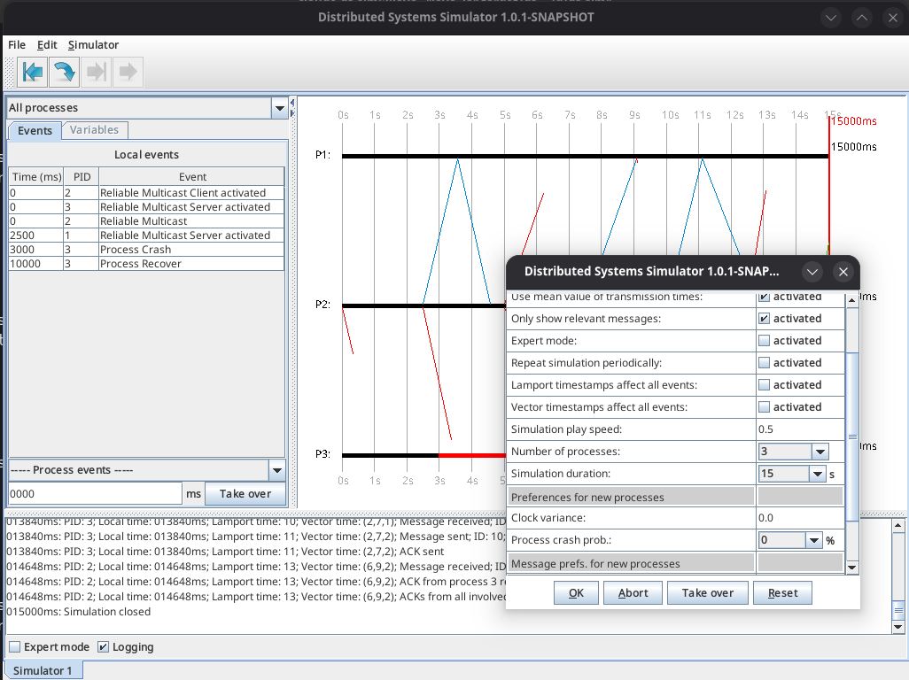](showcase/ds-sim/image-1.png)  

DS-Sim is an open-source distributed systems simulator written in Java, developed from the original VS-Sim project. It provides an interactive environment for modeling, running, and learning about distributed systems concepts, making it valuable as both an educational tool and an experimentation platform. The simulator supports protocol simulation with event handling, implements both Lamport and Vector logical clocks, and includes several classic distributed algorithms out of the box—such as PingPong, Two-Phase Commit, and Berkeley time synchronization. Users can build and save simulations, schedule timestamp-triggered events, and observe process behavior through an interactive GUI backed by comprehensive logging.

The project is built on Java 21 and Maven, with a clean modular architecture: a `core` package handles processes and message passing (via `VSTask` and `VSMessage`), an `events` package manages the event system, `protocols` contains the distributed algorithm implementations, and a `simulator` package drives the main engine. The UI is built with Swing, and the build produces a self-contained executable JAR for easy deployment. Reliability and extensibility are emphasized throughout: the project ships with 141 headless-compatible unit tests, a testing framework for protocol simulations, and developer documentation explaining how to create new protocols and events, making it straightforward to extend with custom distributed algorithms.

[View on GitHub](https://github.com/snonux/ds-sim)  

---

### 40. irregular.ninja

* 💻 Languages: Config (100.0%)
* 📚 Documentation: Markdown (100.0%)
* 📊 Commits: 21
* 📈 Lines of Code: 112
* 📄 Lines of Documentation: 48
* 🏷️ Tags: 0
* 📅 Development Period: 2026-06-15 to 2026-07-18
* 🏆 Score: 2.1 (combines recent activity, code size, tags, and release status)
* ⚖️ License: No license found
* 🧪 Status: Experimental (no releases yet)

This repository contains the working directories and build automation for generating two static photo album websites: **irregular.ninja**, the author's primary photo gallery, and **alt.irregular.ninja**, an alternative gallery featuring "second-order" photos the author considers less compelling. Album generation is powered by [shuriken.sh](https://codeberg.org/snonux/shuriken.sh), a lightweight shell-based photo album generator, so the sites are built as fully static content without any dynamic backend or CMS. The setup is useful because it turns photo publishing into a simple, reproducible build process.

Architecturally, each album lives in its own directory containing a `shuriken.conf` for per-album configuration (title, geometry, templates), an `incoming/` symlink pointing at the source photo collection, and its own `Justfile` with build recipes. A top-level `Justfile` delegates to both sub-albums, enabling commands like `just all` to regenerate both sites at once or `just dry-run-all` to preview changes without writing anything. There's also an `incoming-invalid/` directory in the main album reserved for rejected or invalid photos, keeping the source collection tidy.

[View on GitHub](https://github.com/snonux/irregular.ninja)  

---

### 41. gemtexter

* 💻 Languages: Shell (52.2%), CSS (35.5%), HTML (10.5%), Config (1.9%)
* 📚 Documentation: Text (75.1%), Markdown (24.9%)
* 📊 Commits: 493
* 📈 Lines of Code: 3430
* 📄 Lines of Documentation: 1195
* 🏷️ Tags: 6
* 📅 Development Period: 2021-05-21 to 2026-10-12
* 🏆 Score: 1.9 (combines recent activity, code size, tags, and release status)
* ⚖️ License: GPL-3.0
* 🏷️ Latest Release: 3.0.0 (2024-10-01)

Gemtexter is a blog engine and static site generator written almost entirely in GNU Bash. Its core idea is "write once, publish everywhere": all content is authored in Gemini's Gemtext format (`.gmi` files), and a single `./gemtexter --generate` run converts it into multiple JavaScript-free output formats — a Gemini protocol capsule, XHTML for the regular web, and Markdown for Git-hosting pages like Codeberg or GitHub. Blogging is deliberately simple: dropping a date-prefixed file (e.g. `2023-02-26-title.gmi`) into the gemfeed directory is enough for the script to auto-link it from the site indexes and add it to the generated Atom feed. This makes it useful for anyone wanting to maintain a presence on both the Gemini protocol and the conventional web from one source of truth.

Architecturally, the project is a single large Bash script (chosen as an experiment in keeping a complex shell script maintainable) built on standard GNU tools — sed, grep, date — with optional GNU Source Highlight for HTML syntax highlighting. Content lives in a configurable base directory with one subdirectory per output format (`gemtext`, `html`, `md`), each designed to be its own Git repository; the script detects Git repos and offers `--git-add`, `--git-sync`, and a one-step `--publish` workflow. Key features include a templating system (`.gmi.tpl` files that execute embedded Bash code via `<<` and `<<<`/`>>>` blocks), inline directives for related-post indexes (`template::inline::index`) and tables of contents, regex-based content filtering for fast partial regeneration, themable HTML output with customizable CSS, Mastodon `rel='me'` verification, and careful preservation of hosting-specific files like Codeberg's `.domains` or GitHub Pages' `CNAME` and `_config.yml`.

[View on GitHub](https://github.com/snonux/gemtexter)  

---

### 42. gos

* 💻 Languages: Go (99.6%), JSON (0.2%), Shell (0.2%)
* 📚 Documentation: Markdown (100.0%)
* 📊 Commits: 412
* 📈 Lines of Code: 5055
* 📄 Lines of Documentation: 477
* 🏷️ Tags: 20
* 📅 Development Period: 2024-05-04 to 2026-09-11
* 🏆 Score: 1.7 (combines recent activity, code size, tags, and release status)
* ⚖️ License: Custom License
* 🏷️ Latest Release: v1.3.4 (2026-09-11)

[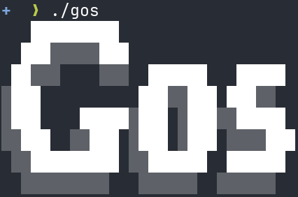](showcase/gos/image-1.png)  

[Gos](https://github.com/snonux/gos) is a command-line tool written in Go that serves as a free, privacy-friendly replacement for Buffer.com. It lets you schedule and publish social media posts to **Mastodon** and **LinkedIn** from plain text files — without the slow web UI, ads, or the 10-post limit of Buffer's free tier. A pseudo-platform called **Noop** tracks posts without publishing anywhere, which is useful for generating summaries separately.

[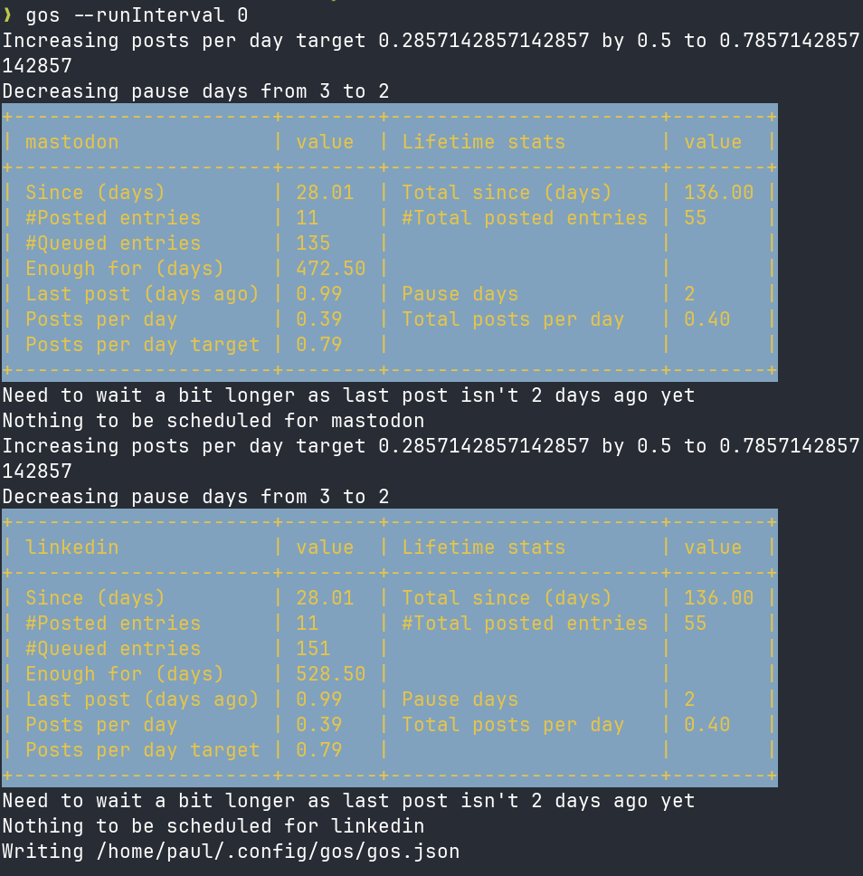](showcase/gos/image-2.png)  

Posts are started via `gosc` (or `gos --compose`) which opens `$EDITOR` on a `.txt` file in `~/.gosdir`. On the next run, Gos parses embedded `share:` tags, validates per-platform size limits (prompts to edit if exceeded), and moves the file into a per-platform queue (`db/platforms/PLATFORM/...queued`). Based on your weekly target, lookback window, priority tags, and pause days, it then selects and publishes messages, renaming files to `.posted` to record the outcome. A run interval prevents back-to-back shell invocations from posting too often, and a dynamic catch-up mechanism increases the effective rate when the queue gets too deep.

[View on GitHub](https://github.com/snonux/gos)  

---

### 43. yoga

* 💻 Languages: Go (69.1%), HTML (30.9%)
* 📚 Documentation: Markdown (100.0%)
* 📊 Commits: 17
* 📈 Lines of Code: 6498
* 📄 Lines of Documentation: 196
* 🏷️ Tags: 9
* 📅 Development Period: 2025-10-01 to 2026-03-07
* 🏆 Score: 1.7 (combines recent activity, code size, tags, and release status)
* ⚖️ License: No license found
* 🏷️ Latest Release: v0.4.0 (2026-01-28)

[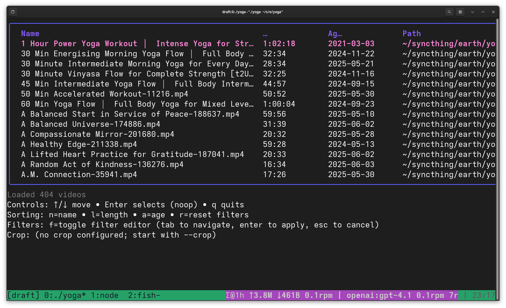](showcase/yoga/image-1.png)  

Yoga is a Go-based terminal user interface (TUI) for browsing and playing a local collection of yoga videos. It scans a chosen directory (defaulting to `~/Yoga`, which it creates on first launch) for common video formats—`.mp4`, `.mkv`, `.mov`, `.avi`, `.wmv`, `.m4v`—following symlinks and caching probed duration metadata per directory in a JSON file to avoid repeated probing on later launches. Its main value is fast, keyboard-driven curation: videos appear in a navigable table that can be sorted by name, length, or age, and filtered via a dialog by name, duration range, or tags, with a single keypress launching playback in VLC. Extra conveniences include a random-video picker for when you can't decide, runtime-toggleable VLC crop strings for aspect-ratio adjustment, and per-video tag editing.

Architecturally, it's a single Go CLI application combining a filesystem scanner, a duration-probing and caching layer, and a dialog-driven TUI, delegating playback entirely to an external VLC process rather than embedding a media player. Development is managed with the Mage task runner (targets for build, test, install, and coverage), enforces gofumpt formatting, and gates contributions on a test suite with at least 85% coverage. Note that despite its polish, the project is officially deprecated and no longer maintained, so it should be treated as an archived utility rather than an actively supported tool.

[View on GitHub](https://github.com/snonux/yoga)  

---

### 44. rcm

* 💻 Languages: Ruby (99.6%), TOML (0.4%)
* 📚 Documentation: Markdown (100.0%)
* 📊 Commits: 109
* 📈 Lines of Code: 1719
* 📄 Lines of Documentation: 778
* 🏷️ Tags: 3
* 📅 Development Period: 2024-12-05 to 2026-03-02
* 🏆 Score: 1.5 (combines recent activity, code size, tags, and release status)
* ⚖️ License: Custom License
* 🏷️ Latest Release: v0.1.1 (2026-03-01)

[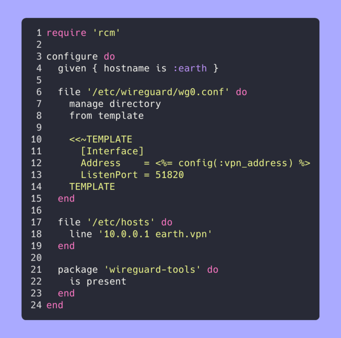](showcase/rcm/image-1.png)  

RCM is a lightweight, declarative configuration management system written in Ruby — essentially a minimalist alternative to tools like Ansible for personal infrastructure. Users describe desired system state via an expressive DSL: creating or deleting files, symlinks, and directories (including recursive copies and purges), managing line-level file edits, setting permissions and ownership, rendering ERB templates, and managing packages (currently Fedora/DNF only). Key features include conditional execution scoped to hostnames (`given { hostname is :earth }`, with optional `--hosts` filtering), resource dependencies evaluated in order with cycle detection, automatic backups before modifications (SHA-256 content-deduplicated, stored in `.rcmbackup/`), and dry-run and debug modes. It can be invoked as a Rake task, a plain Ruby script, a bundled gem, or a standalone CLI.

Architecturally, the project's centerpiece is Ruby metaprogramming: undefined method calls are silently absorbed and chained into resource identifiers, enabling natural-language-like syntax such as `file create config do ... end` or `notify hello dear world`. Configuration blocks (`configure` / `configure_from_scratch`) accumulate typed resources — file, touch, symlink, directory, package, notify — each customized through shared modifiers (`is present/absent/purged`, `mode`, `from template`, `manage directory`, `without backup`, etc.). Additional niceties include a TOML-based `config.toml` for host groups, path overrides to decouple resource names from filesystem paths, and multiple usage modes (Rake, gem, plain script, CLI) for flexible integration. Beyond its practical purpose, the project was built largely by hand as a vehicle for learning Ruby metaprogramming.

[View on GitHub](https://github.com/snonux/rcm)  

---

### 45. scifi

* 💻 Languages: JSON (37.8%), JavaScript (29.6%), CSS (29.0%), HTML (3.6%)
* 📚 Documentation: Markdown (100.0%)
* 📊 Commits: 30
* 📈 Lines of Code: 1757
* 📄 Lines of Documentation: 901
* 🏷️ Tags: 0
* 📅 Development Period: 2026-01-25 to 2026-09-26
* 🏆 Score: 1.4 (combines recent activity, code size, tags, and release status)
* ⚖️ License: No license found
* 🧪 Status: Experimental (no releases yet)

This project is a lightweight, fully self-contained static website that showcases a personal collection of science fiction books. Visitors can browse a responsive grid of cover images, filter the collection by author or format (Paperback, eBook, Audiobook), search by keywords, and click any book to open a detail view with a plot summary. Because everything—styling, scripts, data, and images—is stored locally with no external dependencies, the site works offline and passes W3C HTML validation, making it fast, portable, and easy to host anywhere.

Architecturally, the site uses vanilla HTML, CSS, and JavaScript with a clean separation between content and code. Book metadata lives in `data/books.json`, while plot summaries are maintained as individual Markdown files in `summaries/` and covers as local images. A Node build script (`build.js`) embeds the Markdown summaries into `books.json` and generates a `dist/` directory for deployment, with a Justfile providing simple task commands (`just build`, `just dist`, `just open`). Adding a new book requires only three steps—adding a JSON entry, dropping in a cover image, and creating a summary file—followed by a rebuild, making the project easy to maintain and extend.

[View on GitHub](https://github.com/snonux/scifi)  

---

### 46. log4jbench

* 💻 Languages: Java (78.9%), XML (21.1%)
* 📚 Documentation: Markdown (100.0%)
* 📊 Commits: 5
* 📈 Lines of Code: 774
* 📄 Lines of Documentation: 119
* 🏷️ Tags: 0
* 📅 Development Period: 2026-01-09 to 2026-10-21
* 🏆 Score: 1.4 (combines recent activity, code size, tags, and release status)
* ⚖️ License: MIT
* 🧪 Status: Experimental (no releases yet)

This project is a command-line benchmarking tool that measures Log4j2 logging throughput in Java, helping developers make data-driven decisions about logging configuration. Since logging setup can dramatically affect application performance, the tool makes it easy to quantify real-world trade-offs—such as whether asynchronous logging is worth the added complexity, or how much throughput buffering provides at the cost of data durability. It compares five built-in configurations: two synchronous variants (with immediate flush vs. an 8KB buffer) and three asynchronous loggers backed by LMAX Disruptor ring buffers of 1,024, 4,096, and 10,240 entries, reporting results in both events/sec and MB/sec.

The tool is implemented in Java 17 with Maven and packages as a self-contained executable fat JAR. At runtime, it spawns a configurable number of concurrent logging threads (100 by default) that emit messages of a configurable size under each selected configuration, operating in either a fixed-duration mode or an event-count mode, with an optional warmup period to reduce measurement noise. Command-line options cover thread count, message size, configuration selection, and CSV export for further analysis, and the tool attempts to drop the Linux filesystem cache before each test to ensure disk I/O measurements reflect actual writes rather than cached performance.

[View on GitHub](https://github.com/snonux/log4jbench)  

---

### 47. timr

* 💻 Languages: Go (96.0%), Shell (4.0%)
* 📚 Documentation: Markdown (100.0%)
* 📊 Commits: 32
* 📈 Lines of Code: 1538
* 📄 Lines of Documentation: 99
* 🏷️ Tags: 5
* 📅 Development Period: 2025-06-25 to 2026-01-02
* 🏆 Score: 1.2 (combines recent activity, code size, tags, and release status)
* ⚖️ License: MIT
* 🏷️ Latest Release: v0.3.0 (2026-01-02)

**timr** is a minimalist stopwatch-style time tracker for the terminal, written in Go. It lets you start, stop, resume, and reset a timer that persists its state to disk, so you can pause work and pick up tracking later across terminal sessions. Beyond the basics (`start`, `stop`, `cont`, `status`, `reset`), it offers a `track <description>` command that logs the elapsed time with a note and resets the clock, machine-readable status output in raw seconds or minutes for scripting, and a compact `prompt` command designed for shell integration—a fish shell integration script ships with the project to display live timer status in your prompt.

Implementation-wise, the project follows a standard Go layout with the binary entry point in `cmd/timr` and uses Mage as its build tool. Its most feature-rich component is the interactive `live` mode, a full-screen timer display with real-time keyboard controls (start/stop, reset, quit) and cycling between multiple ASCII-art fonts such as `doom`, `mono12`, `rebel`, and `ansiShadow`—adapting fonts from the open-source pomo project. Notably, the tool was primarily developed using AI coding assistants (Google Gemini CLI and Claude Code CLI), which helps explain its focused scope and clean, single-purpose design.

[View on GitHub](https://github.com/snonux/timr)  

---

### 48. foostats

* 💻 Languages: Perl (100.0%)
* 📚 Documentation: Markdown (54.6%), Text (45.4%)
* 📊 Commits: 98
* 📈 Lines of Code: 1902
* 📄 Lines of Documentation: 423
* 🏷️ Tags: 2
* 📅 Development Period: 2023-01-02 to 2025-11-01
* 🏆 Score: 1.1 (combines recent activity, code size, tags, and release status)
* ⚖️ License: Custom License
* 🏷️ Latest Release: v0.2.0 (2025-10-21)

**foostats** is a privacy-respecting analytics tool for OpenBSD that parses HTTP/HTTPS server logs (httpd) and Gemini protocol logs (vger/relayd) to generate anonymous site statistics, originally built for the foo.zone ecosystem. Its core value is providing comprehensive traffic insights—unique visitors, request counts, top URLs, and Atom/RSS/Gemfeed subscriber tracking—without compromising visitor privacy: IP addresses are immediately hashed with SHA3-512, no cookies or tracking scripts are used, only aggregated data is stored, and high-frequency requesters are excluded. It also doubles as a security aid by filtering and logging suspicious requests (e.g., `.php` or `/wp-admin` probes) based on configurable URI patterns.

The tool is written in Perl 5.38+ and organized as a modular pipeline: `Logreader` parses logs, `Filter` drops suspect URIs, `Aggregator` compiles statistics, and `FileOutputter` persists them as compressed per-day/per-host JSON files. A `Replicator`/`Merger` pair enables distributed deployments by syncing and combining statistics across partner nodes for site-wide totals. Finally, the `Reporter` produces daily, monthly, and 30-day summary reports in both Gemtext and HTML formats, ready to serve directly from Gemini or web servers. Operations are orchestrated via CLI flags (`--parse-logs`, `--replicate`, `--report`, or `--all`), with a test suite and a Justfile supporting development workflows.

[View on GitHub](https://github.com/snonux/foostats)  

---

### 49. wireguardmeshgenerator

* 💻 Languages: Ruby (66.0%), YAML (34.0%)
* 📚 Documentation: Markdown (100.0%)
* 📊 Commits: 44
* 📈 Lines of Code: 967
* 📄 Lines of Documentation: 208
* 🏷️ Tags: 1
* 📅 Development Period: 2025-04-18 to 2026-08-04
* 🏆 Score: 1.0 (combines recent activity, code size, tags, and release status)
* ⚖️ License: Custom License
* 🏷️ Latest Release: v1.0.0 (2025-05-11)

The WireGuard Mesh Generator is a Ruby-based automation tool that creates WireGuard configuration files for an entire mesh network from a single YAML file (`wireguardmeshgenerator.yaml`). Building such a mesh by hand is tedious and error-prone, since every node needs its own keypair, address, and peer entries pointing to all others; this tool handles that generation automatically. It's driven by Rake tasks: `rake generate` produces the `.conf` files, `rake install` deploys them to remote machines (for example over SSH), and `rake clean` removes generated output. The project appears designed to support a home lab environment, as referenced by the linked blog post on running Kubernetes on FreeBSD.

Architecturally, the tool separates configuration (YAML), orchestration (Rake), and output (per-host config files), and manages keypairs deterministically by storing them under `keys/<host>/` so configs can be regenerated without invalidating existing keys. It also includes mobile-friendly features: for Android hosts, it can emit multiple full-tunnel configurations—one per listed gateway—with Android-compatible 15-character names (e.g., `p7p-blowfish.conf`, `p7p-fishfinger.conf`). Users import these variants into the WireGuard app and switch gateways manually, while reusing the same host keypair rather than generating new keys on-device.

[View on GitHub](https://github.com/snonux/wireguardmeshgenerator)  

---

### 50. ioriot

* 💻 Languages: C (58.7%), C/C++ (22.5%), Config (17.9%), Make (1.0%)
* 📚 Documentation: Markdown (100.0%)
* 📊 Commits: 80
* 📈 Lines of Code: 13609
* 📄 Lines of Documentation: 899
* 🏷️ Tags: 7
* 📅 Development Period: 2018-03-01 to 2026-03-19
* 🏆 Score: 0.8 (combines recent activity, code size, tags, and release status)
* ⚖️ License: Apache-2.0
* 🏷️ Latest Release: 0.5.1 (2019-01-04)

  

I/O Riot is a Linux I/O benchmarking tool that captures real file-I/O operations from a production system and replays the identical workload on another host or test environment. Its key advantage over traditional benchmarking tools is that it relies on actual production I/O patterns rather than artificial or pre-defined operation sets, making it useful for validating whether new hardware suits an existing application, isolating I/O bottlenecks without the complexity of a distributed load-testing setup, and safely comparing OS/file-system/hardware configurations. It also enables "what-if" experiments—such as removing reads from the replay journal or synthesizing workloads for applications that don't exist yet—all without touching application code, and it can even expose I/O inefficiencies in applications to report back to developers.

The implementation follows a five-step workflow driven by a single `ioriot` CLI: **capture**, **generate**, **initialize**, **replay**, and **analyze**. Capture is performed in Linux kernel space via SystemTap (with an optional targeted kernel module for a specific PID), which is highly efficient and avoids system slowdowns even under heavy load. The generator transforms the `.capture` log into a `.replay` file, rewriting paths to replay-local equivalents (including symlink targets, with safety checks preventing links that escape the replay tree); initialization builds the required directory/file/symlink skeleton; and the replay engine—written in C for minimal overhead—replays the workload with configurable worker/thread parallelism, optional cache dropping, and adjustable speed. The tool supports a broad set of syscalls (open, read/write, rename, stat, fsync, etc.) and recognizes ext2, ext4, xfs, zfs, and btrfs mount points.

[View on GitHub](https://github.com/snonux/ioriot)  

---

### 51. sillybench

* 💻 Languages: Go (90.9%), Shell (9.1%)
* 📚 Documentation: Markdown (100.0%)
* 📊 Commits: 5
* 📈 Lines of Code: 33
* 📄 Lines of Documentation: 3
* 🏷️ Tags: 0
* 📅 Development Period: 2025-04-03 to 2025-04-03
* 🏆 Score: 0.4 (combines recent activity, code size, tags, and release status)
* ⚖️ License: No license found
* 🧪 Status: Experimental (no releases yet)

The material you've shared is minimal — just the title "Silly Benchmark" and a single line: "To compare how fast this runs on FreeBSD vs a Linux Bhyve VM." That's not enough to write a meaningful summary of the project's key features or architecture, and I don't want to invent details about how it's implemented.

From what's provided, the only things I can confidently say are:

[View on GitHub](https://github.com/snonux/sillybench)  

---

### 52. terraform

* 💻 Languages: HCL (96.6%), Make (1.9%), YAML (1.5%)
* 📚 Documentation: Markdown (100.0%)
* 📊 Commits: 126
* 📈 Lines of Code: 2852
* 📄 Lines of Documentation: 52
* 🏷️ Tags: 0
* 📅 Development Period: 2023-08-27 to 2026-07-23
* 🏆 Score: 0.4 (combines recent activity, code size, tags, and release status)
* ⚖️ License: MIT
* 🧪 Status: Experimental (no releases yet)

⚠️  **Notice**: This project appears to be inactive or no longer maintained. The average age of its last 42 commits exceeds 2 years. Use at your own risk.

This project defines the Terraform configuration for a personal self-hosting platform on AWS, provisioning the infrastructure needed to run containerized personal services—such as Nextcloud, Vaultwarden, Wallabag, an Anki sync server, and Audiobookshelf—on ECS Fargate. Rather than relying on third-party SaaS offerings, it gives the owner private, self-hosted alternatives running in their own AWS account, with persistent data stored on EFS (with daily backups) and traffic secured via TLS certificates from AWS Certificate Manager.

The implementation is organized as a set of layered Terraform modules across separate configurations: `org-buetow-base` creates the foundational networking and storage (VPC, subnets, EFS), `org-buetow-bastion` provides an EC2 jump host used to prepare EFS subdirectories for each service, `org-buetow-elb` sets up the Application Load Balancer that terminates TLS and routes traffic, and `org-buetow-ecs` deploys the Fargate services themselves. A few steps are intentionally handled manually outside Terraform, such as creating the DNS zone and TLS certificate, storing the InfluxDB password in AWS Secrets Manager, and enabling EFS backups via the console. Planned improvements include making the set of ECS services configurable via input variables and adding CloudWatch monitoring with email-based alerting.

[View on GitHub](https://github.com/snonux/terraform)  

---

### 53. photoalbum

* 💻 Languages: Shell (92.5%), Make (4.6%), Config (2.9%)
* 📚 Documentation: Markdown (100.0%)
* 📊 Commits: 159
* 📈 Lines of Code: 908
* 📄 Lines of Documentation: 42
* 🏷️ Tags: 18
* 📅 Development Period: 2011-11-19 to 2026-06-09
* 🏆 Score: 0.4 (combines recent activity, code size, tags, and release status)
* ⚖️ License: No license found
* 🏷️ Latest Release: 0.8.1 (2026-06-09)

⚠️  **Notice**: This project appears to be inactive or no longer maintained. The average age of its last 42 commits exceeds 2 years. Use at your own risk.

**photoalbum** is a minimal Bash script for Unix-like systems that converts a directory of photos into a static web photo album. Its output is pure HTML+CSS with zero JavaScript, making the resulting gallery lightweight, fast, private, and hostable on any static web server. The workflow is intentionally simple: point the `incoming` setting at a photo directory, run `photoalbum generate`, then copy the generated `./dist` directory to a server. Helper subcommands round out the tool—`clean` tidies the workspace, `version` prints the release, and `makemake` bootstraps a `photoalbumrc` config file plus a Makefile in the current directory for a make-driven workflow.

Architecturally, the project is a single Bash script that delegates image processing to ImageMagick, preferring the modern `magick` command with a fallback to the older `convert`. Configuration is handled through rc files—the system-wide `/etc/default/photoalbum` or a local `photoalbumrc`—while the album's appearance is defined by customizable Bash-HTML template files that users can tweak to restyle their galleries. This simple shell-script-plus-templates design keeps dependencies minimal (just Bash and ImageMagick) while remaining flexible. Note that the project is considered done; its successor is [shuriken.sh](https://codeberg.org/snonux/shuriken.sh).

[View on GitHub](https://github.com/snonux/photoalbum)  

---

### 54. guprecords

* 💻 Languages: Raku (100.0%)
* 📚 Documentation: Markdown (100.0%)
* 📊 Commits: 97
* 📈 Lines of Code: 383
* 📄 Lines of Documentation: 425
* 🏷️ Tags: 1
* 📅 Development Period: 2013-03-22 to 2026-03-07
* 🏆 Score: 0.4 (combines recent activity, code size, tags, and release status)
* ⚖️ License: No license found
* 🏷️ Latest Release: v1.0.0 (2023-04-29)

⚠️  **Notice**: This project appears to be inactive or no longer maintained. The average age of its last 42 commits exceeds 2 years. Use at your own risk.

**guprecords** is a command-line tool written in Raku that generates global uptime "leaderboards" from the record files produced by [uptimed](https://github.com/rpodgorny/uptimed), a daemon that tracks system boots and uptime on Unix-like machines. While uptimed only reports statistics for a single host, guprecords aggregates record files collected from many machines—typically gathered into a central location like a git repository—into cross-fleet rankings. Reports can be generated for different categories (`Host`, `Kernel`, `KernelMajor`, `KernelName`) and ranked by different metrics: `Boots` (total boot count), `Uptime`, `Downtime`, `Lifespan` (uptime + downtime), and `Score` (a combined meta-metric). Users can limit results to the top N entries and choose from three output formats: `Plaintext` (ASCII tables), `Markdown`, and `Gemtext`. A `--all` mode generates every report at once, with optional custom section ordering.

The implementation follows a clean class-based architecture in Raku: an `Aggregator` parses the raw record files (lines of `uptime-seconds:boot-timestamp:kernel-name`) and builds `Aggregate`/`HostAggregate` objects holding the per-category data, while `Reporter`/`HostReporter` classes produce the actual reports given a category, metric, limit, and format, with an `OutputHelper` role providing formatting support. The tool includes built-in tests (run via `guprecords.raku test`). Note that the project is now deprecated and has been rewritten in Go as [goprecords](https://codeberg.org/snonux/goprecords), which is the recommended successor.

[View on GitHub](https://github.com/snonux/guprecords)  

---

### 55. geheim

* 💻 Languages: Ruby (86.7%), Shell (13.3%)
* 📚 Documentation: Markdown (100.0%)
* 📊 Commits: 75
* 📈 Lines of Code: 822
* 📄 Lines of Documentation: 108
* 🏷️ Tags: 4
* 📅 Development Period: 2018-05-26 to 2026-03-07
* 🏆 Score: 0.4 (combines recent activity, code size, tags, and release status)
* ⚖️ License: No license found
* 🏷️ Latest Release: v0.3.1 (2025-11-01)

⚠️  **Notice**: This project appears to be inactive or no longer maintained. The average age of its last 42 commits exceeds 2 years. Use at your own risk.

**geheim.rb** is a personal document encryption vault implemented as a single Ruby script. It encrypts any type of file—text, PDFs, binaries, though it's intended for smaller documents—using AES-256-CBC, with the initialization vector derived from a user-supplied PIN. Its core architectural choice is using a Git repository as the storage backend: all encrypted documents are stored there, along with encrypted indices that also hide the file names. The Git repository serves double duty as both version history and a synchronization mechanism, as it can push to multiple remote repositories (e.g., two separate VMs) for geo-redundant backups.

The tool is built for command-line use across macOS, Linux, and Android (via Termux), and prioritizes a smooth secure workflow: encrypted indices are searchable through the fuzzy finder `fzf`, text entries are edited directly in NeoVim (with file caching and swapping disabled to avoid leaving plaintext traces), and clipboard support is provided for macOS and GNOME. It also offers an interactive shell, batch import and export of documents, and the ability to securely shred previously exported data. Note that the project is deprecated and no longer maintained.

[View on GitHub](https://github.com/snonux/geheim)  

---

### 56. gorum

* 💻 Languages: Go (91.3%), JSON (6.4%), YAML (2.3%)
* 📚 Documentation: Markdown (100.0%)
* 📊 Commits: 83
* 📈 Lines of Code: 1525
* 📄 Lines of Documentation: 17
* 🏷️ Tags: 0
* 📅 Development Period: 2023-04-17 to 2026-03-07
* 🏆 Score: 0.3 (combines recent activity, code size, tags, and release status)
* ⚖️ License: Custom License
* 🧪 Status: Experimental (no releases yet)

⚠️  **Notice**: This project appears to be inactive or no longer maintained. The average age of its last 42 commits exceeds 2 years. Use at your own risk.

Gorum (referred to as "Gogios" in the README's description — the naming is inconsistent in the current draft) is a minimalistic quorum manager: a lightweight tool for tracking whether enough nodes in a distributed setup agree on a given state, rather than requiring a heavyweight monitoring or consensus framework. Based on the TODO item about controlling "remote Gorum check execution," it appears intended to orchestrate health or status checks across remote hosts and make quorum-based decisions from their results — useful when you want simple, decentralized checking without the overhead of larger systems like Sensu or Nagios.

Beyond that, the README provides almost no detail on implementation or architecture. The name suggests Go, and the design seems to center on remotely executed checks feeding quorum logic, but there are no documented features, configuration, APIs, or internals to draw on. The project is explicitly pre-alpha ("use at your own risk"), and the TODO items — which include finishing the TODO itself, releasing the software, and writing a blog post — confirm that documentation doesn't exist yet. Any deeper summary at this point would be speculation. If you can share the source code or additional docs, I'd be happy to write a more substantive description of the actual architecture.

[View on GitHub](https://github.com/snonux/gorum)  

---

### 57. docker-radicale-server

* 💻 Languages: Make (57.5%), Docker (42.5%)
* 📚 Documentation: Markdown (100.0%)
* 📊 Commits: 5
* 📈 Lines of Code: 40
* 📄 Lines of Documentation: 3
* 🏷️ Tags: 0
* 📅 Development Period: 2023-12-31 to 2025-08-11
* 🏆 Score: 0.3 (combines recent activity, code size, tags, and release status)
* ⚖️ License: No license found
* 🧪 Status: Experimental (no releases yet)

⚠️  **Notice**: This project appears to be inactive or no longer maintained. The average age of its last 42 commits exceeds 2 years. Use at your own risk.

It looks like only the title and the one-line tagline of the README came through ("# Radicale Docker image / For the Radicale server https://radicale.org") — the rest of the project description, features, and architecture details didn't make it into your message.

If you paste the full README or documentation, I'd be happy to write the 1-2 paragraph summary you're looking for. In the meantime, based on what's actually present, the only thing I can accurately say is that this project is a Docker image for running the Radicale server — but I can't describe its specific features, configuration options, or implementation without the body of the document, and I don't want to guess or invent details.

[View on GitHub](https://github.com/snonux/docker-radicale-server)  

---

### 58. randomjournalpage

* 💻 Languages: Shell (94.1%), Make (5.9%)
* 📚 Documentation: Markdown (100.0%)
* 📊 Commits: 9
* 📈 Lines of Code: 51
* 📄 Lines of Documentation: 26
* 🏷️ Tags: 0
* 📅 Development Period: 2022-06-02 to 2026-08-05
* 🏆 Score: 0.2 (combines recent activity, code size, tags, and release status)
* ⚖️ License: No license found
* 🧪 Status: Experimental (no releases yet)

⚠️  **Notice**: This project appears to be inactive or no longer maintained. The average age of its last 42 commits exceeds 2 years. Use at your own risk.

This project is a small personal shell script (`randomjournalpage.sh`) that serves as a "digital serendipity" tool for revisiting scanned bullet journals. The script randomly selects a PDF from a configured directory, extracts a random set of pages from it, and opens them in a PDF viewer. The idea is that surfacing random pages from the past helps the author rediscover old journal entries, book notes, and half-forgotten ideas worth reconsidering—something that's otherwise difficult to do with digitized handwritten journals, which lack searchable text or easy browsing.

Implementation-wise, the script is intentionally minimal and leans on two standard Linux command-line utilities: `pdfinfo` (from `poppler-utils`) to determine the total page count of a PDF, and `qpdf` to extract the randomly chosen pages. Configuration is done directly in the script, where users set the path to their journal PDFs and their preferred PDF viewer. It was written for Fedora Linux (with `dnf` installation instructions provided), and despite its simplicity it follows reasonable shell scripting practices by passing ShellCheck static analysis, with a single rule exclusion noted in the README.

[View on GitHub](https://github.com/snonux/randomjournalpage)  

---

### 59. algorithms

* 💻 Languages: Go (96.5%), Make (2.0%), Config (1.5%)
* 📚 Documentation: Markdown (100.0%)
* 📊 Commits: 84
* 📈 Lines of Code: 2107
* 📄 Lines of Documentation: 821
* 🏷️ Tags: 0
* 📅 Development Period: 2020-07-12 to 2026-07-06
* 🏆 Score: 0.2 (combines recent activity, code size, tags, and release status)
* ⚖️ License: Custom License
* 🧪 Status: Experimental (no releases yet)

⚠️  **Notice**: This project appears to be inactive or no longer maintained. The average age of its last 42 commits exceeds 2 years. Use at your own risk.

This project is a small collection of algorithm exercises based on material from an algorithms lecture, intended primarily as a refresher to revisit and reinforce core algorithmic concepts. Its usefulness comes from a hands-on approach: rather than passively reviewing lecture notes, the user works through actual implementations, validating correctness with automated tests and gaining insight into runtime behavior through benchmarking.

Implementation-wise, the project is driven by a Makefile with two main targets: `make test` runs the unit test suite to verify that each algorithm behaves correctly, and `make bench` executes benchmarks to measure performance. This suggests a codebase organized around three distinct concerns — algorithm implementations, unit tests, and a benchmark harness — a common structure for educational algorithm repositories. The presence of a dedicated benchmarking workflow implies the implementations are performance-conscious, possibly in a compiled language. That said, the README is fairly minimal and doesn't specify which particular algorithms are covered or the source language used.

[View on GitHub](https://github.com/snonux/algorithms)  

---

### 60. staticfarm-apache-handlers

* 💻 Languages: Perl (96.4%), Make (3.6%)
* 📚 Documentation: Text (100.0%)
* 📊 Commits: 4
* 📈 Lines of Code: 919
* 📄 Lines of Documentation: 16
* 🏷️ Tags: 1
* 📅 Development Period: 2015-01-02 to 2026-03-07
* 🏆 Score: 0.2 (combines recent activity, code size, tags, and release status)
* ⚖️ License: No license found
* 🏷️ Latest Release: 1.1.3 (2015-01-02)

⚠️  **Notice**: This project appears to be inactive or no longer maintained. The average age of its last 42 commits exceeds 2 years. Use at your own risk.

**staticfarm-apache-handlers** is a small collection of mod_perl2 handlers intended to be loaded into an Apache 2.x web server. mod_perl2 embeds a Perl interpreter directly into Apache's process, letting Perl code intercept requests at any stage of the request-handling lifecycle (authentication, response generation, logging, etc.) with far better performance than CGI. Based on the name, the project appears oriented around serving static content—perhaps "farming out" or offloading static file delivery within Apache—but it's worth noting the bundled documentation is extremely sparse (a single line stating only that it "just includes a few mod_perl2 handlers to include into an Apache2"), so the specific handlers and their features would need to be determined from the source code itself.

The most important takeaway is the project's status: it is **deprecated** and receives no further updates, bug fixes, or feature additions, so use is explicitly at your own risk. In its prime, this type of codebase would have been a lightweight way to add custom, high-performance behavior to Apache with deep integration into server internals; mod_perl2 handlers were a standard Perl idiom for this. However, for modern deployments this approach has largely been superseded by patterns like reverse proxies (nginx or Apache mod_proxy) in front of application servers (e.g., PSGI/Plack), and static content is now typically handled by dedicated web servers or CDNs. As such, this project is best treated as legacy code—useful for understanding or maintaining an existing system that depends on it, but inadvisable for new projects.

[View on GitHub](https://github.com/snonux/staticfarm-apache-handlers)  

---

### 61. ipv6test

* 💻 Languages: Perl (65.8%), Docker (34.2%)
* 📚 Documentation: Markdown (100.0%)
* 📊 Commits: 22
* 📈 Lines of Code: 149
* 📄 Lines of Documentation: 21
* 🏷️ Tags: 0
* 📅 Development Period: 2011-07-09 to 2026-02-17
* 🏆 Score: 0.2 (combines recent activity, code size, tags, and release status)
* ⚖️ License: Custom License
* 🧪 Status: Experimental (no releases yet)

⚠️  **Notice**: This project appears to be inactive or no longer maintained. The average age of its last 42 commits exceeds 2 years. Use at your own risk.

This project is a lightweight, Perl-based website for testing a visitor's IPv6 and IPv4 connectivity. It works by exposing a main hostname (`ipv6test.f3s.buetow.org`) over both protocols (dual-stack/IPv4+IPv6), plus two dedicated subdomains: `ipv4.ipv6test...` reachable only via IPv4 and `ipv6.ipv6test...` reachable only via IPv6. By having a client probe these endpoints, the site can determine whether the visitor has working IPv6, IPv4-only access, or full dual-stack connectivity. This is useful for diagnosing broken or misconfigured IPv6 setups (e.g., AAAA records resolve but connections fail), verifying that a browser or network can reach IPv6-only resources, and validating an ISP's or server operator's IPv6 deployment.

Architecturally, the project leans heavily on DNS to make the protocol testing possible: the main host carries both A and AAAA record types, while the `ipv4.` subdomain publishes only an A record and the `ipv6.` subdomain publishes only an AAAA record. This means each protocol path can be tested in isolation—successfully loading the IPv6-only subdomain proves genuine end-to-end IPv6 connectivity rather than just protocol preference. On the implementation side, the site itself is written in Perl (the README describes it as a "quick and dirty" tool) and is packaged for deployment as a Docker image found in the `docker-image` directory, making it easy to self-host for private testing. A live instance is publicly available at the three URLs listed in the README.

[View on GitHub](https://github.com/snonux/ipv6test)  

---

### 62. sway-autorotate

* 💻 Languages: Shell (100.0%)
* 📚 Documentation: Markdown (100.0%)
* 📊 Commits: 8
* 📈 Lines of Code: 41
* 📄 Lines of Documentation: 17
* 🏷️ Tags: 0
* 📅 Development Period: 2020-01-30 to 2025-04-30
* 🏆 Score: 0.2 (combines recent activity, code size, tags, and release status)
* ⚖️ License: GPL-3.0
* 🧪 Status: Experimental (no releases yet)

⚠️  **Notice**: This project appears to be inactive or no longer maintained. The average age of its last 42 commits exceeds 2 years. Use at your own risk.

**sway-autorotate** is a small bash script that adds automatic screen rotation to the Sway Wayland compositor on accelerometer-equipped devices. It's a fork of tedk0n's autorotate_sway_script, adapted specifically for a Microsoft Surface Go 2 running Fedora Linux, with the original having been developed and tested on a Lenovo Thinkpad Helix. The project is useful because Sway, unlike full desktop environments such as GNOME or KDE, has no built-in orientation handling—so on tablets and 2-in-1 convertibles, a helper script is needed both to rotate the display when the device is tilted and to keep touchscreen/stylus input correctly mapped afterward.

Architecturally, the script works by consuming the event stream from `monitor-sensor` (part of the `iio-sensor-proxy` package), which reports orientation changes from the device's accelerometer. Each incoming orientation event triggers a corresponding rotation of the Sway output. A key configuration element is the `WAYLANDINPUT` array, which lists the input devices (discoverable via `swaymsg -t get_inputs`) that should be rotated in sync with the screen—typically the touchscreen and pen—so touch coordinates stay aligned with the new orientation. The script is intended to run as a background process; the documented invocation pipes `monitor-sensor` into the script and launches it via `at now` with output redirected to a log file (e.g., `echo 'monitor-sensor | bash autorotate.sh &> autorotate.log' | at now`), making it a lightweight, self-contained solution requiring no daemons or desktop environment dependencies.

[View on GitHub](https://github.com/snonux/sway-autorotate)  

---

### 63. mon

* 💻 Languages: Perl (96.5%), Shell (1.8%), Make (1.2%), Config (0.4%)
* 📚 Documentation: Text (100.0%)
* 📊 Commits: 8
* 📈 Lines of Code: 5360
* 📄 Lines of Documentation: 793
* 🏷️ Tags: 2
* 📅 Development Period: 2015-01-02 to 2026-03-07
* 🏆 Score: 0.2 (combines recent activity, code size, tags, and release status)
* ⚖️ License: No license found
* 🏷️ Latest Release: 1.0.1 (2015-01-02)

⚠️  **Notice**: This project appears to be inactive or no longer maintained. The average age of its last 42 commits exceeds 2 years. Use at your own risk.

**mon** (also callable as `m` for brevity) is a Perl-based command-line tool for managing monitoring configurations through the RESTlos REST API (github.com/Crapworks/RESTlos). It lets administrators query, create, modify, and delete monitoring objects (hosts, contacts, etc.) using SQL-like syntax such as `m get host where host_name like server01`, with operators ranging from fast API-side `like` queries to client-side filtering via Perl regex (`matches`), equality, and numeric comparisons. Full CRUD is covered through `get`, `insert`, `update`, `delete`, `post`, and `put` commands, plus `edit` (opens results in `$EDITOR` and commits changes back), `view` (read-only pager), and administrative actions like `verify` and `restart`. It also supports variable interpolation in updates—pulling values from the object being modified or the shell environment—making bulk transformations straightforward.

The tool is designed with automation and safety in mind: it's useful both for interactive administration (interactive mode, ZSH auto-completion, shell-like shortcuts such as `:` for `where`, `==` for equality) and for scripted workflows, since all JSON goes to STDOUT while diagnostics go to STDERR, enabling clean piping and redirection. Architecturally, it wraps the RESTlos API behind a configurable layer—settings load from `/etc/mon.conf`, `/etc/mon.d/`, and user home equivalents (later files override earlier ones), with support for Base64-encoded passwords, CA certificate handling for HTTPS, and per-option command-line overrides in dot-notation (e.g., `--restlos.api.port=10043`). Safety features include a `--dry` read-only mode, automatic JSON backups before any mutation (with time-based retention and easy restoration via `post`), an error-file mechanism allowing Puppet to detect failures and retry, and structured exit codes for error handling. Note that per the documentation, this project is deprecated and no longer maintained.

[View on GitHub](https://github.com/snonux/mon)  

---

### 64. fapi

* 💻 Languages: Python (96.6%), Make (3.1%), Config (0.3%)
* 📚 Documentation: Text (98.3%), Markdown (1.7%)
* 📊 Commits: 222
* 📈 Lines of Code: 1681
* 📄 Lines of Documentation: 543
* 🏷️ Tags: 32
* 📅 Development Period: 2014-03-10 to 2026-03-07
* 🏆 Score: 0.1 (combines recent activity, code size, tags, and release status)
* ⚖️ License: No license found
* 🏷️ Latest Release: 1.0.2 (2014-11-17)

⚠️  **Notice**: This project appears to be inactive or no longer maintained. The average age of its last 42 commits exceeds 2 years. Use at your own risk.

**fapi** is a command-line tool for managing F5 BigIP load balancers, providing a scriptable alternative to the BigIP web GUI. It covers the core objects of load balancer configuration—monitors, nodes, pools, and virtual servers—plus extended operations for folders, self IPs, traffic groups, and VLANs. Its main value is speed and automation: administrators can build complete service definitions in a few short commands, such as creating nodes with automatic FQDN-to-IP resolution, assembling pools with members and health monitors, and deploying virtual servers for nPath, HTTP NAT, SNAT, or SSL-offloading scenarios. Flexible naming conventions accept hostnames, FQDNs, IPs, and optional port specification (e.g., `foo:1.2.3.4:80`), with automatic port-suffix naming and even an "aliasable" short command design (`alias f=fapi`).

Architecturally, fapi is a Python application that delegates all BigIP communication to F5's **bigsuds** library, which wraps the iControl API and exposes its full surface. It uses a simple `object action` CLI grammar (e.g., `fapi pool foopool add member fooserver1.example.com:80`), reads connection settings from `~/.fapi.conf`, and can be installed from a personal Debian APT repository or built from source with `make install`. Note that the project is explicitly deprecated—tested only on Debian Wheezy and no longer maintained—so it's best viewed today as a lightweight reference implementation or example of wrapping the iControl/bigsuds API in a convenience CLI rather than production tooling.

[View on GitHub](https://github.com/snonux/fapi)  

---

### 65. pingdomfetch

* 💻 Languages: Perl (97.3%), Make (2.7%)
* 📚 Documentation: Text (100.0%)
* 📊 Commits: 10
* 📈 Lines of Code: 1839
* 📄 Lines of Documentation: 416
* 🏷️ Tags: 3
* 📅 Development Period: 2015-01-02 to 2026-03-07
* 🏆 Score: 0.1 (combines recent activity, code size, tags, and release status)
* ⚖️ License: No license found
* 🏷️ Latest Release: 1.0.2 (2015-01-02)

⚠️  **Notice**: This project appears to be inactive or no longer maintained. The average age of its last 42 commits exceeds 2 years. Use at your own risk.

**pingdomfetch** is a Perl-based command-line tool that fetches availability (uptime) statistics from the Pingdom website monitoring service and reports the results either to stdout or via email. It goes beyond Pingdom's built-in notifications in two key ways: first, it introduces the concept of "top-level services," which group multiple individual Pingdom checks together and calculate an aggregated (potentially weighted) average availability — something Pingdom itself doesn't support, since it only tracks checks independently; and second, it offers flexible alerting, sending emails only when a service or top-level service drops below configurable warning/critical thresholds, with per-service overrides (e.g., raising the threshold for one check without triggering alerts for the whole group). Time windows for stat retrieval are highly flexible, accepting natural-language dates like "yesterday" or "last week," along with a `--flatten` option to normalize intervals to whole-day boundaries.

Architecturally, the tool is configured through layered INI-style config files — a global `/etc/pingdomfetch.conf` plus drop-in files under `/etc/pingdomfetch.d/` and user-level equivalents in `$HOME` — where later files override earlier ones. Top-level services are defined by listing member checks (named by the `protocol://FQDN` convention) with optional per-service options like `weight` (for weighted averages) and `warning` (for custom thresholds). Behavior is driven entirely through CLI flags: `--all-services`/`--all-tls` to fetch everything, `--service`/`--tls`/`--checkid` for specific targets, `--notify` for threshold-based alerts versus `--notify-info` for unconditional summary emails, and `--notify-dummy` for dry-run output instead of actual mail delivery. Date parsing is handled via Perl's Time::ParseDate module. Note that the project is deprecated and no longer maintained.

[View on GitHub](https://github.com/snonux/pingdomfetch)  

---

### 66. fype

* 💻 Languages: C (77.3%), C/C++ (13.1%), HTML (7.5%), Make (2.1%)
* 📚 Documentation: Text (65.8%), LaTeX (20.5%), Markdown (13.7%)
* 📊 Commits: 93
* 📈 Lines of Code: 7904
* 📄 Lines of Documentation: 2774
* 🏷️ Tags: 0
* 📅 Development Period: 2008-05-15 to 2026-02-28
* 🏆 Score: 0.1 (combines recent activity, code size, tags, and release status)
* ⚖️ License: Custom License
* 🧪 Status: Experimental (no releases yet)

⚠️  **Notice**: This project appears to be inactive or no longer maintained. The average age of its last 42 commits exceeds 2 years. Use at your own risk.

Fype ("For Your Program Execution") is a lightweight scripting language built around a distinctive single-pass architecture: there is no abstract syntax tree, and instead the scanner produces a flat token list that the interpreter consumes directly as it parses, keeping the implementation compact and fast to build with a simple `make`. Despite its minimalism, it offers a practical feature set including three data types (integers, doubles, strings) with automatic and explicit conversion, conventional control flow (`if`/`ifnot`, `while`/`until`, `do` loops, `break`/`next`), and a dual model for reusable code — procedures that share the caller's scope versus functions that get local scope, accept parameters, and can return multiple values. It also includes arrays with half-open slice syntax (`nums[1:4]`, `nums[:]`), anonymous blocks for lexical scoping, and a built-in introspection/garbage-collection surface (`scope`, `syms`, `defined`, `undef`, `gc`), plus lower-level capabilities like `fork` and `assert`.

A notable architectural feature is its "synonym" system, where `\foo` creates an alias to a variable so that mutations through one name are visible through the other, and referencing via an alias keeps the underlying value alive even after the original symbol is undefined — suggesting reference-counted memory management. The language also avoids C-style operator ambiguity with distinct bitwise operators (`and`, `or`, `xor`, and `:<`/`:>` for shifts). Written in C and released under the BSD license by Paul C. Buetow, Fype is hosted on Codeberg and ships with an `examples/` directory covering every language feature from basic variables to a comprehensive `uber.fy` demonstration, making it easy to learn by example.

[View on GitHub](https://github.com/snonux/fype)  

---

### 67. loadbars

* 💻 Languages: Perl (97.4%), Make (2.6%)
* 📚 Documentation: Text (93.5%), Markdown (6.5%)
* 📊 Commits: 492
* 📈 Lines of Code: 1828
* 📄 Lines of Documentation: 107
* 🏷️ Tags: 24
* 📅 Development Period: 2010-11-05 to 2015-05-23
* 🏆 Score: 0.1 (combines recent activity, code size, tags, and release status)
* ⚖️ License: No license found
* 🏷️ Latest Release: 0.7.5 (2014-06-22)

⚠️  **Notice**: This project appears to be inactive or no longer maintained. The average age of its last 42 commits exceeds 2 years. Use at your own risk.

**loadbars** is a lightweight script that visualizes CPU load in real time by rendering it as bars on screen. Rather than parsing numeric readings from tools like `top` or `uptime`, users get an immediate, at-a-glance visual indication of how heavily their processor is working. This makes it useful for quick performance checks during development, system administration, or troubleshooting—especially in situations where spinning up a heavier monitoring tool would be overkill.

The project is implemented as a simple script rather than a daemon or GUI application, which keeps it easy to install and run anywhere a terminal is available, with negligible resource overhead of its own. Its minimal architecture means there's essentially nothing to configure or maintain just to get live load feedback. Note that the README itself is quite sparse—and offers only a brief description of the tool—so specifics such as supported platforms, implementation language, and usage options aren't detailed here; further documentation is available on the project's homepage at loadbars.buetow.org.

[View on GitHub](https://github.com/snonux/loadbars)  

---

### 68. pwgrep

* 💻 Languages: Shell (85.0%), Make (15.0%)
* 📚 Documentation: Text (75.0%), Markdown (25.0%)
* 📊 Commits: 115
* 📈 Lines of Code: 493
* 📄 Lines of Documentation: 28
* 🏷️ Tags: 22
* 📅 Development Period: 2009-09-27 to 2026-03-07
* 🏆 Score: 0.1 (combines recent activity, code size, tags, and release status)
* ⚖️ License: No license found
* 🏷️ Latest Release: 0.9.3 (2014-06-14)

⚠️  **Notice**: This project appears to be inactive or no longer maintained. The average age of its last 42 commits exceeds 2 years. Use at your own risk.

**pwgrep** is a minimal, command-line password manager that treats your credential store as a directory of GPG-encrypted plain-text files—one entry per file, typically with the password on the first line and supplementary details (username, URL, comments) beneath it. Because everything under the hood is ordinary text, the store is transparent, scriptable, and easy to back up, and it integrates naturally with a revision control system such as Git, giving you change tracking, versioned history, and straightforward synchronization across machines. This Unix-philosophy approach makes it appealing for users who prefer security built from trusted, auditable primitives—GPG for encryption and a VCS for history—rather than a proprietary database or GUI application.

The implementation is deliberately lean: a compact set of Bash scripts and GNU AWK programs rather than a large application. Bash drives the command-line interface and orchestrates operations (adding, editing, looking up, and searching entries), invoking GPG to decrypt files on demand, while AWK handles parsing the decrypted content and extracting specific fields—fitting the tool's "password + grep" name by letting you search the whole store by name or by content within entries. The architecture—a flat tree of encrypted files, a shell-based CLI, and optional hooks into a VCS—keeps the codebase small enough to audit and easy to extend. Worth noting, however, is that the project is deprecated and no longer maintained, so anyone adopting it should expect to self-maintain any bug fixes or compatibility updates.

[View on GitHub](https://github.com/snonux/pwgrep)  

---

### 69. xerl

* 💻 Languages: Perl (98.3%), Config (1.2%), Make (0.5%)
* 📊 Commits: 143
* 📈 Lines of Code: 1675
* 🏷️ Tags: 1
* 📅 Development Period: 2011-03-06 to 2026-03-07
* 🏆 Score: 0.1 (combines recent activity, code size, tags, and release status)
* ⚖️ License: Custom License
* 🏷️ Latest Release: v1.0.0 (2018-12-22)

⚠️  **Notice**: This project appears to be inactive or no longer maintained. The average age of its last 42 commits exceeds 2 years. Use at your own risk.

**Summary**

Xerl was a Perl-based web framework (now deprecated and unmaintained) built around an object-oriented, page-centric architecture. Packages are organized hierarchically under a `Xerl::Page::*` namespace, with `Xerl::Page::Base` serving as the foundational base class that pages inherit from — indicating the framework treated each web page as an object with encapsulated behavior. Its usefulness lay in providing a structured, modular approach to building dynamic sites in Perl, though the deprecation notice means it receives no further bug fixes or features and should be used at one's own risk. (Note: the provided text is primarily a styleguide rather than a feature list, so the functional description is inferred from its naming and structure.)

[View on GitHub](https://github.com/snonux/xerl)  

---

### 70. playground

* 💻 Languages: Ruby (100.0%)
* 📊 Commits: 5
* 📈 Lines of Code: 15
* 🏷️ Tags: 0
* 📅 Development Period: 2021-01-02 to 2025-06-09
* 🏆 Score: 0.1 (combines recent activity, code size, tags, and release status)
* ⚖️ License: No license found
* 🧪 Status: Experimental (no releases yet)

⚠️  **Notice**: This project appears to be inactive or no longer maintained. The average age of its last 42 commits exceeds 2 years. Use at your own risk.

It looks like no project was included in your message—I don't see any code, files, or descriptions attached. I'd be happy to write the summary once you share the project details!

You can paste in things like:

[View on GitHub](https://github.com/snonux/playground)  

---

### 71. japi

* 💻 Languages: Perl (78.3%), Make (21.7%)
* 📚 Documentation: Text (100.0%)
* 📊 Commits: 42
* 📈 Lines of Code: 286
* 📄 Lines of Documentation: 148
* 🏷️ Tags: 12
* 📅 Development Period: 2013-03-22 to 2026-03-07
* 🏆 Score: 0.1 (combines recent activity, code size, tags, and release status)
* ⚖️ License: No license found
* 🏷️ Latest Release: 0.4.3 (2014-06-16)

⚠️  **Notice**: This project appears to be inactive or no longer maintained. The average age of its last 42 commits exceeds 2 years. Use at your own risk.

japi is a small Perl command-line tool that queries a Jira instance and lists the newest unresolved, unclosed tickets from a project, using Jira's REST API (v2 by default). It's designed to be run manually or via cron—for example, the docs suggest writing the output to a local file each hour and displaying it whenever you open a new shell, giving you an always-visible, lightweight snapshot of outstanding work without launching a browser or Jira client. It's useful for developers who want ambient visibility into project status, particularly with its ability to filter down to just unassigned issues.

The tool is built on the `JIRA::REST` CPAN module (which must be installed manually on some systems, as noted in the docs) and retrieves issues using a customizable JQL search string (`--jira_query`). Configuration is kept deliberately minimal: nearly all settings—Jira URI base, username, API version, and query—are passed as command-line flags, making it well suited to scripted and scheduled use. Authentication relies on your current Linux/UNIX username with a password supplied either interactively or via a Base64-encoded password file (`~/.japipass`, recommended to be `chmod 0600` for security). Other niceties include colorized terminal output (disable with `--nocolor`) and a debug mode. The project is configured entirely through CLI options rather than a config file, keeping it simple and portable.

[View on GitHub](https://github.com/snonux/japi)  

---

### 72. gotop

* 💻 Languages: Go (98.0%), Make (2.0%)
* 📚 Documentation: Markdown (60.0%), Text (40.0%)
* 📊 Commits: 58
* 📈 Lines of Code: 499
* 📄 Lines of Documentation: 10
* 🏷️ Tags: 1
* 📅 Development Period: 2015-05-24 to 2026-03-07
* 🏆 Score: 0.1 (combines recent activity, code size, tags, and release status)
* ⚖️ License: No license found
* 🏷️ Latest Release: 0.1 (2015-06-01)

⚠️  **Notice**: This project appears to be inactive or no longer maintained. The average age of its last 42 commits exceeds 2 years. Use at your own risk.

gotop is a terminal-based utility for Linux that monitors disk I/O on a per-process basis, positioned as a drop-in replacement for the classic iotop tool. Its core purpose is the same: giving users a live view of which processes are reading from and writing to storage, which is invaluable for diagnosing disk bottlenecks, tracking down I/O-heavy applications, and general system monitoring. Its main appeal lies in the language choice—the original iotop is a Python script, whereas gotop is written in Go, allowing it to be distributed as a single, self-contained binary with no runtime dependencies. This makes it quicker to deploy on servers and minimal or containerized environments where installing Python just for a monitoring tool is undesirable.

On the implementation side, the README itself is sparse, but based on the description, the project follows the standard design for tools of this kind: gathering per-process I/O accounting data exposed by the Linux kernel (via the /proc filesystem or the same taskstats netlink interface iotop uses) and presenting it as a continuously updating, top-style view in the terminal—a job well suited to Go's fast startup and concurrency features. It's worth noting that the project is deprecated: the maintainer has discontinued it entirely, with no further updates, bug fixes, or features planned, so anyone relying on it should treat it as unmaintained software to be used at their own risk, or maintain their own fork.

[View on GitHub](https://github.com/snonux/gotop)  

---

### 73. awksite

* 💻 Languages: AWK (72.1%), HTML (16.4%), Config (11.5%)
* 📚 Documentation: Markdown (50.0%), Text (50.0%)
* 📊 Commits: 3
* 📈 Lines of Code: 122
* 📄 Lines of Documentation: 12
* 🏷️ Tags: 1
* 📅 Development Period: 2011-01-27 to 2026-03-07
* 🏆 Score: 0.1 (combines recent activity, code size, tags, and release status)
* ⚖️ License: No license found
* 🏷️ Latest Release: v0.2 (2011-01-27)

⚠️  **Notice**: This project appears to be inactive or no longer maintained. The average age of its last 42 commits exceeds 2 years. Use at your own risk.

Awksite is a lightweight CGI application for generating dynamic HTML websites, designed to run on any system with GNU AWK installed—which covers most *NIX environments. Its implementation relies on AWK, a standard Unix text-processing language, invoked via the Common Gateway Interface (CGI) so that a web server can call it to produce HTML pages on the fly. This approach gives it a minimal footprint: rather than depending on heavy web frameworks, runtime environments, or databases, it leverages a tool already present on virtually all Unix and Linux systems, making deployment simple and broadly portable.

The project's usefulness lies in this simplicity and portability: anyone with a *NIX box and GNU AWK can host a dynamically generated site without installing additional software. However, an important caveat is that Awksite has been officially deprecated—the project is no longer maintained, and no further updates, bug fixes, or features will be released. As a result, it should be considered legacy software, and anyone building on it is advised to proceed at their own risk or evaluate actively maintained alternatives for dynamic site generation.

[View on GitHub](https://github.com/snonux/awksite)  

---

### 74. perldaemon

* 💻 Languages: Perl (72.7%), Shell (23.9%), Config (3.4%)
* 📊 Commits: 111
* 📈 Lines of Code: 611
* 🏷️ Tags: 6
* 📅 Development Period: 2011-02-05 to 2026-03-07
* 🏆 Score: 0.1 (combines recent activity, code size, tags, and release status)
* ⚖️ License: Custom License
* 🏷️ Latest Release: v1.4 (2022-04-29)

⚠️  **Notice**: This project appears to be inactive or no longer maintained. The average age of its last 42 commits exceeds 2 years. Use at your own risk.

**PerlDaemon** is a minimal, extensible daemon framework written in Perl for Linux and other UNIX-like systems. Its purpose is to handle all the boilerplate involved in building a background service—automatic daemonizing, logging with logrotate support (SIGHUP), clean shutdown (SIGTERM), pidfile creation with startup checks, and an "alive" file touched each cycle for external monitoring—so developers can focus purely on their task logic. Configuration lives in a simple key-value file (`conf/perldaemon.conf`) and can be overridden per-run on the command line, with a `./control` script serving as a convenient wrapper for start, stop, restart, and foreground-mode operation (useful for debugging).

Architecturally, the daemon runs an event loop with a configurable interval (e.g., `daemon.interval=10`), using `Time::HiRes` for high-resolution timing. It tracks a carry value each loop so tasks can catch up on lost time and stay on their intended schedules. Functionality is added by writing custom Perl modules in the `PerlDaemonModules::` namespace—typically by copying and modifying the bundled `ExampleModule.pm`—and any number of modules can be installed in parallel, though they execute sequentially within each loop cycle (with parallel execution via threads/processes noted as a future possibility). Note that the project is deprecated and no longer maintained, so it should be used with caution.

[View on GitHub](https://github.com/snonux/perldaemon)  

---

### 75. rubyfy

* 💻 Languages: Ruby (98.5%), JSON (1.5%)
* 📚 Documentation: Markdown (100.0%)
* 📊 Commits: 35
* 📈 Lines of Code: 273
* 📄 Lines of Documentation: 34
* 🏷️ Tags: 1
* 📅 Development Period: 2015-09-29 to 2026-03-07
* 🏆 Score: 0.1 (combines recent activity, code size, tags, and release status)
* ⚖️ License: Apache-2.0
* 🏷️ Latest Release: 0 (2015-10-26)

⚠️  **Notice**: This project appears to be inactive or no longer maintained. The average age of its last 42 commits exceeds 2 years. Use at your own risk.

Rubyfy is a lightweight command-line tool for executing commands on multiple remote servers over SSH—essentially, as its README puts it, "a fancy SSH loop." It's designed for sysadmins and operations teams who need to run ad-hoc commands or scripts across many machines quickly, without the overhead of deploying a full configuration management system like Ansible or Puppet. Server hostnames are read from standard input (one per line), so you can pipe in lists from files or shell expansions. Key features include configurable parallelism (e.g., running commands on 10–50 servers concurrently), execution as root via sudo, running scripts in the background on remote hosts, saving command output to local files, and precondition checks—for example, only rebooting a server if a maintenance lock file does *not* exist, providing a safety guard for potentially disruptive operations.

Implementation-wise, it's a single self-contained Ruby script (`rubyfy.rb`) with no apparent external dependencies, originally tested on Fedora and Mac OS X. The tool's value lies in its simplicity: it wraps SSH in a convenient loop with parallel execution and safety features, making it handy for quick operational tasks like gathering diagnostics (`pgrep -lf httpd`), running maintenance scripts, or coordinating reboots across a server fleet. Note that the project is now deprecated and no longer maintained, so it should be used at your own risk—alternatives like Ansible's `ad-hoc` commands offer similar functionality with ongoing support.

[View on GitHub](https://github.com/snonux/rubyfy)  

---

### 76. netdiff

* 💻 Languages: Shell (52.2%), Make (46.3%), Config (1.5%)
* 📚 Documentation: Text (100.0%)
* 📊 Commits: 43
* 📈 Lines of Code: 134
* 📄 Lines of Documentation: 110
* 🏷️ Tags: 10
* 📅 Development Period: 2013-03-22 to 2026-03-07
* 🏆 Score: 0.1 (combines recent activity, code size, tags, and release status)
* ⚖️ License: No license found
* 🏷️ Latest Release: 0.1.5 (2014-06-22)

⚠️  **Notice**: This project appears to be inactive or no longer maintained. The average age of its last 42 commits exceeds 2 years. Use at your own risk.

netdiff is a network utility for comparing the contents of a file or directory across two hosts, making it easy to spot differences between systems—for example, identifying configuration drift in setup files like the PAM configuration in `/etc/pam.d`, which is typically spread across many small files that are tedious to compare by hand. It is designed to be run simultaneously on both machines (e.g., via Cluster-SSH) with an identical command, where each invocation specifies the hostname of *the other* host along with a fully qualified path to the file or directory being compared.

Architecturally, the script uses a peer-to-peer client/server model: based on the supplied hostname, each instance determines whether it should play the client or server role. The client then recursively transfers everything under the given path to the peer host—encrypted via OpenSSL/AES—and the comparison is computed using the standard `diff` tool, with support for passing additional diff options and a configurable port (defaulting to the value in `/etc/default/netdiff`). Note that the project is deprecated and is no longer maintained, so it should be used at your own risk.

[View on GitHub](https://github.com/snonux/netdiff)  

---

### 77. perl-c-fibonacci

* 💻 Languages: C (80.4%), Make (19.6%)
* 📚 Documentation: Text (100.0%)
* 📊 Commits: 4
* 📈 Lines of Code: 51
* 📄 Lines of Documentation: 69
* 🏷️ Tags: 0
* 📅 Development Period: 2014-03-24 to 2022-04-23
* 🏆 Score: 0.1 (combines recent activity, code size, tags, and release status)
* ⚖️ License: No license found
* 🧪 Status: Experimental (no releases yet)

⚠️  **Notice**: This project appears to be inactive or no longer maintained. The average age of its last 42 commits exceeds 2 years. Use at your own risk.

I don't see any project content in our conversation—no code, files, or description was included. Could you paste the project materials you'd like summarized? For example, you could share:

Once you provide that, I'll give you a concise 1-2 paragraph summary covering what the project does, its usefulness, key features, and architecture.

[View on GitHub](https://github.com/snonux/perl-c-fibonacci)  

---

### 78. muttdelay

* 💻 Languages: Make (47.1%), Shell (46.3%), Vim Script (5.9%), Config (0.7%)
* 📚 Documentation: Text (100.0%)
* 📊 Commits: 42
* 📈 Lines of Code: 136
* 📄 Lines of Documentation: 100
* 🏷️ Tags: 4
* 📅 Development Period: 2013-03-22 to 2026-03-07
* 🏆 Score: 0.1 (combines recent activity, code size, tags, and release status)
* ⚖️ License: No license found
* 🏷️ Latest Release: 0.2.0 (2014-07-05)

⚠️  **Notice**: This project appears to be inactive or no longer maintained. The average age of its last 42 commits exceeds 2 years. Use at your own risk.

Muttdelay is a lightweight bash-based utility that adds scheduled email sending to the mutt mail client, allowing users to compose a message and defer its delivery to a specific future time. Unlike mutt's built-in "postpone" feature—which merely saves a draft for later editing—muttdelay actually queues the message for automatic dispatch at a chosen timestamp. This is useful for timing communications appropriately (e.g., reminders or time-sensitive announcements) without needing to be present at send time, and author Paul C. Buetow notes the project is now deprecated and unmaintained.

The implementation relies on three coordinated components: a Vim plugin, a cron job, and mutt itself. While composing a message in mutt, the user triggers the plugin via the `,L` keybinding in Vim, which saves the mail to `~/.muttdelay/` using a filename format that encodes both the intended send timestamp and the compose timestamp. An hourly cron job running `muttdelay cron` then scans this directory and compares the stored timestamps against the current Unix time; any messages whose send time has passed are dispatched mutt-style through the command line (`mutt -s subject recipient < mail.txt`). This simple file-based architecture—timestamps encoded in filenames, with cron as the scheduler—makes the tool easy to understand and audit, with no database or daemon requirements beyond cron.

[View on GitHub](https://github.com/snonux/muttdelay)  

---

### 79. cpuinfo

* 💻 Languages: Shell (53.2%), Make (46.8%)
* 📚 Documentation: Text (100.0%)
* 📊 Commits: 26
* 📈 Lines of Code: 124
* 📄 Lines of Documentation: 75
* 🏷️ Tags: 3
* 📅 Development Period: 2010-11-05 to 2021-11-05
* 🏆 Score: 0.1 (combines recent activity, code size, tags, and release status)
* ⚖️ License: No license found
* 🏷️ Latest Release: 1.0.2 (2014-06-22)

⚠️  **Notice**: This project appears to be inactive or no longer maintained. The average age of its last 42 commits exceeds 2 years. Use at your own risk.

**cpuinfo** is a minimalist command-line utility for Linux that displays CPU information in a human-readable format. While the Linux kernel already exposes detailed processor data through the `/proc/cpuinfo` file, that output is dense, technical, and difficult to scan quickly. This tool addresses that pain point by parsing the file and presenting only the relevant details in a cleaner, more digestible form—making it handy for system administrators, developers inspecting unfamiliar machines, or anyone who wants a quick overview of their CPU without wading through raw kernel output.

The implementation is strikingly simple and embodies the Unix philosophy of doing one thing well: rather than being a compiled binary, cpuinfo essentially wraps AWK, invoking it to parse `/proc/cpuinfo` and format the results. Because AWK is universally available on Unix-like systems, the tool carries virtually no dependencies and is highly portable. This lightweight architecture—no build step, no libraries, just a small script leveraging a standard text-processing tool—keeps the project small and maintainable. Written by Paul Buetow, it is available at http://cpuinfo.buetow.org.

[View on GitHub](https://github.com/snonux/cpuinfo)  

---

### 80. dyndns

* 💻 Languages: Shell (100.0%)
* 📚 Documentation: Text (100.0%)
* 📊 Commits: 4
* 📈 Lines of Code: 18
* 📄 Lines of Documentation: 53
* 🏷️ Tags: 0
* 📅 Development Period: 2014-03-24 to 2026-03-07
* 🏆 Score: 0.1 (combines recent activity, code size, tags, and release status)
* ⚖️ License: No license found
* 🧪 Status: Experimental (no releases yet)

⚠️  **Notice**: This project appears to be inactive or no longer maintained. The average age of its last 42 commits exceeds 2 years. Use at your own risk.

This project is a self-hosted dynamic DNS (DynDNS) updater built around a BIND DNS server, allowing a client machine with a frequently changing IP address (such as one connected via PPP/dial-up or other dynamic assignments) to keep its hostname's DNS record up to date. Rather than relying on a commercial dynamic DNS provider, the client machine simply runs the updater script remotely over SSH, passing the hostname, record type (typically an A record), the new IP address, and a short TTL (e.g., 30 seconds, appropriate for fast-changing dynamic hosts). The provided example shows ppp.linkup integration, so the update fires automatically whenever a new IP is assigned.

Architecturally, the system consists of a server-side component and a client-side component. On the DNS server, you create a dedicated zone and a restricted "dyndns" user account that owns an nsupdate key (for authenticated RFC 2136 dynamic updates to BIND) and SSH RSA keys for passwordless remote invocation, with update logging to a file like /var/log/lastnsupdate.log. The client triggers updates via `ssh dyndns@server /path/to/dyndns-update your.host.name. A <new-ip> 30`. Tools like dig and nslookup can verify updates propagated correctly. Note that the project is explicitly deprecated and unmaintained, so it should not be relied upon for new deployments.

[View on GitHub](https://github.com/snonux/dyndns)  

---

### 81. debroid

* 💻 Languages: Shell (92.0%), Make (8.0%)
* 📚 Documentation: Markdown (100.0%)
* 📊 Commits: 17
* 📈 Lines of Code: 88
* 📄 Lines of Documentation: 150
* 🏷️ Tags: 1
* 📅 Development Period: 2015-06-18 to 2026-03-07
* 🏆 Score: 0.1 (combines recent activity, code size, tags, and release status)
* ⚖️ License: No license found
* 🧪 Status: Experimental (no releases yet)

⚠️  **Notice**: This project appears to be inactive or no longer maintained. The average age of its last 42 commits exceeds 2 years. Use at your own risk.

  

**Debroid** is a set of scripts and instructions for installing a full Debian GNU/Linux (Jessie) environment as a chroot on a rooted LG G3 (D855) running CyanogenMod 13 (Android 6). Because it uses a chroot rather than a virtual machine or dual-boot setup, Debian runs directly on Android's existing Linux kernel, giving the phone a complete Linux userland—apt package management, standard CLI tools, and background services—without disrupting the Android OS. The chroot is integrated with the host system via bind mounts: kernel pseudo-filesystems (`/proc`, `/dev`, `/sys`) are shared with Android, and both the internal emulated storage and external SD card are mounted inside the chroot so either environment can access the same files and storage. (Note: the project is deprecated and no longer maintained.)

Implementation proceeds in two debootstrap stages. On a desktop Linux host, a 5GB disk image is created, formatted as ext4, loop-mounted, and populated via `debootstrap --foreign` for the ARM (armel) architecture. The image is gzipped (to work around Android's sparse-image copying issues) and pushed over ADB to the phone's external SD card, where it is loop- and bind-mounted before the second debootstrap stage completes installation natively on-device. A helper script (`jessie.sh`) manages entering the chroot, services are launched through a custom `/etc/rc.debroid` script (bypassing Debian's standard runlevels), and an Android-side hook (`userinit.sh` installed to `/data/local/`) starts the environment automatically at boot.

[View on GitHub](https://github.com/snonux/debroid)  

---

### 82. netcalendar

* 💻 Languages: Java (83.0%), HTML (12.9%), XML (3.0%), CSS (0.8%), Make (0.2%)
* 📚 Documentation: Text (89.5%), Markdown (10.5%)
* 📊 Commits: 50
* 📈 Lines of Code: 17380
* 📄 Lines of Documentation: 949
* 🏷️ Tags: 0
* 📅 Development Period: 2009-02-07 to 2026-03-07
* 🏆 Score: 0.1 (combines recent activity, code size, tags, and release status)
* ⚖️ License: GPL-2.0
* 🧪 Status: Experimental (no releases yet)

⚠️  **Notice**: This project appears to be inactive or no longer maintained. The average age of its last 42 commits exceeds 2 years. Use at your own risk.

  

NetCalendar is a Java-based, network-enabled calendar application built around a client-server architecture. It supports three deployment modes: standalone (client and server running as two threads within a single JVM process, communicating over local TCP/IP), distributed without encryption (server on one host, clients connecting via a server address), and distributed with SSL/TLS for secure communication. The distributed mode allows multiple users to share a common calendar over a network, with the server shut down remotely through the client GUI. The project is deprecated and no longer maintained.

[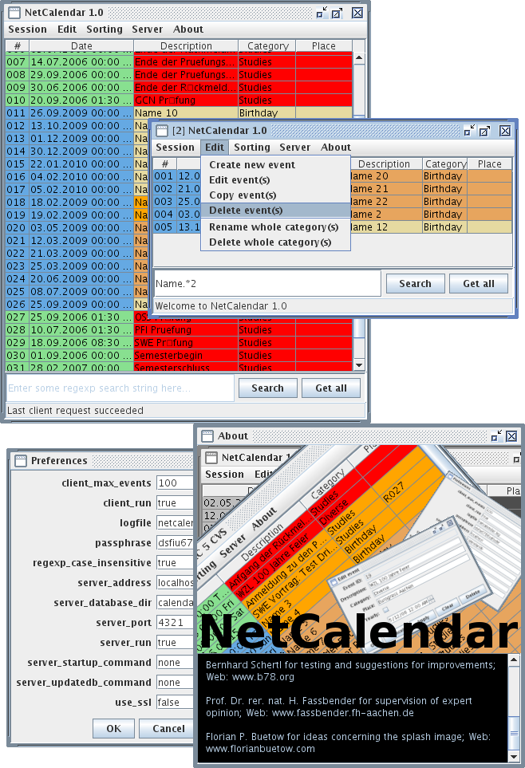](showcase/netcalendar/image-2.png)  

The implementation requires only a JRE 6+ and ships as a single executable JAR, with behavior controlled via command-line flags and either a `netcalendar.conf` file or the client's GUI preferences. Notable features include color-coded event display that communicates urgency at a glance (red for events within 24 hours, orange within a week, yellow within 28 days, plus distinct colors distinguishing yearly from one-time events), and compatibility with the traditional Unix `calendar` database (`~/.calendar`), letting users of that tool adopt NetCalendar without migrating their data. Secure deployments use standard Java keystore/truststore mechanisms configured through JVM system properties.

[View on GitHub](https://github.com/snonux/netcalendar)  

---

### 83. jsmstrade

* 💻 Languages: Java (76.0%), Shell (15.4%), XML (8.6%)
* 📚 Documentation: Markdown (100.0%)
* 📊 Commits: 14
* 📈 Lines of Code: 720
* 📄 Lines of Documentation: 8
* 🏷️ Tags: 0
* 📅 Development Period: 2008-06-21 to 2026-03-07
* 🏆 Score: 0.1 (combines recent activity, code size, tags, and release status)
* ⚖️ License: Custom License
* 🧪 Status: Experimental (no releases yet)

⚠️  **Notice**: This project appears to be inactive or no longer maintained. The average age of its last 42 commits exceeds 2 years. Use at your own risk.

[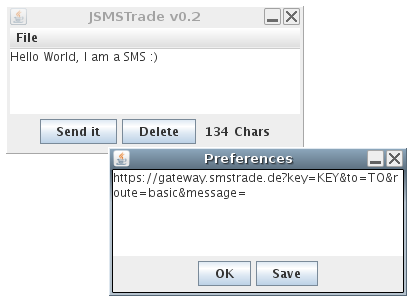](showcase/jsmstrade/image-1.png)  

JSMSTrade is a small, lightweight desktop application that provides a graphical interface for sending SMS messages through smstrade.de, a German SMS gateway service. Gateways like smstrade.de typically expose an HTTP API intended to be called from code, which makes sending a text via the service inconvenient for non-programmers or anyone who just wants to fire off a quick message. JSMSTrade addresses this by wrapping the gateway in a minimal GUI, so users can simply enter a recipient and message and send it directly from their computer—convenient for one-off texts, desktop-to-phone messaging, or low-volume SMS sending without needing a mobile device at hand. Its deliberately "minimal" scope keeps the tool focused on this single task without extra complexity.

Architecturally, the tool acts as a thin front-end over the smstrade.de API: based on the available README, it presumably gathers the recipient, message content, and sender options from the user, authenticates with the configured account credentials, and dispatches the request to the gateway for delivery. The "js" in the name suggests it may be implemented with JavaScript or web technologies, though the sparse documentation doesn't confirm the exact framework. It's worth noting that the project is deprecated—no further updates, bug fixes, or feature additions are planned—so anyone relying on it today does so at their own risk.

[View on GitHub](https://github.com/snonux/jsmstrade)  

---

### 84. template

* 💻 Languages: Make (89.2%), Shell (10.8%)
* 📚 Documentation: Text (100.0%)
* 📊 Commits: 23
* 📈 Lines of Code: 65
* 📄 Lines of Documentation: 232
* 🏷️ Tags: 1
* 📅 Development Period: 2013-03-22 to 2026-03-07
* 🏆 Score: 0.1 (combines recent activity, code size, tags, and release status)
* ⚖️ License: No license found
* 🧪 Status: Experimental (no releases yet)

⚠️  **Notice**: This project appears to be inactive or no longer maintained. The average age of its last 42 commits exceeds 2 years. Use at your own risk.

**Summary**

This project is a template (now deprecated and unmaintained) that provides a ready-made skeleton for packaging software as Debian packages (.deb files). It was tested with Debian Squeeze and Wheezy, and its purpose is to spare developers the boilerplate work of setting up Debian packaging from scratch—package metadata, build rules, changelog, and documentation—so they can clone it, rename everything to their project's name, and start shipping .deb packages. After installation, the packaged program is available as `/usr/bin/template` with a corresponding man page.

[View on GitHub](https://github.com/snonux/template)  

---

### 85. vs-sim

* 💻 Languages: Java (98.8%), Shell (0.7%), XML (0.4%)
* 📚 Documentation: LaTeX (98.3%), Text (1.4%), Markdown (0.3%)
* 📊 Commits: 396
* 📈 Lines of Code: 16303
* 📄 Lines of Documentation: 2905
* 🏷️ Tags: 0
* 📅 Development Period: 2008-05-15 to 2026-03-07
* 🏆 Score: 0.1 (combines recent activity, code size, tags, and release status)
* ⚖️ License: Custom License
* 🧪 Status: Experimental (no releases yet)

⚠️  **Notice**: This project appears to be inactive or no longer maintained. The average age of its last 42 commits exceeds 2 years. Use at your own risk.

[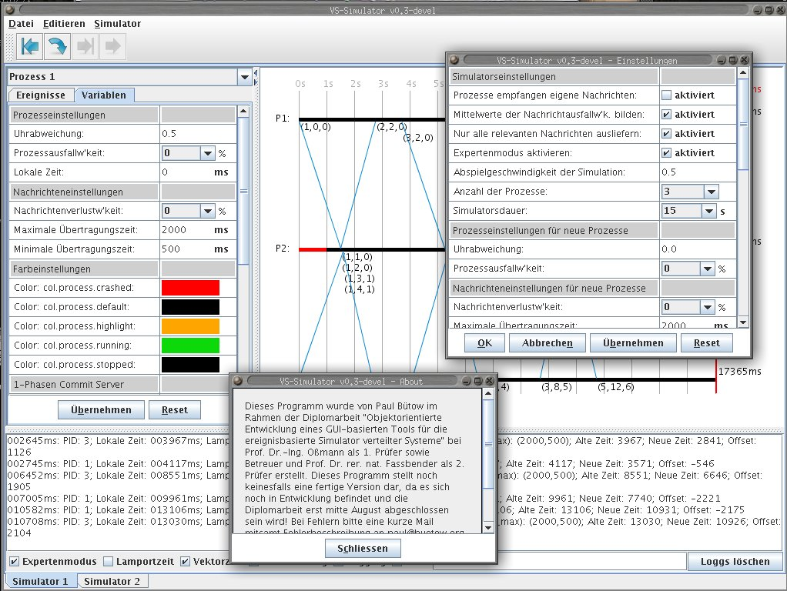](showcase/vs-sim/image-1.jpg)  

VS-Sim (short for "Verteilte Systeme Simulator," German for "Distributed Systems Simulator") is an open-source simulator for distributed systems, implemented in Java. The project originated as a diploma thesis at Aachen University of Applied Sciences, which gives it a distinctly academic character—such simulators are typically valuable for students and educators who want to model, visualize, and experiment with distributed system behavior without needing real networked infrastructure. By simulating distributed systems in a controlled environment, the tool enables users to explore how nodes interact, communicate, and behave under varying conditions in a repeatable way.

On the implementation side, VS-Sim is written entirely in Java, making it cross-platform, and screenshots in the repository suggest it provides a graphical interface for working with simulations. Notably, however, the project is now deprecated: the author has discontinued maintenance, and users are pointed toward its successor, ds-sim, hosted on Codeberg. The successor is described as a modernized and English-translated version of the project, so new users should start there rather than with VS-Sim itself.

[View on GitHub](https://github.com/snonux/vs-sim)  

---

### 86. perl-poetry

* 💻 Languages: Perl (100.0%)
* 📚 Documentation: Markdown (100.0%)
* 📊 Commits: 2
* 📈 Lines of Code: 191
* 📄 Lines of Documentation: 8
* 🏷️ Tags: 0
* 📅 Development Period: 2014-03-24 to 2014-03-24
* 🏆 Score: 0.1 (combines recent activity, code size, tags, and release status)
* ⚖️ License: No license found
* 🧪 Status: Experimental (no releases yet)

⚠️  **Notice**: This project appears to be inactive or no longer maintained. The average age of its last 42 commits exceeds 2 years. Use at your own risk.

**perl-poetry** is a collection of Perl programs written as poetry. Each piece consists of valid Perl source code that compiles successfully with the specified Perl version, but the code intentionally has no functional purpose—its entire value is aesthetic. The project sits at the intersection of programming and creative writing, showcasing how Perl's famously flexible and expressive syntax can be arranged so that source code reads like verse while still being syntactically correct. Its usefulness lies in entertainment and artistic expression, and in demonstrating the unusual degree of freedom Perl affords in how code can be structured and worded—making it a fun contribution to the tradition of code-as-art alongside things like obfuscated code contests.

In terms of implementation, the project is deliberately minimal: there is no framework, dependency management, or runtime architecture to speak of. It's simply a set of standalone Perl scripts, each crafted to satisfy two constraints simultaneously—the code must pass a compile/syntax check with the indicated Perl compiler, and it should "look nice" as poetry. The creative challenge underlying each piece is working within Perl's grammar rules (keywords, operators, punctuation, and variables) while shaping them into something that reads with poetic rhythm or imagery, rather than solving any computational problem.

[View on GitHub](https://github.com/snonux/perl-poetry)  

---

### 87. hsbot

* 💻 Languages: Haskell (98.5%), Make (1.5%)
* 📊 Commits: 81
* 📈 Lines of Code: 601
* 🏷️ Tags: 0
* 📅 Development Period: 2009-11-22 to 2026-03-07
* 🏆 Score: 0.1 (combines recent activity, code size, tags, and release status)
* ⚖️ License: Custom License
* 🧪 Status: Experimental (no releases yet)

⚠️  **Notice**: This project appears to be inactive or no longer maintained. The average age of its last 42 commits exceeds 2 years. Use at your own risk.

Unfortunately, this README doesn't contain enough information to write a meaningful summary of the project's purpose, features, or architecture. Beyond the deprecation notice, it only lists two dependency requirements:

From these dependencies alone, I can only infer a few things:

[View on GitHub](https://github.com/snonux/hsbot)  

---

### 88. jailman

* 📊 Commits: 0
* 📈 Lines of Code: 0
* 🏷️ Tags: 0
* 📅 Development Period:  to 
* 🏆 Score: 0.0 (combines recent activity, code size, tags, and release status)
* ⚖️ License: No license found
* 🧪 Status: Experimental (no releases yet)

I don't see a project shared in our conversation—there's no code, files, repository, or description included in your message.

To write the summary you're looking for, please share the project with me. You could paste:

[View on GitHub](https://github.com/snonux/jailman)  
