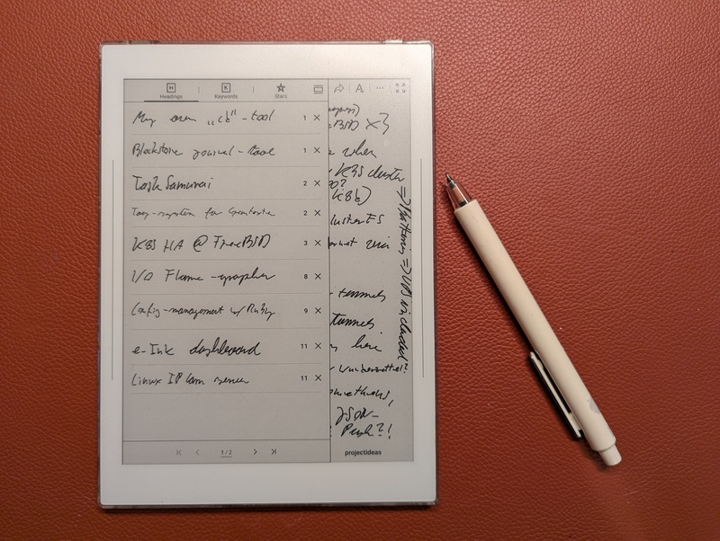
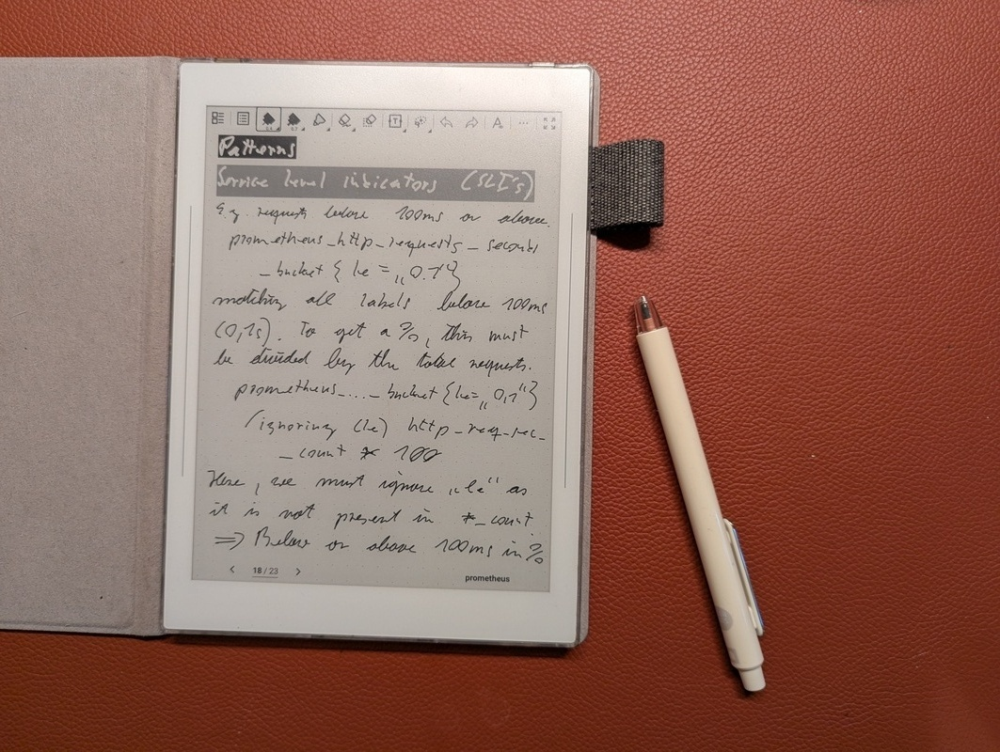

# Using Supernote Nomad offline

> Published at 2025-12-31T16:25:30+02:00

I take a lot of notes. For years I've been looking for a digital device to complement my paper notebooks, and the Supernote Nomad is it. I use it completely offline, no cloud sync, and in this post I'll explain why.

[Supernote Nomad](https://supernote.com/pages/supernote-nomad)  

I initially bought it because Ratta (the manufacturer of the Supernote) stated on their website that an open-source Linux firmware would be released soon. That was over a year ago, and there's still no sign of it (hopefully someday). In the meantime, I just use the Nomad as a plain offline device.

```
⣿⣿⣿⣿⣿⣿⡿⠿⠿⣿⣿⣿⣿⣿⣿⣿⣿⣿⣿⣿⣿⣿⣿⣿⣿⣿⣿⣿⣿⣿
⣿⣿⣿⣿⣿⣏⠀⢶⣆⡘⠉⠙⠛⠿⠿⣿⣿⣿⣿⣿⣿⣿⣿⣿⣿⣿⣿⣿⣿⣿
⣿⣿⣿⣿⣿⠋⣤⣄⠘⠃⢠⣀⣀⠀⠀⠀⠀⠀⠉⠉⠛⠛⠿⢿⣿⣿⣿⣿⣿⣿
⣿⣿⣿⣿⡿⠀⡉⠻⡟⠀⠈⠉⠙⠛⠷⠶⣦⣤⣄⣀⠀⠀⠀⠀⠀⣾⣿⣿⣿⣿
⣿⣿⣿⣿⡄⠸⢿⣤⠀⢠⣤⣀⡀⠀⠀⠀⠀⠀⠉⠙⠛⠻⠶⠀⢰⣿⣿⠻⣿⣿
⣿⣿⣿⣿⠠⣶⣆⡉⠀⠀⠈⠉⠙⠛⠳⠶⠦⣤⣤⣄⣀⡀⢀⣴⠟⠋⠙⢷⣬⣿
⣿⣿⣿⠏⣠⡄⠹⠁⠰⢶⣤⣤⣀⡀⠀⠀⠀⠀⠀⠉⢉⣿⠟⠁⠀⠀⣠⣾⣿⣿
⣿⣿⡿⠂⠙⠻⡆⠀⠀⠀⠀⠈⠉⠛⠛⠷⠶⣦⣤⣴⠟⠁⠀⠀⣠⣾⣿⣿⣿⣿
⣿⣿⡇⠸⣿⣄⠀⠰⠶⢶⣤⣄⣀⡀⠀⠀⠀⣴⣟⠁⠀⠀⣠⣾⣿⣿⣿⣿⣿⣿
⣿⡟⠀⣶⣀⠃⠀⠀⠀⠀⠀⠈⠉⠙⠛⠓⢾⡟⢙⣷⣤⢾⣿⣿⣿⣿⣿⣿⣿⣿
⣿⠋⣀⡉⠻⠀⠘⠛⠻⠶⢶⣤⣤⣀⡀⢠⠿⠟⠛⠉⠁⣸⣿⣿⣿⣿⣿⣿⣿⣿
⣿⡀⠛⠳⠆⠀⠀⠀⠀⠀⠀⠀⠉⠉⠛⠛⠷⠶⣦⠄⢀⣿⣿⣿⣿⣿⣿⣿⣿⣿
⣿⣿⣿⣶⣦⣀⣀⠀⠀⠀⠀⠀⠀⠀⠀⠀⠀⠀⠀⠀⣸⣿⣿⣿⣿⣿⣿⣿⣿⣿
⣿⣿⣿⣿⣿⣿⣿⣿⣿⣿⣶⣶⣤⣤⣀⣀⠀⠀⠀⢠⣿⣿⣿⣿⣿⣿⣿⣿⣿⣿
⣿⣿⣿⣿⣿⣿⣿⣿⣿⣿⣿⣿⣿⣿⣿⣿⣿⣷⣶⣾⣿⣿⣿⣿⣿⣿⣿⣿⣿⣿
```

## Table of Contents

* [⇢ Using Supernote Nomad offline](#using-supernote-nomad-offline)
* [⇢ ⇢ The Joy of Being Offline](#the-joy-of-being-offline)
* [⇢ ⇢ My Offline Workflow](#my-offline-workflow)
* [⇢ ⇢ ⇢ Converting Notes to PDF](#converting-notes-to-pdf)
* [⇢ ⇢ ⇢ Syncing to my Phone](#syncing-to-my-phone)
* [⇢ ⇢ ⇢ Firmware updates](#firmware-updates)
* [⇢ ⇢ The Writing Experience](#the-writing-experience)
* [⇢ ⇢ Conclusion](#conclusion)

## The Joy of Being Offline

I keep my Supernote Nomad offline at all times. No Wi-Fi, no cloud sync, just me and my notes. And honestly, it's great.

With Wi-Fi off, the battery lasts about a week on a single charge (how convenient :-)).

Privacy was my main concern, though. I don't sync anything to Ratta's cloud, so my notes stay mine. No one's reading or mining my stuff. Simple as that.

[](./using-supernote-nomad-offline/nomad2.jpg)  

## My Offline Workflow

My workflow is simple, only relying on a direct USB connection to my Linux laptop.

I connect my Supernote Nomad to my Linux laptop via a USB-C cable. The device is automatically recognized as a storage device, and I can directly access the `Note` folder, which contains all my notes as `.note` files. I then copy these files to a dedicated archive folder on my laptop.

### Converting Notes to PDF

To make my notes accessible and shareable, I convert them from the proprietary `.note` format to PDF. For this, I use the open-source `supernote-tool`. It's not an official Ratta tool, but it works well.

[https://github.com/jya-dev/supernote-tool](https://github.com/jya-dev/supernote-tool)  

I've created a small shell script to automate the conversion process using this tool. This script, `convert-notes-to-pdfs.sh`, resides in my notes archive folder:

```bash
#!/usr/bin/env bash

convert () {
  find . -name \*.note \
    | while read -r note; do
        echo supernote-tool convert -a -t pdf "$note" "${note/.note/.pdf}"
        supernote-tool convert -a -t pdf "$note" "${note/.note/.pdf}.tmp"
        mv "${note/.note/.pdf}.tmp" "${note/.note/.pdf}"
        du -hs "$note" "${note/.note/.pdf}"
        echo
      done
}

# Make the PDFs available on my Phone as well
copy () {
  if [ ! -d ~/Documents/Supernote ]; then
    echo "Directory ~/Documents/Supernote does not exist, skipping"
    exit 1
  fi

  rsync -delete -av --include='*/' --include='*.pdf' --exclude='*' . ~/Documents/Supernote/
  echo This was copied from $(pwd) so dont edit manually >~/Documents/Supernote/README.txt
}

convert
copy
```

### Syncing to my Phone

The `~/Documents/Supernote` folder on my laptop is synchronized with my phone using Syncthing. This way, I have access to all my notes in PDF format on my phone, wherever I go, without relying on any cloud service.

[https://syncthing.net/](https://syncthing.net/)  

### Firmware updates

Firmware updates usually arrive over Wi-Fi, but you can install them completely offline too. I download the update from the Supernote website, connect the Nomad to my Linux laptop via USB, copy the firmware `.zip` (without unzipping it) into the `Export` folder, and restart the device. That's it.

[How to update your Supernote](https://support.supernote.com/en_US/change-log/how-to-update-your-supernote)  

## The Writing Experience

Writing on the Nomad feels great. The screen texture plus the ceramic pen nib comes close to real paper, and there's basically no lag. It makes me want to take more notes.

[](./using-supernote-nomad-offline/nomad1.jpg)  

## Conclusion

Used offline, the Nomad gives me a private note-taking device without distractions, and the manual USB workflow means I keep all my data. Recommended, if you want a digital notebook and don't need the cloud.

The Supernote didn't fully replace my traditional paper journals, though. Each of them has its own use case. However, that is outside the scope of this blog post.

Other related posts:

[2026-01-01 Using Supernote Nomad offline (You are currently reading this)](./2026-01-01-using-supernote-nomad-offline.md)  
[2026-01-01 Cloudless Kobo Forma with KOReader](./2026-01-01-cloudless-kobo-forma-with-koreader.md)  

E-Mail your comments to `paul@nospam.buetow.org` :-)

[Back to the main site](../)  
