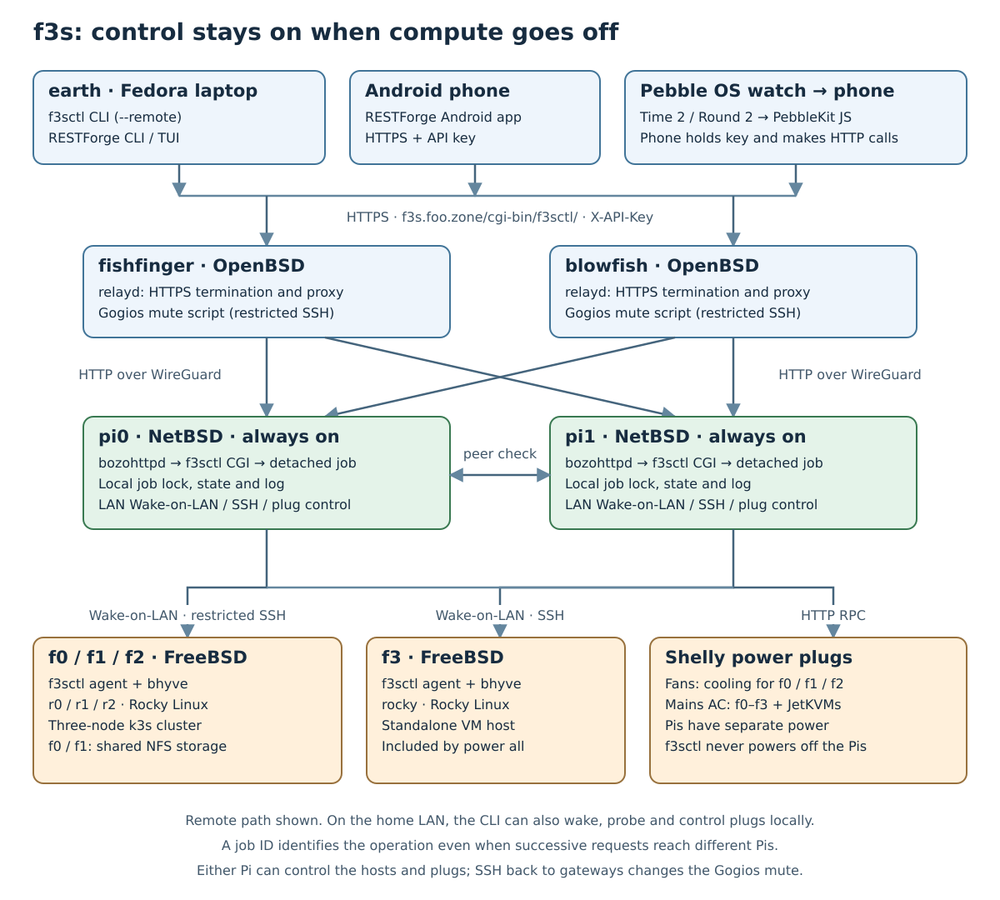
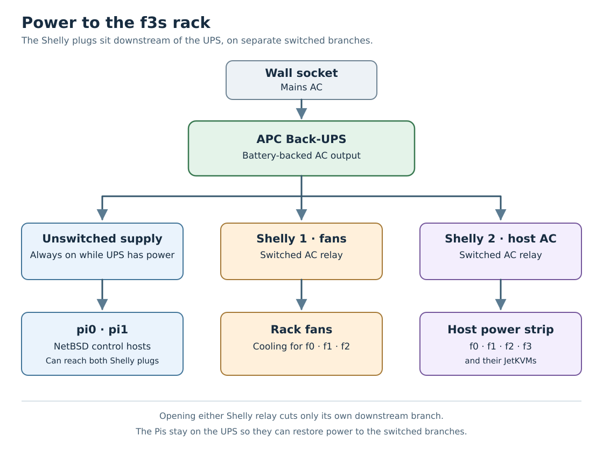
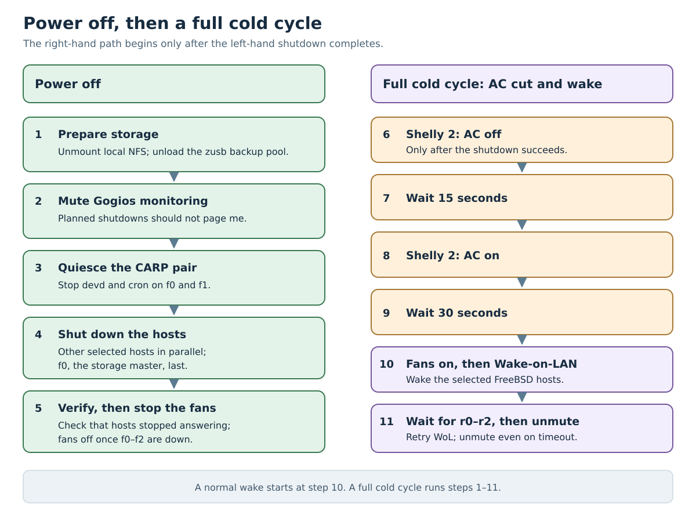
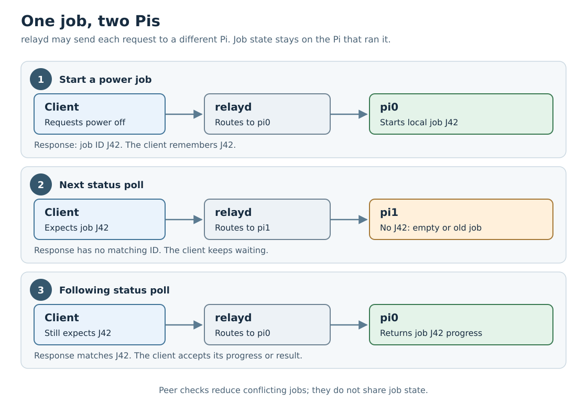
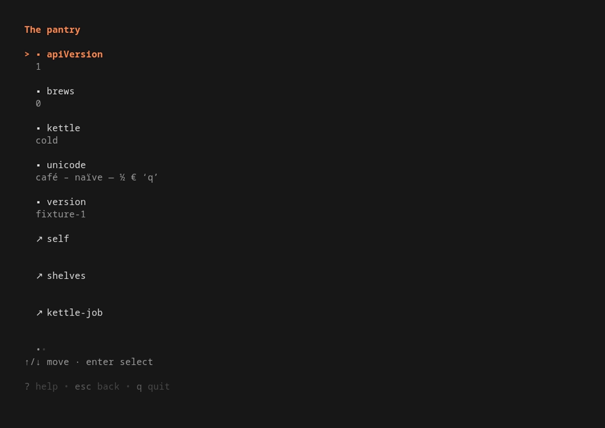
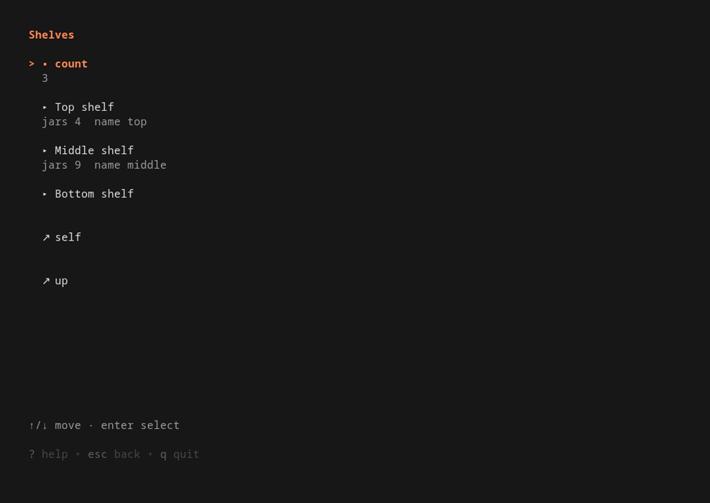
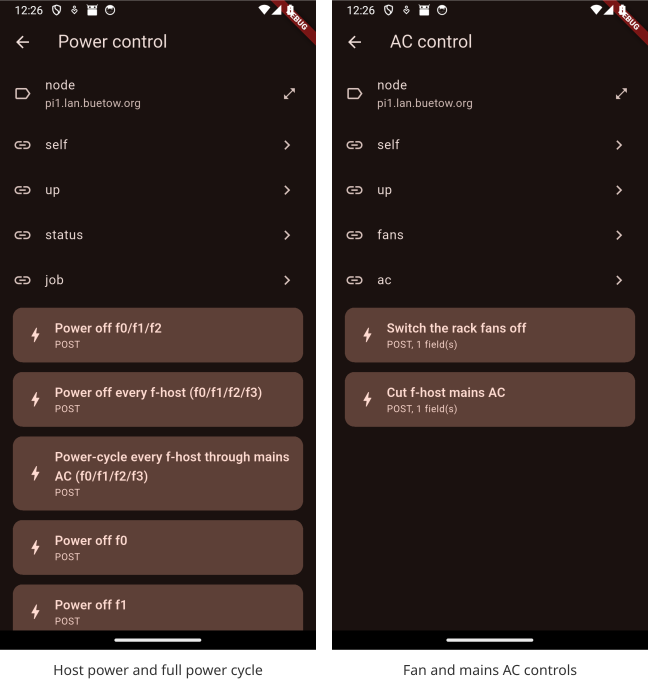

# f3s: Kubernetes with FreeBSD - Part 11: Remote control with f3sctl and RESTForge

> Published at 2026-11-01T00:00:00+02:00

This is the 11th post in the f3s series about my self-hosting home lab. f3s? The "f" stands for FreeBSD, and the "3s" stands for k3s, the Kubernetes distribution I use on FreeBSD-based physical machines.

[2024-11-17 f3s: Kubernetes with FreeBSD - Part 1: Setting the stage](./2024-11-17-f3s-kubernetes-with-freebsd-part-1.md)  
[2024-12-03 f3s: Kubernetes with FreeBSD - Part 2: Hardware and base installation](./2024-12-03-f3s-kubernetes-with-freebsd-part-2.md)  
[2025-02-01 f3s: Kubernetes with FreeBSD - Part 3: Protecting from power cuts](./2025-02-01-f3s-kubernetes-with-freebsd-part-3.md)  
[2025-04-05 f3s: Kubernetes with FreeBSD - Part 4: Rocky Linux Bhyve VMs](./2025-04-05-f3s-kubernetes-with-freebsd-part-4.md)  
[2025-05-11 f3s: Kubernetes with FreeBSD - Part 5: WireGuard mesh network](./2025-05-11-f3s-kubernetes-with-freebsd-part-5.md)  
[2025-07-14 f3s: Kubernetes with FreeBSD - Part 6: Storage](./2025-07-14-f3s-kubernetes-with-freebsd-part-6.md)  
[2025-10-02 f3s: Kubernetes with FreeBSD - Part 7: k3s and first pod deployments](./2025-10-02-f3s-kubernetes-with-freebsd-part-7.md)  
[2025-12-07 f3s: Kubernetes with FreeBSD - Part 8: Observability](./2025-12-07-f3s-kubernetes-with-freebsd-part-8.md)  
[2025-12-14 f3s: Kubernetes with FreeBSD - Part 8b: Distributed Tracing with Tempo](./2025-12-14-f3s-kubernetes-with-freebsd-part-8b.md)  
[2026-04-02 f3s: Kubernetes with FreeBSD - Part 9: GitOps with ArgoCD](./2026-04-02-f3s-kubernetes-with-freebsd-part-9.md)  
[2026-09-01 f3s: Kubernetes with FreeBSD - Part 10: A New Home](./2026-09-01-f3s-kubernetes-with-freebsd-part-10.md)  
[2026-11-01 f3s: Kubernetes with FreeBSD - Part 11: Remote control with f3sctl and RESTForge (You are currently reading this)](./2026-11-01-f3s-kubernetes-with-freebsd-part-11.md)  

[](./f3s-kubernetes-with-freebsd-part-1/f3slogo.png)  

Some home labs run 24/7. My FreeBSD cluster doesn't. The power draw, fan noise and hardware wear aren't worth it when I don't need the machines, so the f-hosts stay off until I do. I wake the cluster when I need it and shut it down when I'm done.

Turning the cluster off is mostly straightforward. Getting it back on while I'm away from home needs a little more thought. This part of my f3s series is about `f3sctl`, the tool I created to control the hosts, their power plugs and monitoring from my laptop, phone, and even a Pebble watch.

## Table of Contents

* [⇢ f3s: Kubernetes with FreeBSD - Part 11: Remote control with f3sctl and RESTForge](#f3s-kubernetes-with-freebsd---part-11-remote-control-with-f3sctl-and-restforge)
* [⇢ ⇢ Something has to stay on](#something-has-to-stay-on)
* [⇢ ⇢ From the internet to the rack](#from-the-internet-to-the-rack)
* [⇢ ⇢ Commands from earth](#commands-from-earth)
* [⇢ ⇢ What it can control now](#what-it-can-control-now)
* [⇢ ⇢ ⇢ Hosts and guests](#hosts-and-guests)
* [⇢ ⇢ ⇢ Fans](#fans)
* [⇢ ⇢ ⇢ Mains power](#mains-power)
* [⇢ ⇢ ⇢ Monitoring mute](#monitoring-mute)
* [⇢ ⇢ ⇢ Monitoring reports](#monitoring-reports)
* [⇢ ⇢ ⇢ Jobs and API discovery](#jobs-and-api-discovery)
* [⇢ ⇢ Switching off in the right order](#switching-off-in-the-right-order)
* [⇢ ⇢ Two Pis, one job](#two-pis-one-job)
* [⇢ ⇢ RESTForge: let the API supply the menu](#restforge-let-the-api-supply-the-menu)
* [⇢ ⇢ ⇢ A second Shelly plug, no app updates](#a-second-shelly-plug-no-app-updates)
* [⇢ ⇢ ⇢ The same API on three screens](#the-same-api-on-three-screens)
* [⇢ ⇢ ⇢ In the terminal](#in-the-terminal)
* [⇢ ⇢ ⇢ On Android](#on-android)
* [⇢ ⇢ ⇢ From a Pebble OS watch](#from-a-pebble-os-watch)

## Something has to stay on

My three FreeBSD mini-PCs, `f0`, `f1` and `f2`, each run a Rocky Linux virtual machine under bhyve. Those guests, `r0` through `r2`, form the Kubernetes cluster. A fourth FreeBSD host, `f3`, runs a separate Rocky Linux VM and isn't part of k3s.

The control service can't live inside the cluster: shutting down the cluster would shut down the only way to wake it again. So it runs on `pi0` and `pi1`, my two always-on Raspberry Pis running NetBSD. They already serve static sites with bozohttpd, NetBSD's small web server. It can run f3sctl as a CGI program too, starting it for each API request.

[f3sctl source code](https://github.com/snonux/f3sctl)  

I use `earth`, my main Fedora laptop, to run the f3sctl command-line interface or browse the same API with RESTForge, another tool I wrote. RESTForge also has Android and Pebble OS apps. More on those below.

[RESTForge source code](https://github.com/snonux/restforge)  

## From the internet to the rack

The public entry point is `https://f3s.foo.zone/cgi-bin/f3sctl/`. My two OpenBSD gateways, `fishfinger` and `blowfish`, run relayd. Either gateway can forward requests over WireGuard to the NetBSD Pis, with relayd balancing requests between `pi0` and `pi1`.

[relayd manual](https://man.openbsd.org/relayd)  
[WireGuard](https://www.wireguard.com/)  

[](./f3s-kubernetes-with-freebsd-part-11/setup.svg)  

HTTPS terminates at the gateways; the HTTP connection to the Pis travels inside WireGuard. The Pi receiving the request runs f3sctl as a CGI program under bozohttpd. For a longer operation, it starts a detached job and returns a job ID. The client can then follow progress without holding the original request open for the whole shutdown.

From the Pis, Wake-on-LAN packets wake the FreeBSD hosts, restricted SSH commands shut them down, and HTTP requests control the Shelly plugs. One plug powers the rack fans for `f0` through `f2`; another controls mains power for `f0` through `f3` and their JetKVM devices for remote console access. All three power branches come from the UPS (uninterruptible power supply). The Pis have an unswitched branch, so f3sctl never switches them off.

[](./f3s-kubernetes-with-freebsd-part-11/power-lines.svg)  

A Shelly plug is a smart socket with a relay and a small Wi-Fi server inside. It gets an IP address on my LAN and answers HTTP RPC calls. `Switch.Set?id=0&on=true` closes the relay and turns on whatever is plugged in; `Switch.GetStatus` reads its state. Both calls need HTTP digest auth with the plug's admin password, which f3sctl reads from a protected file. The relay takes a moment to flip, so f3sctl reads the state back after every `Switch.Set` instead of trusting the acknowledgement. It all happens on the LAN, with no cloud in between.

[](./f3s-kubernetes-with-freebsd-part-11/shelly-plug.jpg)  

The fan plug already showed up in Part 10, where a shell script on the Pis flipped the fans with a single HTTP request. f3sctl took over that job and later added the second plug for mains AC.

[f3s: Kubernetes with FreeBSD - Part 10: A New Home](./2026-09-01-f3s-kubernetes-with-freebsd-part-10.md)  

The same Go program runs in three modes: as a CLI on earth, as CGI on the Pis, and as a restricted agent on the FreeBSD hosts. The OpenBSD gateways don't need the f3sctl binary. Besides forwarding requests, they run a small forced-command script to set and clear the Gogios mute marker. Gogios is my monitoring system, and I don't want alerts when I shut down the cluster on purpose.

[Read KISS server monitoring with Gogios](./2023-06-01-kiss-server-monitoring-with-gogios.md)  

## Commands from earth

The basic commands are still short. These examples assume the API URL and key are configured; they show commands to run, not a captured shutdown session:

```sh
f3sctl --remote power status
f3sctl --remote power on
f3sctl --remote power off
```

`--remote` sends the request to a Pi. That's important for Wake-on-LAN: its magic packet is a local broadcast, so a Pi must send it on the home LAN when I'm away.

On earth, the per-user configuration is `~/.config/f3sctl.json`. For example, with the key stored separately in a private file:

```json
{
  "api_url": "https://f3s.foo.zone/cgi-bin/f3sctl/",
  "api_key_file": "/home/paul/.config/f3sctl/apikey"
}
```

The API key travels in the `X-API-Key` header. Putting it in the URL would also put it in access logs, so the API doesn't accept that. Each client can have its own key; both Pis must accept the same set because either one may receive a request.

[The full key management runbook](https://github.com/snonux/f3sctl/blob/main/docs/API-KEYS.md)  

## What it can control now

The current command set has six groups. The storage work described later is part of the shutdown procedure.

### Hosts and guests

* `power status` probes the FreeBSD hosts and the k3s nodes.
* `power on` and `power off` operate on `f0`, `f1` and `f2`, with the rack fan and monitoring handling included.
* `power all on` and `power all off` include the standalone `f3` host too.
* `power f0 on` and `power f0 off` target one host. The same works for `f1`, `f2` and `f3`.
* `power all cycle` shuts down all four hosts, cuts mains AC, restores it and wakes them again.

A single-host shutdown leaves the fans and Gogios mute alone. It stops that host's guests as part of shutting the host down; there isn't a separate command here to start or stop an arbitrary bhyve VM or Kubernetes deployment.

### Fans

`fans status`, `fans on` and `fans off` control the fan plug. f3sctl refuses to turn the fans off while any of `f0`, `f1` or `f2` may still be running, or while a power job is in flight. `f3` doesn't need these fans for its usual workload, so its power state doesn't keep them on.

### Mains power

Sometimes a host gets stuck and only a cold power cycle helps. That happened once while I was away for a week. I had to run the Kubernetes cluster on two of its three nodes until I got back. That was annoying enough to make me add remote mains control.

`ac status`, `ac on` and `ac off` control the f-host mains plug. This is separate from asking an operating system to shut down. f3sctl refuses to cut AC while any f-host may be up or a power job is running.

Both `fans off` and `ac off` have an explicit `--force` override. Switching a plug on remains available without the job guard, so a stale job record doesn't prevent restoring power or cooling.

### Monitoring mute

`monitoring status`, `monitoring mute` and `monitoring unmute` report or change the Gogios alerting mute. A planned shutdown shouldn't page me about the hosts I just switched off! The explicit unmute command is also handy if an interrupted local wake left monitoring muted.

### Monitoring reports

`gogios` (or `gogios status`) shows the report overview. I can drill into `critical`, `warning`, `unknown`, `stale`, `suppressed` and `ok`, then ask for a check's full detail:

```sh
f3sctl --remote gogios critical
f3sctl --remote gogios detail 'name of a check from the report'
f3sctl --remote gogios cache clear
```

The last command clears the report cache so the next read fetches it again. These reports and the mute controls are also browsable through the API.

### Jobs and API discovery

The API exposes the current or last power job, including its ID, progress and outcome. It also exposes the host and plug status, the monitoring reports, and an OpenAPI description. RESTForge follows those links to display them. `version` prints the CLI version, while the API root reports its version and serving node too.

## Switching off in the right order

The interesting part of `power off` is what happens before the hosts disappear. Kubernetes uses storage exported by the FreeBSD machines, so shutting them down in an arbitrary order is asking for stuck NFS (Network File System) clients. NFS is one of the pain points in my setup. I hope to replace it with my own filesystem one day; HomelabFS is an early attempt at that.

[HomelabFS on GitHub](https://github.com/snonux/homelabfs)  

The shutdown procedure first checks local NFS mounts and unmounts them, refusing to continue if they are stuck. It then unloads the removable `zusb` backup pool wherever it is imported, allowing its snapshot, clean export and disk spin-down to finish before losing power. Gogios gets muted before the hosts go away.

Next comes the storage failover pair. CARP is the mechanism that lets `f0` and `f1` share a virtual IP address for storage. During shutdown, f3sctl stops `devd` and `cron` on that pair so a failover or scheduled failback doesn't start storage services on a host that is itself going down. NFS stays available while the guests still need it.

The other selected hosts then shut down in parallel. The configured storage master, `f0`, shuts down last.

Finally, f3sctl checks that the hosts stopped answering and switches off the rack fans only once `f0` through `f2` are down. A timing summary in the job log shows where the time went. Network silence is the check available here; it isn't a physical power sensor.

To wake the cluster, f3sctl turns on the fans, sends Wake-on-LAN magic packets, and waits for `r0`, `r1` and `r2` to answer before unmuting Gogios. It sends the packets again every two minutes while waiting. If a node never comes back before the timeout, f3sctl unmutes monitoring anyway and reports a failure. Otherwise the broken host would remain hidden behind the mute.

The full cold cycle adds two waits: 15 seconds with AC off, then 30 seconds after restoring AC before sending wake packets. If any host still responds to pings, f3sctl refuses to cut mains. It also attempts to restore AC if the job is interrupted during the power-off wait.

[](./f3s-kubernetes-with-freebsd-part-11/power-sequence.svg)  

## Two Pis, one job

There is a small complication with load balancing. A job can start on `pi0`, while the next status request lands on `pi1`. Host status describes the same physical machines from either Pi, but job state belongs to the Pi that ran the job.

So clients must match the job ID. An old result from the other Pi doesn't mean the new job failed, and an empty response doesn't mean it finished. Every response also has an `X-F3sctl-Node` header to make the serving node visible.

[](./f3s-kubernetes-with-freebsd-part-11/two-pis-one-job.svg)  

Each Pi uses a local lock and checks its peer before starting a power job. That reduces conflicts, though it isn't a distributed lock. I don't have shared storage that's independent of the cluster I'm switching off. For my home lab, the peer check is good enough.

The SSH side is deliberately narrow too. Normally, an SSH key can give you a shell on the remote machine. The Pis' key can reach only the restricted f3sctl agent.

On each FreeBSD host, the `authorized_keys` entry for the agent account accepts the key only from `pi0` and `pi1`. `ForceCommand` in `sshd_config` runs `f3sctl agent` instead of a shell, regardless of the command the Pi asks for.

The agent accepts exactly five bare verbs: `probe`, `zusb-status`, `zusb-unload`, `carp-quiesce` and `poweroff`. One word, no arguments, nothing interpolated, nothing that reaches a shell. The verbs that need root re-enter the binary through `doas`, with an exact-command rule per verb rather than a general grant.

The agent account is unprivileged. Its `authorized_keys` file lives in a root-owned path outside its home directory, so the account can't add more keys.

On the Pis, the CGI process needs no special privileges: Wake-on-LAN is an unprivileged broadcast, ping comes from the setuid `ping` binary, and SSH uses the restricted identity.

## RESTForge: let the API supply the menu

RESTForge lets me use f3sctl without memorising commands. It browses Siren, a JSON format for hypermedia APIs. “Hypermedia” sounds rather grand, but the idea is familiar from browsing a website: a response contains information, plus links and actions I can follow.

[Siren hypermedia format](https://github.com/kevinswiber/siren)  

In Siren, properties describe the current state, sub-entities describe related things, and links lead to other resources. An action describes something I can do: its name and title, the URL to submit to, the HTTP method and any input fields. So the server supplies enough information for RESTForge to draw the menu and submit a request without knowing what a particular button does to my homelab.

For f3sctl, the root leads to power control, AC control, Gogios and read-only resources. The API decides which operations to offer in the current state. RESTForge doesn't need a hard-coded list of f-hosts, shutdown rules or API paths. It displays the Siren document and follows what that document offers.

### A second Shelly plug, no app updates

I recently added a second Shelly plug to cut and restore mains power to all the f-hosts. The first plug controls the fans; this one lets me do a full power cycle. That meant adding the plug control and cold-cycle procedure to f3sctl, then exposing the new status, links and actions in its REST responses.

I didn't have to update any of the RESTForge apps. No new terminal build, Android APK or Pebble watch app. Once they fetched the updated Siren documents, they displayed the AC controls and full power-cycle action. The labels and request details came from the server, just like the older controls.

The whole shutdown, AC-off wait, AC restore and wake sequence still runs in f3sctl. RESTForge submits the advertised action and watches the resulting job. It doesn't need to know that I've added another plug, which hosts that plug powers, or how long their power supplies need to drain.

That's the useful part of Siren for me: I can add features on the server without updating three clients. This works as long as the new feature uses Siren fields and job behaviour the clients already understand. A new kind of interaction would still need client changes.

### The same API on three screens

The terminal screenshots below come from RESTForge's repository and use its “pantry” demo API, with shelves and a kettle instead of servers and power plugs. The Android screenshots were captured in an emulator connected to my real f3sctl backend. The watch section also includes actual f3sctl screens, plus a labelled demo of job progress.

### In the terminal

Running `restforge` opens the terminal user interface, or TUI. It has a backend picker, browsable documents, confirmation prompts, settings and saved shortcuts. Arrow keys or vi-style keys move through the rows, and `/` filters the list.

[](./f3s-kubernetes-with-freebsd-part-11/restforge-tui-document.png)  
[](./f3s-kubernetes-with-freebsd-part-11/restforge-tui-entities.png)  

These two frames come from the repository's terminal recording. On earth, I can configure an `f3s` backend with the public API base URL, `X-API-Key` as the auth header, and my client key. Then I browse power control and monitoring in the same way.

There are one-shot commands as well. After configuring that backend, these are read-only examples:

```sh
restforge --backend f3s get
restforge --backend f3s get --rel power
restforge --backend f3s get --output json
```

`restforge act` invokes a server-advertised action, with `--yes` providing confirmation for a state-changing request. For scripting a known homelab operation I can keep using f3sctl; for exploring what an API currently offers, RESTForge gives me a menu.

[RESTForge terminal client and usage](https://github.com/snonux/restforge/tree/main/cli)  

### On Android

The Android version is written in Flutter. I add the backend URL and key in its settings, then tap through properties, links and actions. The app uses secure storage for the secret. The terminal version instead keeps it in its private TOML configuration file.

[](./f3s-kubernetes-with-freebsd-part-11/restforge-android-row.svg)  

Here the app is showing the real host power and AC menus, including the full power-cycle action added for the second Shelly plug. These captures only browse the available controls; no power action was submitted to take them. Selecting an action opens its confirmation prompt. Once confirmed, the app follows the job and refreshes the document to find out what changed.

[RESTForge Android app](https://github.com/snonux/restforge/tree/main/flutter)  
[My F-Droid repository, including RESTForge](https://github.com/snonux/fdroid)  

### From a Pebble OS watch

And then there is the smallest client: the RESTForge Pebble OS watch app. It targets the Pebble Time 2 and Pebble Round 2. The same API menu fits on the watch, with physical buttons for moving between rows and selecting an entry. A long press on Select refreshes the document.

[")](./f3s-kubernetes-with-freebsd-part-11/restforge-pebble-round-row.svg)  
[")](./f3s-kubernetes-with-freebsd-part-11/restforge-pebble-time-row.svg)  

The watch doesn't make the HTTP requests itself. PebbleKit JavaScript in the phone companion handles requests, navigation, API parsing and job polling. It sends rendered text to the watch; the watch sends back which row I pressed. The API key and URLs stay on the phone.

Backend configuration lives in the Pebble phone app's settings for RESTForge. Pointing it at f3sctl therefore gives the watch the same power and monitoring menus without teaching the watch anything about FreeBSD or Kubernetes. The phone needs to be connected for this to work; the standalone RESTForge Android app isn't the bridge used by the watch.

[RESTForge Pebble OS app](https://github.com/snonux/restforge/tree/main/pebble)  
[RESTForge in the Pebble Appstore](https://apps.repebble.com/restforge_931683527605431e96bf2772)  

A watch button is a funny place for a FreeBSD shutdown to begin. The request still goes through the always-on Pis, and f3sctl waits for the guests, storage and hosts in the right order. That's where most of the work went.

Other *BSD-related posts:

[2026-11-01 f3s: Kubernetes with FreeBSD - Part 11: Remote control with f3sctl and RESTForge (You are currently reading this)](./2026-11-01-f3s-kubernetes-with-freebsd-part-11.md)  
[2026-09-01 f3s: Kubernetes with FreeBSD - Part 10: A New Home](./2026-09-01-f3s-kubernetes-with-freebsd-part-10.md)  
[2026-04-02 f3s: Kubernetes with FreeBSD - Part 9: GitOps with ArgoCD](./2026-04-02-f3s-kubernetes-with-freebsd-part-9.md)  
[2025-12-14 f3s: Kubernetes with FreeBSD - Part 8b: Distributed Tracing with Tempo](./2025-12-14-f3s-kubernetes-with-freebsd-part-8b.md)  
[2025-12-07 f3s: Kubernetes with FreeBSD - Part 8: Observability](./2025-12-07-f3s-kubernetes-with-freebsd-part-8.md)  
[2025-10-02 f3s: Kubernetes with FreeBSD - Part 7: k3s and first pod deployments](./2025-10-02-f3s-kubernetes-with-freebsd-part-7.md)  
[2025-07-14 f3s: Kubernetes with FreeBSD - Part 6: Storage](./2025-07-14-f3s-kubernetes-with-freebsd-part-6.md)  
[2025-05-11 f3s: Kubernetes with FreeBSD - Part 5: WireGuard mesh network](./2025-05-11-f3s-kubernetes-with-freebsd-part-5.md)  
[2025-04-05 f3s: Kubernetes with FreeBSD - Part 4: Rocky Linux Bhyve VMs](./2025-04-05-f3s-kubernetes-with-freebsd-part-4.md)  
[2025-02-01 f3s: Kubernetes with FreeBSD - Part 3: Protecting from power cuts](./2025-02-01-f3s-kubernetes-with-freebsd-part-3.md)  
[2024-12-03 f3s: Kubernetes with FreeBSD - Part 2: Hardware and base installation](./2024-12-03-f3s-kubernetes-with-freebsd-part-2.md)  
[2024-11-17 f3s: Kubernetes with FreeBSD - Part 1: Setting the stage](./2024-11-17-f3s-kubernetes-with-freebsd-part-1.md)  
[2024-04-01 KISS high-availability with OpenBSD](./2024-04-01-KISS-high-availability-with-OpenBSD.md)  
[2024-01-13 One reason why I love OpenBSD](./2024-01-13-one-reason-why-i-love-openbsd.md)  
[2022-10-30 Installing DTail on OpenBSD](./2022-10-30-installing-dtail-on-openbsd.md)  
[2022-07-30 Let's Encrypt with OpenBSD and Rex](./2022-07-30-lets-encrypt-with-openbsd-and-rex.md)  
[2016-04-09 Jails and ZFS with Puppet on FreeBSD](./2016-04-09-jails-and-zfs-on-freebsd-with-puppet.md)  

E-Mail your comments to `paul@nospam.buetow.org` :-)

[Back to the main site](../)  
